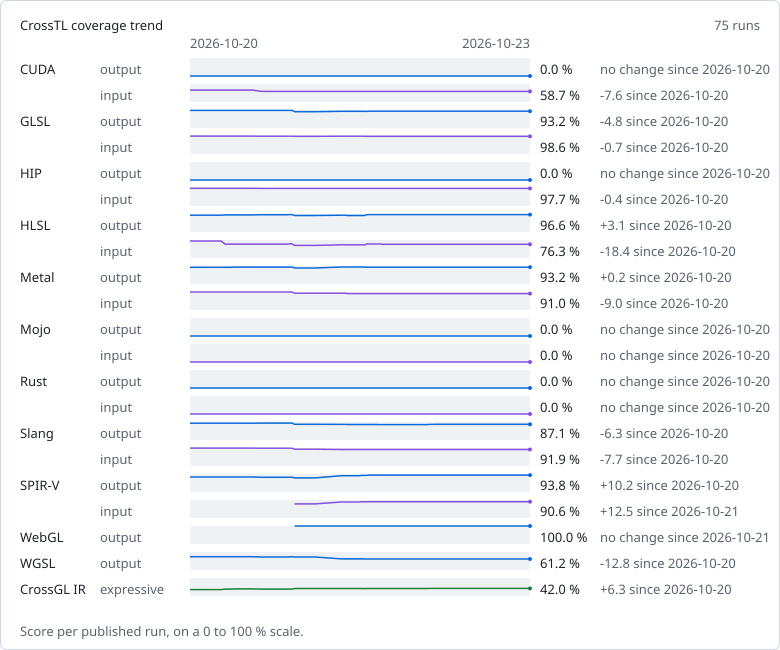

# CrossTL coverage

Measured on commit [`897aca1`](https://github.com/CrossGL/crosstl/commit/897aca18951782e6a59b41b5d1f5fe95f4037f1d) at 2026-10-23T09:16:38Z (CrossTL 3.4.0) by the [Coverage workflow](https://github.com/CrossGL/crosstl/actions/workflows/coverage.yml), which publishes this file on every push to `main` and nightly. Run `python -m tools.coverage run` to measure locally.

Every feature in a pinned upstream feature list gets a generated probe. For output, CrossTL translates a CrossGL probe to the language; for input, it imports a native probe and translates it back. The native SPIR-V probe is the module glslang compiles the GLSL probe to, and its round trip must keep the feature's instruction. The language's reference tool then validates the result:

- **supported**: the reference tool accepts the translation;
- **refused**: CrossTL rejects the feature with a diagnostic;
- **wrong**: CrossTL produces output the reference tool rejects, or fails without a diagnostic;
- **untested**: no probe can be built for the feature yet, or the reference tool rejects the probe itself.

Score = supported / (supported + refused + wrong). Untested features are shown separately and do not count. The CrossGL IR row covers the union of every language's output features, merged into semantic features through the SPIR-V each native probe lowers to; a semantic feature is expressible when its CrossGL probe translates correctly to at least one language that has it.

| Language | Direction | Score | Supported | Refused | Wrong | Untested |
|---|---|---:|---:|---:|---:|---:|
| CUDA | output | 0.0 % | 0 | 0 | 504 | 0 |
| CUDA | input | 58.7 % | 296 | 0 | 208 | 0 |
| GLSL | output | 93.2 % | 207 | 2 | 13 | 0 |
| GLSL | input | 98.6 % | 219 | 0 | 3 | 0 |
| HIP | output | 0.0 % | 0 | 0 | 388 | 0 |
| HIP | input | 97.7 % | 379 | 0 | 9 | 0 |
| HLSL | output | 96.6 % | 514 | 14 | 4 | 11 |
| HLSL | input | 76.3 % | 406 | 21 | 105 | 11 |
| Metal | output | 93.2 % | 248 | 12 | 6 | 1 |
| Metal | input | 91.0 % | 242 | 2 | 22 | 1 |
| Mojo | output | 0.0 % | 0 | 1 | 111 | 0 |
| Mojo | input | 0.0 % | 0 | 0 | 112 | 0 |
| Rust | output | 0.0 % | 0 | 9 | 343 | 12 |
| Rust | input | 0.0 % | 0 | 27 | 321 | 16 |
| Slang | output | 87.1 % | 323 | 6 | 42 | 19 |
| Slang | input | 91.9 % | 341 | 6 | 24 | 19 |
| SPIR-V | output | 93.8 % | 122 | 8 | 0 | 3 |
| SPIR-V | input | 90.6 % | 116 | 9 | 3 | 5 |
| WebGL | output | 100.0 % | 113 | 0 | 0 | 0 |
| WebGL | input | not offered | | | | |
| WGSL | output | 61.2 % | 109 | 1 | 68 | 2 |
| WGSL | input | not offered | | | | |
| CrossGL IR | expressiveness | 42.0 % | 612 | 35 | 811 | 43 |

WebGL input is not offered: CrossTL has no WebGL source frontend.
WGSL input is not offered: CrossTL has no WGSL source frontend.

## Trend

## By category

Each cell counts the supported features of a category over its supported, refused and wrong ones. Untested features are left out, and a blank cell means none of the category's features could be measured.

| Language | Direction | compute | control-flow | function | method | resource | stage | type |
|---|---|---:|---:|---:|---:|---:|---:|---:|
| CUDA | output | 0/5 | 0/13 | 0/469 | | 0/4 | 0/1 | 0/12 |
| CUDA | input | 1/5 | 12/13 | 277/469 | | 4/4 | 1/1 | 1/12 |
| GLSL | output | 5/5 | 14/14 | 159/170 | | 4/4 | 10/14 | 15/15 |
| GLSL | input | 5/5 | 14/14 | 168/170 | | 4/4 | 13/14 | 15/15 |
| HIP | output | 0/5 | 0/13 | 0/353 | | 0/4 | 0/1 | 0/12 |
| HIP | input | 5/5 | 13/13 | 347/353 | | 4/4 | 1/1 | 9/12 |
| HLSL | output | 4/4 | 14/14 | 195/198 | 271/285 | 4/4 | 13/14 | 13/13 |
| HLSL | input | 4/4 | 14/14 | 195/198 | 162/285 | 4/4 | 14/14 | 13/13 |
| Metal | output | 5/5 | 14/14 | 208/223 | | 4/4 | 4/7 | 13/13 |
| Metal | input | 5/5 | 14/14 | 203/223 | | 4/4 | 3/7 | 13/13 |
| Mojo | output | 0/5 | 0/10 | 0/81 | | 0/2 | 0/1 | 0/13 |
| Mojo | input | 0/5 | 0/10 | 0/81 | | 0/2 | 0/1 | 0/13 |
| Rust | output | 0/5 | 0/13 | 0/301 | | 0/4 | 0/14 | 0/15 |
| Rust | input | 0/5 | 0/13 | 0/299 | | 0/4 | 0/12 | 0/15 |
| Slang | output | 4/5 | 14/14 | 275/319 | | 4/4 | 12/14 | 14/15 |
| Slang | input | 4/5 | 14/14 | 295/319 | | 4/4 | 9/14 | 15/15 |
| SPIR-V | output | 5/5 | 14/14 | 72/78 | | 4/4 | 12/14 | 15/15 |
| SPIR-V | input | 5/5 | 14/14 | 70/76 | | 4/4 | 12/14 | 11/15 |
| WebGL | output | | 14/14 | 89/89 | | 2/2 | 2/2 | 6/6 |
| WGSL | output | 5/5 | 9/14 | 81/144 | | 4/4 | 3/3 | 7/8 |
| CrossGL IR | expressiveness | 5/5 | 14/14 | 466/1300 | 94/106 | 4/4 | 14/14 | 15/15 |

## Feature lists

| Language | Feature list | Pinned at |
|---|---|---|
| CUDA | [LLVM 23.1.3 device-side CUDA Math API wrappers](https://github.com/llvm/llvm-project/blob/0d261d1ca552c95a8f007e061c787ac7132fbcbc/clang/lib/Headers/__clang_cuda_math.h) | `0d261d1ca552` |
| CUDA | [LLVM 23.1.3 CUDA intrinsic and atomic wrappers](https://github.com/llvm/llvm-project/blob/0d261d1ca552c95a8f007e061c787ac7132fbcbc/clang/lib/Headers/__clang_cuda_device_functions.h) | `0d261d1ca552` |
| GLSL | [GLSL 4.60 specification, chapter 8 (built-in functions)](https://github.com/KhronosGroup/GLSL/blob/0099bf83b0288469917fc2e2972cb0a2b74d6711/chapters/builtinfunctions.adoc) | `0099bf83b028` |
| HIP | [LLVM 17.0.6 device-side HIP math functions and intrinsics](https://github.com/llvm/llvm-project/blob/6009708b4367171ccdbf4b5905cb6a803753fe18/clang/lib/Headers/__clang_hip_math.h) | `6009708b4367` |
| HIP | [ROCm 5.7.1 HIP atomic functions](https://github.com/ROCm/clr/blob/1949b1621a802ffb1492616adbae6154bfbe64ef/hipamd/include/hip/amd_detail/amd_hip_atomic.h) | `1949b1621a80` |
| HIP | [ROCm 5.7.1 HIP device functions (integer intrinsics, conversions, barriers)](https://github.com/ROCm/clr/blob/1949b1621a802ffb1492616adbae6154bfbe64ef/hipamd/include/hip/amd_detail/amd_device_functions.h) | `1949b1621a80` |
| HLSL | [DXC v1.9.2602.24 intrinsic table](https://github.com/microsoft/DirectXShaderCompiler/blob/d355aa8364d34df3f0822ba0de8d1dfc75ae6f48/utils/hct/gen_intrin_main.txt) | `d355aa8364d3` |
| Metal | [Metal Shading Language 4.1 standard library, from Apple metal version 32023.918 (metalfe-32023.918.1)](https://github.com/CrossGL/crosstl/blob/897aca18951782e6a59b41b5d1f5fe95f4037f1d/tools/coverage/features/metal.txt) | this repository |
| Mojo | [Mojo 1.1.0 std.bit functions](https://github.com/modular/modular/blob/c6fa49f712fe15c99d0461ad2baaf2a15cbc58ce/Mojo/stdlib/std/bit/bit.mojo) | `c6fa49f712fe` |
| Mojo | [Mojo 1.1.0 std.bit public API](https://github.com/modular/modular/blob/c6fa49f712fe15c99d0461ad2baaf2a15cbc58ce/Mojo/stdlib/std/bit/__init__.mojo) | `c6fa49f712fe` |
| Mojo | [Mojo 1.1.0 std.math functions](https://github.com/modular/modular/blob/c6fa49f712fe15c99d0461ad2baaf2a15cbc58ce/Mojo/stdlib/std/math/math.mojo) | `c6fa49f712fe` |
| Mojo | [Mojo 1.1.0 std.math public API](https://github.com/modular/modular/blob/c6fa49f712fe15c99d0461ad2baaf2a15cbc58ce/Mojo/stdlib/std/math/__init__.mojo) | `c6fa49f712fe` |
| Mojo | [Mojo 1.1.0 floating-point predicates std.math re-exports](https://github.com/modular/modular/blob/c6fa49f712fe15c99d0461ad2baaf2a15cbc58ce/Mojo/stdlib/std/utils/numerics.mojo) | `c6fa49f712fe` |
| Rust | [rust-gpu 0.11.0 spirv_std::arch](https://github.com/Rust-GPU/rust-gpu/blob/62401280ab4b512c734ad1aceee7553385e17418/crates/spirv-std/src/arch.rs) | `62401280ab4b` |
| Rust | [rust-gpu 0.11.0 spirv_std::arch, module atomics](https://github.com/Rust-GPU/rust-gpu/blob/62401280ab4b512c734ad1aceee7553385e17418/crates/spirv-std/src/arch/atomics.rs) | `62401280ab4b` |
| Rust | [rust-gpu 0.11.0 spirv_std::arch, module barrier](https://github.com/Rust-GPU/rust-gpu/blob/62401280ab4b512c734ad1aceee7553385e17418/crates/spirv-std/src/arch/barrier.rs) | `62401280ab4b` |
| Rust | [rust-gpu 0.11.0 spirv_std::arch, module demote_to_helper_invocation_ext](https://github.com/Rust-GPU/rust-gpu/blob/62401280ab4b512c734ad1aceee7553385e17418/crates/spirv-std/src/arch/demote_to_helper_invocation_ext.rs) | `62401280ab4b` |
| Rust | [rust-gpu 0.11.0 spirv_std::arch, module derivative](https://github.com/Rust-GPU/rust-gpu/blob/62401280ab4b512c734ad1aceee7553385e17418/crates/spirv-std/src/arch/derivative.rs) | `62401280ab4b` |
| Rust | [num-traits 0.2.19 Float trait](https://github.com/rust-num/num-traits/blob/7ec3d41d39b28190ec1d42db38021107b3951f3a/src/float.rs) | `7ec3d41d39b2` |
| Rust | [rust-gpu 0.11.0 spirv_std::arch, module mesh_shading](https://github.com/Rust-GPU/rust-gpu/blob/62401280ab4b512c734ad1aceee7553385e17418/crates/spirv-std/src/arch/mesh_shading.rs) | `62401280ab4b` |
| Rust | [rust-gpu 0.11.0 spirv_std::arch, module primitive](https://github.com/Rust-GPU/rust-gpu/blob/62401280ab4b512c734ad1aceee7553385e17418/crates/spirv-std/src/arch/primitive.rs) | `62401280ab4b` |
| Rust | [rust-gpu 0.11.0 spirv_std::arch, module ray_tracing](https://github.com/Rust-GPU/rust-gpu/blob/62401280ab4b512c734ad1aceee7553385e17418/crates/spirv-std/src/arch/ray_tracing.rs) | `62401280ab4b` |
| Rust | [rust-gpu 0.11.0 spirv_std::arch, module subgroup](https://github.com/Rust-GPU/rust-gpu/blob/62401280ab4b512c734ad1aceee7553385e17418/crates/spirv-std/src/arch/subgroup.rs) | `62401280ab4b` |
| Rust | [glam 0.34.1 Vec3](https://github.com/bitshifter/glam-rs/blob/f5c5a6b635c5be1b7e904808175470ed0f29f4ff/src/f32/vec3.rs) | `f5c5a6b635c5` |
| Slang | [Slang v2026.9.1 core module: HLSL-compatible built-in functions](https://github.com/shader-slang/slang/blob/4685b35be78104ae007013cb749a1e906c414600/source/slang/hlsl.meta.slang) | `4685b35be781` |
| Slang | [Slang v2026.9.1 core module: core built-in functions](https://github.com/shader-slang/slang/blob/4685b35be78104ae007013cb749a1e906c414600/source/slang/core.meta.slang) | `4685b35be781` |
| SPIR-V | [SPIR-V GLSL.std.450 extended instruction grammar](https://github.com/KhronosGroup/SPIRV-Headers/blob/496543121ce6419f23d6fa5d7194ba66c36212d2/include/spirv/unified1/extinst.glsl.std.450.grammar.json) | `496543121ce6` |
| SPIR-V | [SPIR-V core grammar (execution models, capabilities, storage classes, instructions)](https://github.com/KhronosGroup/SPIRV-Headers/blob/496543121ce6419f23d6fa5d7194ba66c36212d2/include/spirv/unified1/spirv.core.grammar.json) | `496543121ce6` |
| WebGL | [ANGLE's GLSL ES built-in function table](https://github.com/google/angle/blob/1ff891807e391d842c33d552ea26ab26b5341ef4/src/compiler/translator/builtin_function_declarations.txt) | `1ff891807e39` |
| WGSL | [Tint's WGSL built-in function definitions](https://github.com/google/dawn/blob/ff7c6960f62d4249f967a78448918eec21705a86/src/tint/lang/wgsl/wgsl.def) | `ff7c6960f62d` |

Reference tools: dxc libdxcompiler.so: 1.9(5191-d355aa83)(1.9.0.5191), glslangValidator Glslang Version: 11:16.6.0, hipcc HIP version: 5.7.31921-0, metal Apple metal version 32023.921 (metalfe-32023.921.6), mojo Mojo 1.1.0 (8189361e), naga 30.0.1, nvcc nvcc: NVIDIA (R) Cuda compiler driver, rust-gpu rust-gpu 0.11.0 (rustc 1.99.0-nightly (d453bdd8f 2026-08-14)), slangc 2026.9.1, spirv-as SPIRV-Tools v2026.4 ef96ed763b43b59b33b31b362f09a02b729fa1c9, spirv-dis SPIRV-Tools v2026.4 ef96ed763b43b59b33b31b362f09a02b729fa1c9, spirv-val SPIRV-Tools v2026.4 ef96ed763b43b59b33b31b362f09a02b729fa1c9.

## Gaps

### CUDA output

504 gaps: 0 refused, 504 wrong

**compute**

- `local-invocation-id` wrong: probe.cu(1890): error: identifier "outp" is undefined in device code
- `local-invocation-index` wrong: probe.cu(1890): error: identifier "outp" is undefined in device code
- `num-workgroups` wrong: probe.cu(1890): error: identifier "outp" is undefined in device code
- `shared-memory` wrong: probe.cu(1891): error: identifier "fin" is undefined in device code
- `workgroup-id` wrong: probe.cu(1890): error: identifier "outp" is undefined in device code

**control-flow**

- `break` wrong: probe.cu(1892): error: identifier "iin" is undefined in device code
- `conditional-expression` wrong: probe.cu(1890): error: identifier "fin" is undefined in device code
- `continue` wrong: probe.cu(1892): error: identifier "iin" is undefined in device code
- `do-while-loop` wrong: probe.cu(1893): error: identifier "fin" is undefined in device code
- `early-return` wrong: probe.cu(1890): error: identifier "fin" is undefined in device code
- `for-loop` wrong: probe.cu(1891): error: identifier "iin" is undefined in device code
- `function-call` wrong: probe.cu(1894): error: identifier "fin" is undefined in device code
- `if-else` wrong: probe.cu(1890): error: identifier "fin" is undefined in device code
- `inout-parameter` wrong: probe.cu(1894): error: identifier "fin" is undefined in device code
- `out-parameter` wrong: probe.cu(1897): error: identifier "fin" is undefined in device code
- `short-circuit-logic` wrong: probe.cu(1890): error: identifier "iin" is undefined in device code
- `switch` wrong: probe.cu(1890): error: identifier "iin" is undefined in device code
- `while-loop` wrong: probe.cu(1892): error: identifier "iin" is undefined in device code

**function**

- `__brev` wrong: probe.cu(1888): error: identifier "uin" is undefined in device code
- `__brevll` wrong: probe.cu(1888): error: identifier "uint64_t" is undefined
- `__byte_perm` wrong: probe.cu(1888): error: identifier "uin" is undefined in device code
- `__clz` wrong: probe.cu(1888): error: identifier "iin" is undefined in device code
- `__clzll` wrong: probe.cu(1888): error: identifier "iin" is undefined in device code
- `__cosf` wrong: probe.cu(1888): error: identifier "fin" is undefined in device code
- `__dadd_rd` wrong: probe.cu(1888): error: identifier "fin" is undefined in device code
- `__dadd_rn` wrong: probe.cu(1888): error: identifier "fin" is undefined in device code
- `__dadd_ru` wrong: probe.cu(1888): error: identifier "fin" is undefined in device code
- `__dadd_rz` wrong: probe.cu(1888): error: identifier "fin" is undefined in device code
- `__ddiv_rd` wrong: probe.cu(1888): error: identifier "fin" is undefined in device code
- `__ddiv_rn` wrong: probe.cu(1888): error: identifier "fin" is undefined in device code
- `__ddiv_ru` wrong: probe.cu(1888): error: identifier "fin" is undefined in device code
- `__ddiv_rz` wrong: probe.cu(1888): error: identifier "fin" is undefined in device code
- `__dmul_rd` wrong: probe.cu(1888): error: identifier "fin" is undefined in device code
- `__dmul_rn` wrong: probe.cu(1888): error: identifier "fin" is undefined in device code
- `__dmul_ru` wrong: probe.cu(1888): error: identifier "fin" is undefined in device code
- `__dmul_rz` wrong: probe.cu(1888): error: identifier "fin" is undefined in device code
- `__double2float_rd` wrong: probe.cu(1888): error: identifier "fin" is undefined in device code
- `__double2float_rn` wrong: probe.cu(1888): error: identifier "fin" is undefined in device code
- `__double2float_ru` wrong: probe.cu(1888): error: identifier "fin" is undefined in device code
- `__double2float_rz` wrong: probe.cu(1888): error: identifier "fin" is undefined in device code
- `__double2hiint` wrong: probe.cu(1888): error: identifier "fin" is undefined in device code
- `__double2int_rd` wrong: probe.cu(1888): error: identifier "fin" is undefined in device code
- `__double2int_rn` wrong: probe.cu(1888): error: identifier "fin" is undefined in device code
- `__double2int_ru` wrong: probe.cu(1888): error: identifier "fin" is undefined in device code
- `__double2int_rz` wrong: probe.cu(1888): error: identifier "fin" is undefined in device code
- `__double2ll_rd` wrong: probe.cu(1888): error: identifier "fin" is undefined in device code
- `__double2ll_rn` wrong: probe.cu(1888): error: identifier "fin" is undefined in device code
- `__double2ll_ru` wrong: probe.cu(1888): error: identifier "fin" is undefined in device code
- `__double2ll_rz` wrong: probe.cu(1888): error: identifier "fin" is undefined in device code
- `__double2loint` wrong: probe.cu(1888): error: identifier "fin" is undefined in device code
- `__double2uint_rd` wrong: probe.cu(1888): error: identifier "fin" is undefined in device code
- `__double2uint_rn` wrong: probe.cu(1888): error: identifier "fin" is undefined in device code
- `__double2uint_ru` wrong: probe.cu(1888): error: identifier "fin" is undefined in device code
- `__double2uint_rz` wrong: probe.cu(1888): error: identifier "fin" is undefined in device code
- `__double2ull_rd` wrong: probe.cu(1889): error: identifier "uint64_t" is undefined
- `__double2ull_rn` wrong: probe.cu(1889): error: identifier "uint64_t" is undefined
- `__double2ull_ru` wrong: probe.cu(1889): error: identifier "uint64_t" is undefined
- `__double2ull_rz` wrong: probe.cu(1889): error: identifier "uint64_t" is undefined
- `__double_as_longlong` wrong: probe.cu(1888): error: identifier "fin" is undefined in device code
- `__drcp_rd` wrong: probe.cu(1888): error: identifier "fin" is undefined in device code
- `__drcp_rn` wrong: probe.cu(1888): error: identifier "fin" is undefined in device code
- `__drcp_ru` wrong: probe.cu(1888): error: identifier "fin" is undefined in device code
- `__drcp_rz` wrong: probe.cu(1888): error: identifier "fin" is undefined in device code
- `__dsqrt_rd` wrong: probe.cu(1888): error: identifier "fin" is undefined in device code
- `__dsqrt_rn` wrong: probe.cu(1888): error: identifier "fin" is undefined in device code
- `__dsqrt_ru` wrong: probe.cu(1888): error: identifier "fin" is undefined in device code
- `__dsqrt_rz` wrong: probe.cu(1888): error: identifier "fin" is undefined in device code
- `__dsub_rd` wrong: probe.cu(1888): error: identifier "fin" is undefined in device code
- `__dsub_rn` wrong: probe.cu(1888): error: identifier "fin" is undefined in device code
- `__dsub_ru` wrong: probe.cu(1888): error: identifier "fin" is undefined in device code
- `__dsub_rz` wrong: probe.cu(1888): error: identifier "fin" is undefined in device code
- `__exp10f` wrong: probe.cu(1888): error: identifier "fin" is undefined in device code
- `__expf` wrong: probe.cu(1888): error: identifier "fin" is undefined in device code
- `__fadd_rd` wrong: probe.cu(1888): error: identifier "fin" is undefined in device code
- `__fadd_rn` wrong: probe.cu(1888): error: identifier "fin" is undefined in device code
- `__fadd_ru` wrong: probe.cu(1888): error: identifier "fin" is undefined in device code
- `__fadd_rz` wrong: probe.cu(1888): error: identifier "fin" is undefined in device code
- `__fdiv_rd` wrong: probe.cu(1888): error: identifier "fin" is undefined in device code
- `__fdiv_rn` wrong: probe.cu(1888): error: identifier "fin" is undefined in device code
- `__fdiv_ru` wrong: probe.cu(1888): error: identifier "fin" is undefined in device code
- `__fdiv_rz` wrong: probe.cu(1888): error: identifier "fin" is undefined in device code
- `__fdividef` wrong: probe.cu(1888): error: identifier "fin" is undefined in device code
- `__ffs` wrong: probe.cu(1888): error: identifier "iin" is undefined in device code
- `__ffsll` wrong: probe.cu(1888): error: identifier "iin" is undefined in device code
- `__finite` wrong: probe.cu(1888): error: identifier "fin" is undefined in device code
- `__finitef` wrong: probe.cu(1888): error: identifier "fin" is undefined in device code
- `__float2int_rd` wrong: probe.cu(1888): error: identifier "fin" is undefined in device code
- `__float2int_rn` wrong: probe.cu(1888): error: identifier "fin" is undefined in device code
- `__float2int_ru` wrong: probe.cu(1888): error: identifier "fin" is undefined in device code
- `__float2int_rz` wrong: probe.cu(1888): error: identifier "fin" is undefined in device code
- `__float2ll_rd` wrong: probe.cu(1888): error: identifier "fin" is undefined in device code
- `__float2ll_rn` wrong: probe.cu(1888): error: identifier "fin" is undefined in device code
- `__float2ll_ru` wrong: probe.cu(1888): error: identifier "fin" is undefined in device code
- `__float2ll_rz` wrong: probe.cu(1888): error: identifier "fin" is undefined in device code
- `__float2uint_rd` wrong: probe.cu(1888): error: identifier "fin" is undefined in device code
- `__float2uint_rn` wrong: probe.cu(1888): error: identifier "fin" is undefined in device code
- `__float2uint_ru` wrong: probe.cu(1888): error: identifier "fin" is undefined in device code
- `__float2uint_rz` wrong: probe.cu(1888): error: identifier "fin" is undefined in device code
- `__float2ull_rd` wrong: probe.cu(1889): error: identifier "uint64_t" is undefined
- `__float2ull_rn` wrong: probe.cu(1889): error: identifier "uint64_t" is undefined
- `__float2ull_ru` wrong: probe.cu(1889): error: identifier "uint64_t" is undefined
- `__float2ull_rz` wrong: probe.cu(1889): error: identifier "uint64_t" is undefined
- `__float_as_int` wrong: probe.cu(1888): error: identifier "fin" is undefined in device code
- `__float_as_uint` wrong: probe.cu(1888): error: identifier "fin" is undefined in device code
- `__fma_rd` wrong: probe.cu(1888): error: identifier "fin" is undefined in device code
- `__fma_rn` wrong: probe.cu(1888): error: identifier "fin" is undefined in device code
- `__fma_ru` wrong: probe.cu(1888): error: identifier "fin" is undefined in device code
- `__fma_rz` wrong: probe.cu(1888): error: identifier "fin" is undefined in device code
- `__fmaf_ieee_rd` wrong: probe.cu(1888): error: identifier "fin" is undefined in device code
- `__fmaf_ieee_rn` wrong: probe.cu(1888): error: identifier "fin" is undefined in device code
- `__fmaf_ieee_ru` wrong: probe.cu(1888): error: identifier "fin" is undefined in device code
- `__fmaf_ieee_rz` wrong: probe.cu(1888): error: identifier "fin" is undefined in device code
- `__fmaf_rd` wrong: probe.cu(1888): error: identifier "fin" is undefined in device code
- `__fmaf_rn` wrong: probe.cu(1888): error: identifier "fin" is undefined in device code
- `__fmaf_ru` wrong: probe.cu(1888): error: identifier "fin" is undefined in device code
- `__fmaf_rz` wrong: probe.cu(1888): error: identifier "fin" is undefined in device code
- `__fmul_rd` wrong: probe.cu(1888): error: identifier "fin" is undefined in device code
- `__fmul_rn` wrong: probe.cu(1888): error: identifier "fin" is undefined in device code
- `__fmul_ru` wrong: probe.cu(1888): error: identifier "fin" is undefined in device code
- `__fmul_rz` wrong: probe.cu(1888): error: identifier "fin" is undefined in device code
- `__frcp_rd` wrong: probe.cu(1888): error: identifier "fin" is undefined in device code
- `__frcp_rn` wrong: probe.cu(1888): error: identifier "fin" is undefined in device code
- `__frcp_ru` wrong: probe.cu(1888): error: identifier "fin" is undefined in device code
- `__frcp_rz` wrong: probe.cu(1888): error: identifier "fin" is undefined in device code
- `__frsqrt_rn` wrong: probe.cu(1888): error: identifier "fin" is undefined in device code
- `__fsqrt_rd` wrong: probe.cu(1888): error: identifier "fin" is undefined in device code
- `__fsqrt_rn` wrong: probe.cu(1888): error: identifier "fin" is undefined in device code
- `__fsqrt_ru` wrong: probe.cu(1888): error: identifier "fin" is undefined in device code
- `__fsqrt_rz` wrong: probe.cu(1888): error: identifier "fin" is undefined in device code
- `__fsub_rd` wrong: probe.cu(1888): error: identifier "fin" is undefined in device code
- `__fsub_rn` wrong: probe.cu(1888): error: identifier "fin" is undefined in device code
- `__fsub_ru` wrong: probe.cu(1888): error: identifier "fin" is undefined in device code
- `__fsub_rz` wrong: probe.cu(1888): error: identifier "fin" is undefined in device code
- `__hadd` wrong: probe.cu(1888): error: identifier "iin" is undefined in device code
- `__hiloint2double` wrong: probe.cu(1888): error: identifier "iin" is undefined in device code
- `__int2double_rn` wrong: probe.cu(1888): error: identifier "iin" is undefined in device code
- `__int2float_rd` wrong: probe.cu(1888): error: identifier "iin" is undefined in device code
- `__int2float_rn` wrong: probe.cu(1888): error: identifier "iin" is undefined in device code
- `__int2float_ru` wrong: probe.cu(1888): error: identifier "iin" is undefined in device code
- `__int2float_rz` wrong: probe.cu(1888): error: identifier "iin" is undefined in device code
- `__int_as_float` wrong: probe.cu(1888): error: identifier "iin" is undefined in device code
- `__isinf` wrong: probe.cu(1888): error: identifier "fin" is undefined in device code
- `__isinff` wrong: probe.cu(1888): error: identifier "fin" is undefined in device code
- `__isnan` wrong: probe.cu(1888): error: identifier "fin" is undefined in device code
- `__isnanf` wrong: probe.cu(1888): error: identifier "fin" is undefined in device code
- `__ll2double_rd` wrong: probe.cu(1888): error: identifier "iin" is undefined in device code
- `__ll2double_rn` wrong: probe.cu(1888): error: identifier "iin" is undefined in device code
- `__ll2double_ru` wrong: probe.cu(1888): error: identifier "iin" is undefined in device code
- `__ll2double_rz` wrong: probe.cu(1888): error: identifier "iin" is undefined in device code
- `__ll2float_rd` wrong: probe.cu(1888): error: identifier "iin" is undefined in device code
- `__ll2float_rn` wrong: probe.cu(1888): error: identifier "iin" is undefined in device code
- `__ll2float_ru` wrong: probe.cu(1888): error: identifier "iin" is undefined in device code
- `__ll2float_rz` wrong: probe.cu(1888): error: identifier "iin" is undefined in device code
- `__log10f` wrong: probe.cu(1888): error: identifier "fin" is undefined in device code
- `__log2f` wrong: probe.cu(1888): error: identifier "fin" is undefined in device code
- `__logf` wrong: probe.cu(1888): error: identifier "fin" is undefined in device code
- `__longlong_as_double` wrong: probe.cu(1888): error: identifier "iin" is undefined in device code
- `__mul24` wrong: probe.cu(1888): error: identifier "iin" is undefined in device code
- `__mul64hi` wrong: probe.cu(1888): error: identifier "iin" is undefined in device code
- `__mulhi` wrong: probe.cu(1888): error: identifier "iin" is undefined in device code
- `__popc` wrong: probe.cu(1888): error: identifier "uin" is undefined in device code
- `__popcll` wrong: probe.cu(1888): error: identifier "uint64_t" is undefined
- `__powf` wrong: probe.cu(1888): error: identifier "fin" is undefined in device code
- `__rhadd` wrong: probe.cu(1888): error: identifier "iin" is undefined in device code
- `__sad` wrong: probe.cu(1890): error: identifier "iin" is undefined in device code
- `__saturatef` wrong: probe.cu(1888): error: identifier "fin" is undefined in device code
- `__signbitf` wrong: probe.cu(1888): error: identifier "fin" is undefined in device code
- `__sincosf` wrong: probe.cu(1891): error: argument of type "float" is incompatible with parameter of type "float *"
- `__sinf` wrong: probe.cu(1888): error: identifier "fin" is undefined in device code
- `__syncthreads_and` wrong: probe.cu(1888): error: identifier "iin" is undefined in device code
- `__syncthreads_count` wrong: probe.cu(1888): error: identifier "iin" is undefined in device code
- `__syncthreads_or` wrong: probe.cu(1888): error: identifier "iin" is undefined in device code
- `__tanf` wrong: probe.cu(1888): error: identifier "fin" is undefined in device code
- `__threadfence` wrong: probe.cu(1887): error: identifier "outp" is undefined in device code
- `__threadfence_block` wrong: probe.cu(1887): error: identifier "outp" is undefined in device code
- `__threadfence_system` wrong: probe.cu(1887): error: identifier "outp" is undefined in device code
- `__uhadd` wrong: probe.cu(1888): error: identifier "uin" is undefined in device code
- `__uint2double_rn` wrong: probe.cu(1888): error: identifier "uin" is undefined in device code
- `__uint2float_rd` wrong: probe.cu(1888): error: identifier "uin" is undefined in device code
- `__uint2float_rn` wrong: probe.cu(1888): error: identifier "uin" is undefined in device code
- `__uint2float_ru` wrong: probe.cu(1888): error: identifier "uin" is undefined in device code
- `__uint2float_rz` wrong: probe.cu(1888): error: identifier "uin" is undefined in device code
- `__uint_as_float` wrong: probe.cu(1888): error: identifier "uin" is undefined in device code
- `__ull2double_rd` wrong: probe.cu(1888): error: identifier "uint64_t" is undefined
- `__ull2double_rn` wrong: probe.cu(1888): error: identifier "uint64_t" is undefined
- `__ull2double_ru` wrong: probe.cu(1888): error: identifier "uint64_t" is undefined
- `__ull2double_rz` wrong: probe.cu(1888): error: identifier "uint64_t" is undefined
- `__ull2float_rd` wrong: probe.cu(1888): error: identifier "uint64_t" is undefined
- `__ull2float_rn` wrong: probe.cu(1888): error: identifier "uint64_t" is undefined
- `__ull2float_ru` wrong: probe.cu(1888): error: identifier "uint64_t" is undefined
- `__ull2float_rz` wrong: probe.cu(1888): error: identifier "uint64_t" is undefined
- `__umul24` wrong: probe.cu(1888): error: identifier "uin" is undefined in device code
- `__umul64hi` wrong: probe.cu(1888): error: identifier "uint64_t" is undefined
- `__umulhi` wrong: probe.cu(1888): error: identifier "uin" is undefined in device code
- `__urhadd` wrong: probe.cu(1888): error: identifier "uin" is undefined in device code
- `__usad` wrong: probe.cu(1888): error: identifier "uin" is undefined in device code
- `__vabs2` wrong: probe.cu(1888): error: identifier "uin" is undefined in device code
- `__vabs4` wrong: probe.cu(1888): error: identifier "uin" is undefined in device code
- `__vabsdiffs2` wrong: probe.cu(1888): error: identifier "uin" is undefined in device code
- `__vabsdiffs4` wrong: probe.cu(1888): error: identifier "uin" is undefined in device code
- `__vabsdiffu2` wrong: probe.cu(1888): error: identifier "uin" is undefined in device code
- `__vabsdiffu4` wrong: probe.cu(1888): error: identifier "uin" is undefined in device code
- `__vabsss2` wrong: probe.cu(1888): error: identifier "uin" is undefined in device code
- `__vabsss4` wrong: probe.cu(1888): error: identifier "uin" is undefined in device code
- `__vadd2` wrong: probe.cu(1888): error: identifier "uin" is undefined in device code
- `__vadd4` wrong: probe.cu(1888): error: identifier "uin" is undefined in device code
- `__vaddss2` wrong: probe.cu(1888): error: identifier "uin" is undefined in device code
- `__vaddss4` wrong: probe.cu(1888): error: identifier "uin" is undefined in device code
- `__vaddus2` wrong: probe.cu(1888): error: identifier "uin" is undefined in device code
- `__vaddus4` wrong: probe.cu(1888): error: identifier "uin" is undefined in device code
- `__vavgs2` wrong: probe.cu(1888): error: identifier "uin" is undefined in device code
- `__vavgs4` wrong: probe.cu(1888): error: identifier "uin" is undefined in device code
- `__vavgu2` wrong: probe.cu(1888): error: identifier "uin" is undefined in device code
- `__vavgu4` wrong: probe.cu(1888): error: identifier "uin" is undefined in device code
- `__vcmpeq2` wrong: probe.cu(1888): error: identifier "uin" is undefined in device code
- `__vcmpeq4` wrong: probe.cu(1888): error: identifier "uin" is undefined in device code
- `__vcmpges2` wrong: probe.cu(1888): error: identifier "uin" is undefined in device code
- `__vcmpges4` wrong: probe.cu(1888): error: identifier "uin" is undefined in device code
- `__vcmpgeu2` wrong: probe.cu(1888): error: identifier "uin" is undefined in device code
- `__vcmpgeu4` wrong: probe.cu(1888): error: identifier "uin" is undefined in device code
- `__vcmpgts2` wrong: probe.cu(1888): error: identifier "uin" is undefined in device code
- `__vcmpgts4` wrong: probe.cu(1888): error: identifier "uin" is undefined in device code
- `__vcmpgtu2` wrong: probe.cu(1888): error: identifier "uin" is undefined in device code
- `__vcmpgtu4` wrong: probe.cu(1888): error: identifier "uin" is undefined in device code
- `__vcmples2` wrong: probe.cu(1888): error: identifier "uin" is undefined in device code
- `__vcmples4` wrong: probe.cu(1888): error: identifier "uin" is undefined in device code
- `__vcmpleu2` wrong: probe.cu(1888): error: identifier "uin" is undefined in device code
- `__vcmpleu4` wrong: probe.cu(1888): error: identifier "uin" is undefined in device code
- `__vcmplts2` wrong: probe.cu(1888): error: identifier "uin" is undefined in device code
- `__vcmplts4` wrong: probe.cu(1888): error: identifier "uin" is undefined in device code
- `__vcmpltu2` wrong: probe.cu(1888): error: identifier "uin" is undefined in device code
- `__vcmpltu4` wrong: probe.cu(1888): error: identifier "uin" is undefined in device code
- `__vcmpne2` wrong: probe.cu(1888): error: identifier "uin" is undefined in device code
- `__vcmpne4` wrong: probe.cu(1888): error: identifier "uin" is undefined in device code
- `__vhaddu2` wrong: probe.cu(1888): error: identifier "uin" is undefined in device code
- `__vhaddu4` wrong: probe.cu(1888): error: identifier "uin" is undefined in device code
- `__vmaxs2` wrong: probe.cu(1888): error: identifier "uin" is undefined in device code
- `__vmaxs4` wrong: probe.cu(1888): error: identifier "uin" is undefined in device code
- `__vmaxu2` wrong: probe.cu(1888): error: identifier "uin" is undefined in device code
- `__vmaxu4` wrong: probe.cu(1888): error: identifier "uin" is undefined in device code
- `__vmins2` wrong: probe.cu(1888): error: identifier "uin" is undefined in device code
- `__vmins4` wrong: probe.cu(1888): error: identifier "uin" is undefined in device code
- `__vminu2` wrong: probe.cu(1888): error: identifier "uin" is undefined in device code
- `__vminu4` wrong: probe.cu(1888): error: identifier "uin" is undefined in device code
- `__vneg2` wrong: probe.cu(1888): error: identifier "uin" is undefined in device code
- `__vneg4` wrong: probe.cu(1888): error: identifier "uin" is undefined in device code
- `__vnegss2` wrong: probe.cu(1888): error: identifier "uin" is undefined in device code
- `__vnegss4` wrong: probe.cu(1888): error: identifier "uin" is undefined in device code
- `__vsads2` wrong: probe.cu(1888): error: identifier "uin" is undefined in device code
- `__vsads4` wrong: probe.cu(1888): error: identifier "uin" is undefined in device code
- `__vsadu2` wrong: probe.cu(1888): error: identifier "uin" is undefined in device code
- `__vsadu4` wrong: probe.cu(1888): error: identifier "uin" is undefined in device code
- `__vseteq2` wrong: probe.cu(1888): error: identifier "uin" is undefined in device code
- `__vseteq4` wrong: probe.cu(1888): error: identifier "uin" is undefined in device code
- `__vsetges2` wrong: probe.cu(1888): error: identifier "uin" is undefined in device code
- `__vsetges4` wrong: probe.cu(1888): error: identifier "uin" is undefined in device code
- `__vsetgeu2` wrong: probe.cu(1888): error: identifier "uin" is undefined in device code
- `__vsetgeu4` wrong: probe.cu(1888): error: identifier "uin" is undefined in device code
- `__vsetgts2` wrong: probe.cu(1888): error: identifier "uin" is undefined in device code
- `__vsetgts4` wrong: probe.cu(1888): error: identifier "uin" is undefined in device code
- `__vsetgtu2` wrong: probe.cu(1888): error: identifier "uin" is undefined in device code
- `__vsetgtu4` wrong: probe.cu(1888): error: identifier "uin" is undefined in device code
- `__vsetles2` wrong: probe.cu(1888): error: identifier "uin" is undefined in device code
- `__vsetles4` wrong: probe.cu(1888): error: identifier "uin" is undefined in device code
- `__vsetleu2` wrong: probe.cu(1888): error: identifier "uin" is undefined in device code
- `__vsetleu4` wrong: probe.cu(1888): error: identifier "uin" is undefined in device code
- `__vsetlts2` wrong: probe.cu(1888): error: identifier "uin" is undefined in device code
- `__vsetlts4` wrong: probe.cu(1888): error: identifier "uin" is undefined in device code
- `__vsetltu2` wrong: probe.cu(1888): error: identifier "uin" is undefined in device code
- `__vsetltu4` wrong: probe.cu(1888): error: identifier "uin" is undefined in device code
- `__vsetne2` wrong: probe.cu(1888): error: identifier "uin" is undefined in device code
- `__vsetne4` wrong: probe.cu(1888): error: identifier "uin" is undefined in device code
- `__vsub2` wrong: probe.cu(1888): error: identifier "uin" is undefined in device code
- `__vsub4` wrong: probe.cu(1888): error: identifier "uin" is undefined in device code
- `__vsubss2` wrong: probe.cu(1888): error: identifier "uin" is undefined in device code
- `__vsubss4` wrong: probe.cu(1888): error: identifier "uin" is undefined in device code
- `__vsubus2` wrong: probe.cu(1888): error: identifier "uin" is undefined in device code
- `__vsubus4` wrong: probe.cu(1888): error: identifier "uin" is undefined in device code
- `abs` wrong: probe.cu(1888): error: identifier "iin" is undefined in device code
- `acos` wrong: probe.cu(1888): error: identifier "fin" is undefined in device code
- `acosf` wrong: probe.cu(1888): error: identifier "fin" is undefined in device code
- `acosh` wrong: probe.cu(1888): error: identifier "fin" is undefined in device code
- `acoshf` wrong: probe.cu(1888): error: identifier "fin" is undefined in device code
- `asin` wrong: probe.cu(1888): error: identifier "fin" is undefined in device code
- `asinf` wrong: probe.cu(1888): error: identifier "fin" is undefined in device code
- `asinh` wrong: probe.cu(1888): error: identifier "fin" is undefined in device code
- `asinhf` wrong: probe.cu(1888): error: identifier "fin" is undefined in device code
- `atan` wrong: probe.cu(1888): error: identifier "fin" is undefined in device code
- `atan2` wrong: probe.cu(1888): error: identifier "fin" is undefined in device code
- `atan2f` wrong: probe.cu(1888): error: identifier "fin" is undefined in device code
- `atanf` wrong: probe.cu(1888): error: identifier "fin" is undefined in device code
- `atanh` wrong: probe.cu(1888): error: identifier "fin" is undefined in device code
- `atanhf` wrong: probe.cu(1888): error: identifier "fin" is undefined in device code
- `atomicAdd` wrong: probe.cu(1888): error: identifier "iin" is undefined in device code
- `atomicAdd_block` wrong: probe.cu(1889): error: no instance of overloaded function "atomicAdd_block" matches the argument list
- `atomicAdd_system` wrong: probe.cu(1889): error: no instance of overloaded function "atomicAdd_system" matches the argument list
- `atomicAnd` wrong: probe.cu(1888): error: identifier "iin" is undefined in device code
- `atomicAnd_block` wrong: probe.cu(1889): error: no instance of overloaded function "atomicAnd_block" matches the argument list
- `atomicAnd_system` wrong: probe.cu(1889): error: no instance of overloaded function "atomicAnd_system" matches the argument list
- `atomicCAS` wrong: probe.cu(1888): error: identifier "iin" is undefined in device code
- `atomicCAS_block` wrong: probe.cu(1890): error: no instance of overloaded function "atomicCAS_block" matches the argument list
- `atomicCAS_system` wrong: probe.cu(1890): error: no instance of overloaded function "atomicCAS_system" matches the argument list
- `atomicDec` wrong: probe.cu(1888): error: identifier "uin" is undefined in device code
- `atomicDec_block` wrong: probe.cu(1889): error: argument of type "uint" (aka "unsigned int") is incompatible with parameter of type "unsigned int *"
- `atomicDec_system` wrong: probe.cu(1889): error: argument of type "uint" (aka "unsigned int") is incompatible with parameter of type "unsigned int *"
- `atomicExch` wrong: probe.cu(1888): error: identifier "iin" is undefined in device code
- `atomicExch_block` wrong: probe.cu(1889): error: no instance of overloaded function "atomicExch_block" matches the argument list
- `atomicExch_system` wrong: probe.cu(1889): error: no instance of overloaded function "atomicExch_system" matches the argument list
- `atomicInc` wrong: probe.cu(1888): error: identifier "uin" is undefined in device code
- `atomicInc_block` wrong: probe.cu(1889): error: argument of type "uint" (aka "unsigned int") is incompatible with parameter of type "unsigned int *"
- `atomicInc_system` wrong: probe.cu(1889): error: argument of type "uint" (aka "unsigned int") is incompatible with parameter of type "unsigned int *"
- `atomicMax` wrong: probe.cu(1888): error: identifier "iin" is undefined in device code
- `atomicMax_block` wrong: probe.cu(1889): error: no instance of overloaded function "atomicMax_block" matches the argument list
- `atomicMax_system` wrong: probe.cu(1889): error: no instance of overloaded function "atomicMax_system" matches the argument list
- `atomicMin` wrong: probe.cu(1888): error: identifier "iin" is undefined in device code
- `atomicMin_block` wrong: probe.cu(1889): error: no instance of overloaded function "atomicMin_block" matches the argument list
- `atomicMin_system` wrong: probe.cu(1889): error: no instance of overloaded function "atomicMin_system" matches the argument list
- `atomicOr` wrong: probe.cu(1888): error: identifier "iin" is undefined in device code
- `atomicOr_block` wrong: probe.cu(1889): error: no instance of overloaded function "atomicOr_block" matches the argument list
- `atomicOr_system` wrong: probe.cu(1889): error: no instance of overloaded function "atomicOr_system" matches the argument list
- `atomicXor` wrong: probe.cu(1888): error: identifier "iin" is undefined in device code
- `atomicXor_block` wrong: probe.cu(1889): error: no instance of overloaded function "atomicXor_block" matches the argument list
- `atomicXor_system` wrong: probe.cu(1889): error: no instance of overloaded function "atomicXor_system" matches the argument list
- `cbrt` wrong: probe.cu(1888): error: identifier "fin" is undefined in device code
- `cbrtf` wrong: probe.cu(1888): error: identifier "fin" is undefined in device code
- `ceil` wrong: probe.cu(1888): error: identifier "fin" is undefined in device code
- `ceilf` wrong: probe.cu(1888): error: identifier "fin" is undefined in device code
- `clock` wrong: probe.cu(1887): error: identifier "outp" is undefined in device code
- `clock64` wrong: probe.cu(1887): error: identifier "outp" is undefined in device code
- `copysign` wrong: probe.cu(1888): error: identifier "fin" is undefined in device code
- `copysignf` wrong: probe.cu(1888): error: identifier "fin" is undefined in device code
- `cos` wrong: probe.cu(1888): error: identifier "fin" is undefined in device code
- `cosf` wrong: probe.cu(1888): error: identifier "fin" is undefined in device code
- `cosh` wrong: probe.cu(1888): error: identifier "fin" is undefined in device code
- `coshf` wrong: probe.cu(1888): error: identifier "fin" is undefined in device code
- `cospi` wrong: probe.cu(1888): error: identifier "fin" is undefined in device code
- `cospif` wrong: probe.cu(1888): error: identifier "fin" is undefined in device code
- `cyl_bessel_i0` wrong: probe.cu(1888): error: identifier "fin" is undefined in device code
- `cyl_bessel_i0f` wrong: probe.cu(1888): error: identifier "fin" is undefined in device code
- `cyl_bessel_i1` wrong: probe.cu(1888): error: identifier "fin" is undefined in device code
- `cyl_bessel_i1f` wrong: probe.cu(1888): error: identifier "fin" is undefined in device code
- `erf` wrong: probe.cu(1888): error: identifier "fin" is undefined in device code
- `erfc` wrong: probe.cu(1888): error: identifier "fin" is undefined in device code
- `erfcf` wrong: probe.cu(1888): error: identifier "fin" is undefined in device code
- `erfcinv` wrong: probe.cu(1888): error: identifier "fin" is undefined in device code
- `erfcinvf` wrong: probe.cu(1888): error: identifier "fin" is undefined in device code
- `erfcx` wrong: probe.cu(1888): error: identifier "fin" is undefined in device code
- `erfcxf` wrong: probe.cu(1888): error: identifier "fin" is undefined in device code
- `erff` wrong: probe.cu(1888): error: identifier "fin" is undefined in device code
- `erfinv` wrong: probe.cu(1888): error: identifier "fin" is undefined in device code
- `erfinvf` wrong: probe.cu(1888): error: identifier "fin" is undefined in device code
- `exp` wrong: probe.cu(1888): error: identifier "fin" is undefined in device code
- `exp10` wrong: probe.cu(1888): error: identifier "fin" is undefined in device code
- `exp10f` wrong: probe.cu(1888): error: identifier "fin" is undefined in device code
- `exp2` wrong: probe.cu(1888): error: identifier "fin" is undefined in device code
- `exp2f` wrong: probe.cu(1888): error: identifier "fin" is undefined in device code
- `expf` wrong: probe.cu(1888): error: identifier "fin" is undefined in device code
- `expm1` wrong: probe.cu(1888): error: identifier "fin" is undefined in device code
- `expm1f` wrong: probe.cu(1888): error: identifier "fin" is undefined in device code
- `fabs` wrong: probe.cu(1888): error: identifier "fin" is undefined in device code
- `fabsf` wrong: probe.cu(1888): error: identifier "fin" is undefined in device code
- `fdim` wrong: probe.cu(1888): error: identifier "fin" is undefined in device code
- `fdimf` wrong: probe.cu(1888): error: identifier "fin" is undefined in device code
- `fdivide` wrong: probe.cu(1888): error: identifier "fin" is undefined in device code
- `fdividef` wrong: probe.cu(1888): error: identifier "fin" is undefined in device code
- `floor` wrong: probe.cu(1888): error: identifier "fin" is undefined in device code
- `floorf` wrong: probe.cu(1888): error: identifier "fin" is undefined in device code
- `fma` wrong: probe.cu(1888): error: identifier "fin" is undefined in device code
- `fmaf` wrong: probe.cu(1888): error: identifier "fin" is undefined in device code
- `fmax` wrong: probe.cu(1888): error: identifier "fin" is undefined in device code
- `fmaxf` wrong: probe.cu(1888): error: identifier "fin" is undefined in device code
- `fmin` wrong: probe.cu(1888): error: identifier "fin" is undefined in device code
- `fminf` wrong: probe.cu(1888): error: identifier "fin" is undefined in device code
- `fmod` wrong: probe.cu(1888): error: identifier "fin" is undefined in device code
- `fmodf` wrong: probe.cu(1888): error: identifier "fin" is undefined in device code
- `frexp` wrong: probe.cu(1890): error: no instance of overloaded function "frexp" matches the argument list
- `frexpf` wrong: probe.cu(1890): error: no instance of overloaded function "frexp" matches the argument list
- `hypot` wrong: probe.cu(1888): error: identifier "fin" is undefined in device code
- `hypotf` wrong: probe.cu(1888): error: identifier "fin" is undefined in device code
- `ilogb` wrong: probe.cu(1888): error: identifier "fin" is undefined in device code
- `ilogbf` wrong: probe.cu(1888): error: identifier "fin" is undefined in device code
- `j0` wrong: probe.cu(1888): error: identifier "fin" is undefined in device code
- `j0f` wrong: probe.cu(1888): error: identifier "fin" is undefined in device code
- `j1` wrong: probe.cu(1888): error: identifier "fin" is undefined in device code
- `j1f` wrong: probe.cu(1888): error: identifier "fin" is undefined in device code
- `jn` wrong: probe.cu(1890): error: identifier "iin" is undefined in device code
- `jnf` wrong: probe.cu(1890): error: identifier "iin" is undefined in device code
- `labs` wrong: probe.cu(1888): error: identifier "iin" is undefined in device code
- `ldexp` wrong: probe.cu(1890): error: identifier "fin" is undefined in device code
- `ldexpf` wrong: probe.cu(1890): error: identifier "fin" is undefined in device code
- `lgamma` wrong: probe.cu(1888): error: identifier "fin" is undefined in device code
- `lgammaf` wrong: probe.cu(1888): error: identifier "fin" is undefined in device code
- `llabs` wrong: probe.cu(1888): error: identifier "iin" is undefined in device code
- `llmax` wrong: probe.cu(1888): error: identifier "iin" is undefined in device code
- `llmin` wrong: probe.cu(1888): error: identifier "iin" is undefined in device code
- `llrint` wrong: probe.cu(1888): error: identifier "fin" is undefined in device code
- `llrintf` wrong: probe.cu(1888): error: identifier "fin" is undefined in device code
- `llround` wrong: probe.cu(1888): error: identifier "fin" is undefined in device code
- `llroundf` wrong: probe.cu(1888): error: identifier "fin" is undefined in device code
- `log` wrong: probe.cu(1888): error: identifier "fin" is undefined in device code
- `log10` wrong: probe.cu(1888): error: identifier "fin" is undefined in device code
- `log10f` wrong: probe.cu(1888): error: identifier "fin" is undefined in device code
- `log1p` wrong: probe.cu(1888): error: identifier "fin" is undefined in device code
- `log1pf` wrong: probe.cu(1888): error: identifier "fin" is undefined in device code
- `log2` wrong: probe.cu(1888): error: identifier "fin" is undefined in device code
- `log2f` wrong: probe.cu(1888): error: identifier "fin" is undefined in device code
- `logb` wrong: probe.cu(1888): error: identifier "fin" is undefined in device code
- `logbf` wrong: probe.cu(1888): error: identifier "fin" is undefined in device code
- `logf` wrong: probe.cu(1888): error: identifier "fin" is undefined in device code
- `lrint` wrong: probe.cu(1888): error: identifier "fin" is undefined in device code
- `lrintf` wrong: probe.cu(1888): error: identifier "fin" is undefined in device code
- `lround` wrong: probe.cu(1888): error: identifier "fin" is undefined in device code
- `lroundf` wrong: probe.cu(1888): error: identifier "fin" is undefined in device code
- `max` wrong: probe.cu(1888): error: identifier "iin" is undefined in device code
- `min` wrong: probe.cu(1888): error: identifier "iin" is undefined in device code
- `modf` wrong: probe.cu(1890): error: no instance of overloaded function "modf" matches the argument list
- `modff` wrong: probe.cu(1890): error: no instance of overloaded function "modf" matches the argument list
- `nearbyint` wrong: probe.cu(1888): error: identifier "fin" is undefined in device code
- `nearbyintf` wrong: probe.cu(1888): error: identifier "fin" is undefined in device code
- `nextafter` wrong: probe.cu(1888): error: identifier "fin" is undefined in device code
- `nextafterf` wrong: probe.cu(1888): error: identifier "fin" is undefined in device code
- `norm` wrong: probe.cu(1890): error: identifier "iin" is undefined in device code
- `norm3d` wrong: probe.cu(1888): error: identifier "fin" is undefined in device code
- `norm3df` wrong: probe.cu(1888): error: identifier "fin" is undefined in device code
- `norm4d` wrong: probe.cu(1888): error: identifier "fin" is undefined in device code
- `norm4df` wrong: probe.cu(1888): error: identifier "fin" is undefined in device code
- `normcdf` wrong: probe.cu(1888): error: identifier "fin" is undefined in device code
- `normcdff` wrong: probe.cu(1888): error: identifier "fin" is undefined in device code
- `normcdfinv` wrong: probe.cu(1888): error: identifier "fin" is undefined in device code
- `normcdfinvf` wrong: probe.cu(1888): error: identifier "fin" is undefined in device code
- `normf` wrong: probe.cu(1892): error: argument of type "float *" is incompatible with parameter of type "const double *"
- `pow` wrong: probe.cu(1888): error: identifier "fin" is undefined in device code
- `powf` wrong: probe.cu(1888): error: identifier "fin" is undefined in device code
- `rcbrt` wrong: probe.cu(1888): error: identifier "fin" is undefined in device code
- `rcbrtf` wrong: probe.cu(1888): error: identifier "fin" is undefined in device code
- `remainder` wrong: probe.cu(1888): error: identifier "fin" is undefined in device code
- `remainderf` wrong: probe.cu(1888): error: identifier "fin" is undefined in device code
- `remquo` wrong: probe.cu(1891): error: no instance of overloaded function "remquo" matches the argument list
- `remquof` wrong: probe.cu(1891): error: no instance of overloaded function "remquo" matches the argument list
- `rhypot` wrong: probe.cu(1888): error: identifier "fin" is undefined in device code
- `rhypotf` wrong: probe.cu(1888): error: identifier "fin" is undefined in device code
- `rint` wrong: probe.cu(1888): error: identifier "fin" is undefined in device code
- `rintf` wrong: probe.cu(1888): error: identifier "fin" is undefined in device code
- `rnorm` wrong: probe.cu(1890): error: identifier "iin" is undefined in device code
- `rnorm3d` wrong: probe.cu(1888): error: identifier "fin" is undefined in device code
- `rnorm3df` wrong: probe.cu(1888): error: identifier "fin" is undefined in device code
- `rnorm4d` wrong: probe.cu(1888): error: identifier "fin" is undefined in device code
- `rnorm4df` wrong: probe.cu(1888): error: identifier "fin" is undefined in device code
- `rnormf` wrong: probe.cu(1892): error: argument of type "float *" is incompatible with parameter of type "const double *"
- `round` wrong: probe.cu(1888): error: identifier "fin" is undefined in device code
- `roundf` wrong: probe.cu(1888): error: identifier "fin" is undefined in device code
- `rsqrt` wrong: probe.cu(1888): error: identifier "fin" is undefined in device code
- `rsqrtf` wrong: probe.cu(1888): error: identifier "fin" is undefined in device code
- `scalbln` wrong: probe.cu(1890): error: identifier "fin" is undefined in device code
- `scalblnf` wrong: probe.cu(1890): error: identifier "fin" is undefined in device code
- `scalbn` wrong: probe.cu(1890): error: identifier "fin" is undefined in device code
- `scalbnf` wrong: probe.cu(1890): error: identifier "fin" is undefined in device code
- `sin` wrong: probe.cu(1888): error: identifier "fin" is undefined in device code
- `sincos` wrong: probe.cu(1891): error: no instance of overloaded function "sincos" matches the argument list
- `sincosf` wrong: probe.cu(1891): error: argument of type "float" is incompatible with parameter of type "float *"
- `sincospi` wrong: probe.cu(1891): error: no instance of overloaded function "sincospi" matches the argument list
- `sincospif` wrong: probe.cu(1891): error: argument of type "float" is incompatible with parameter of type "float *"
- `sinf` wrong: probe.cu(1888): error: identifier "fin" is undefined in device code
- `sinh` wrong: probe.cu(1888): error: identifier "fin" is undefined in device code
- `sinhf` wrong: probe.cu(1888): error: identifier "fin" is undefined in device code
- `sinpi` wrong: probe.cu(1888): error: identifier "fin" is undefined in device code
- `sinpif` wrong: probe.cu(1888): error: identifier "fin" is undefined in device code
- `sqrt` wrong: probe.cu(1888): error: identifier "fin" is undefined in device code
- `sqrtf` wrong: probe.cu(1888): error: identifier "fin" is undefined in device code
- `tan` wrong: probe.cu(1888): error: identifier "fin" is undefined in device code
- `tanf` wrong: probe.cu(1888): error: identifier "fin" is undefined in device code
- `tanh` wrong: probe.cu(1888): error: identifier "fin" is undefined in device code
- `tanhf` wrong: probe.cu(1888): error: identifier "fin" is undefined in device code
- `tgamma` wrong: probe.cu(1888): error: identifier "fin" is undefined in device code
- `tgammaf` wrong: probe.cu(1888): error: identifier "fin" is undefined in device code
- `trunc` wrong: probe.cu(1888): error: identifier "fin" is undefined in device code
- `truncf` wrong: probe.cu(1888): error: identifier "fin" is undefined in device code
- `ullmax` wrong: probe.cu(1888): error: identifier "uint64_t" is undefined
- `ullmin` wrong: probe.cu(1888): error: identifier "uint64_t" is undefined
- `umax` wrong: probe.cu(1888): error: identifier "uin" is undefined in device code
- `umin` wrong: probe.cu(1888): error: identifier "uin" is undefined in device code
- `y0` wrong: probe.cu(1888): error: identifier "fin" is undefined in device code
- `y0f` wrong: probe.cu(1888): error: identifier "fin" is undefined in device code
- `y1` wrong: probe.cu(1888): error: identifier "fin" is undefined in device code
- `y1f` wrong: probe.cu(1888): error: identifier "fin" is undefined in device code
- `yn` wrong: probe.cu(1890): error: identifier "iin" is undefined in device code
- `ynf` wrong: probe.cu(1890): error: identifier "iin" is undefined in device code

**resource**

- `read-only-buffer` wrong: probe.cu(1892): error: identifier "rin" is undefined in device code
- `sampled-texture` wrong: probe.cu(1893): error: identifier "fin" is undefined in device code
- `storage-image` wrong: probe.cu(1893): error: identifier "fin" is undefined in device code
- `uniform-buffer` wrong: probe.cu(1894): error: identifier "fin" is undefined in device code

**stage**

- `compute` wrong: probe.cu(1890): error: identifier "fin" is undefined in device code

**type**

- `array` wrong: probe.cu(1892): error: identifier "fin" is undefined in device code
- `array-of-structs` wrong: probe.cu(1896): error: identifier "fin" is undefined in device code
- `double` wrong: probe.cu(1890): error: identifier "fin" is undefined in device code
- `global-constant` wrong: probe.cu(1892): error: identifier "fin" is undefined in device code
- `half` wrong: probe.cu(1890): error: identifier "fin" is undefined in device code
- `int16` wrong: probe.cu(1890): error: identifier "iin" is undefined in device code
- `int64` wrong: probe.cu(1890): error: identifier "iin" is undefined in device code
- `int8` wrong: probe.cu(1890): error: identifier "iin" is undefined in device code
- `struct` wrong: probe.cu(1896): error: identifier "fin" is undefined in device code
- `uint16` wrong: probe.cu(1890): error: identifier "uint16_t" is undefined
- `uint64` wrong: probe.cu(1890): error: identifier "uint64_t" is undefined
- `uint8` wrong: probe.cu(1890): error: identifier "uint8_t" is undefined

### CUDA input

208 gaps: 0 refused, 208 wrong

**compute**

- `local-invocation-id` wrong: after the round trip: probe.cu(1884): error: identifier "f32" is undefined
- `local-invocation-index` wrong: after the round trip: probe.cu(1884): error: identifier "f32" is undefined
- `num-workgroups` wrong: after the round trip: probe.cu(1884): error: identifier "f32" is undefined
- `workgroup-id` wrong: after the round trip: probe.cu(1884): error: identifier "f32" is undefined

**control-flow**

- `short-circuit-logic` wrong: after the round trip: probe.cu(1884): error: identifier "f32" is undefined

**function**

- `__brevll` wrong: after the round trip: probe.cu(1884): error: identifier "u64" is undefined
- `__clz` wrong: after the round trip: probe.cu(1885): error: identifier "countLeadingZeros" is undefined
- `__clzll` wrong: after the round trip: probe.cu(1884): error: identifier "i64" is undefined
- `__dadd_rd` wrong: after the round trip: probe.cu(1884): error: identifier "f64" is undefined
- `__dadd_rn` wrong: after the round trip: probe.cu(1884): error: identifier "f64" is undefined
- `__dadd_ru` wrong: after the round trip: probe.cu(1884): error: identifier "f64" is undefined
- `__dadd_rz` wrong: after the round trip: probe.cu(1884): error: identifier "f64" is undefined
- `__ddiv_rd` wrong: after the round trip: probe.cu(1884): error: identifier "f64" is undefined
- `__ddiv_rn` wrong: after the round trip: probe.cu(1884): error: identifier "f64" is undefined
- `__ddiv_ru` wrong: after the round trip: probe.cu(1884): error: identifier "f64" is undefined
- `__ddiv_rz` wrong: after the round trip: probe.cu(1884): error: identifier "f64" is undefined
- `__dmul_rd` wrong: after the round trip: probe.cu(1884): error: identifier "f64" is undefined
- `__dmul_rn` wrong: after the round trip: probe.cu(1884): error: identifier "f64" is undefined
- `__dmul_ru` wrong: after the round trip: probe.cu(1884): error: identifier "f64" is undefined
- `__dmul_rz` wrong: after the round trip: probe.cu(1884): error: identifier "f64" is undefined
- `__double2float_rd` wrong: after the round trip: probe.cu(1884): error: identifier "f64" is undefined
- `__double2float_rn` wrong: after the round trip: probe.cu(1884): error: identifier "f64" is undefined
- `__double2float_ru` wrong: after the round trip: probe.cu(1884): error: identifier "f64" is undefined
- `__double2float_rz` wrong: after the round trip: probe.cu(1884): error: identifier "f64" is undefined
- `__double2hiint` wrong: after the round trip: probe.cu(1884): error: identifier "f64" is undefined
- `__double2int_rd` wrong: after the round trip: probe.cu(1884): error: identifier "f64" is undefined
- `__double2int_rn` wrong: after the round trip: probe.cu(1884): error: identifier "f64" is undefined
- `__double2int_ru` wrong: after the round trip: probe.cu(1884): error: identifier "f64" is undefined
- `__double2int_rz` wrong: after the round trip: probe.cu(1884): error: identifier "f64" is undefined
- `__double2ll_rd` wrong: after the round trip: probe.cu(1884): error: identifier "f64" is undefined
- `__double2ll_rn` wrong: after the round trip: probe.cu(1884): error: identifier "f64" is undefined
- `__double2ll_ru` wrong: after the round trip: probe.cu(1884): error: identifier "f64" is undefined
- `__double2ll_rz` wrong: after the round trip: probe.cu(1884): error: identifier "f64" is undefined
- `__double2loint` wrong: after the round trip: probe.cu(1884): error: identifier "f64" is undefined
- `__double2uint_rd` wrong: after the round trip: probe.cu(1884): error: identifier "f64" is undefined
- `__double2uint_rn` wrong: after the round trip: probe.cu(1884): error: identifier "f64" is undefined
- `__double2uint_ru` wrong: after the round trip: probe.cu(1884): error: identifier "f64" is undefined
- `__double2uint_rz` wrong: after the round trip: probe.cu(1884): error: identifier "f64" is undefined
- `__double2ull_rd` wrong: after the round trip: probe.cu(1884): error: identifier "f64" is undefined
- `__double2ull_rn` wrong: after the round trip: probe.cu(1884): error: identifier "f64" is undefined
- `__double2ull_ru` wrong: after the round trip: probe.cu(1884): error: identifier "f64" is undefined
- `__double2ull_rz` wrong: after the round trip: probe.cu(1884): error: identifier "f64" is undefined
- `__double_as_longlong` wrong: after the round trip: probe.cu(1884): error: identifier "f64" is undefined
- `__drcp_rd` wrong: after the round trip: probe.cu(1884): error: identifier "f64" is undefined
- `__drcp_rn` wrong: after the round trip: probe.cu(1884): error: identifier "f64" is undefined
- `__drcp_ru` wrong: after the round trip: probe.cu(1884): error: identifier "f64" is undefined
- `__drcp_rz` wrong: after the round trip: probe.cu(1884): error: identifier "f64" is undefined
- `__dsqrt_rd` wrong: after the round trip: probe.cu(1884): error: identifier "f64" is undefined
- `__dsqrt_rn` wrong: after the round trip: probe.cu(1884): error: identifier "f64" is undefined
- `__dsqrt_ru` wrong: after the round trip: probe.cu(1884): error: identifier "f64" is undefined
- `__dsqrt_rz` wrong: after the round trip: probe.cu(1884): error: identifier "f64" is undefined
- `__dsub_rd` wrong: after the round trip: probe.cu(1884): error: identifier "f64" is undefined
- `__dsub_rn` wrong: after the round trip: probe.cu(1884): error: identifier "f64" is undefined
- `__dsub_ru` wrong: after the round trip: probe.cu(1884): error: identifier "f64" is undefined
- `__dsub_rz` wrong: after the round trip: probe.cu(1884): error: identifier "f64" is undefined
- `__ffsll` wrong: after the round trip: probe.cu(1884): error: identifier "i64" is undefined
- `__finite` wrong: after the round trip: probe.cu(1884): error: identifier "f64" is undefined
- `__float2int_rd` wrong: after the round trip: probe.cu(1885): error: identifier "i32" is undefined
- `__float2int_rn` wrong: after the round trip: probe.cu(1885): error: identifier "i32" is undefined
- `__float2int_ru` wrong: after the round trip: probe.cu(1885): error: identifier "i32" is undefined
- `__float2int_rz` wrong: after the round trip: probe.cu(1885): error: identifier "i32" is undefined
- `__float2ll_rd` wrong: after the round trip: probe.cu(1885): error: identifier "i64" is undefined
- `__float2ll_rn` wrong: after the round trip: probe.cu(1885): error: identifier "i64" is undefined
- `__float2ll_ru` wrong: after the round trip: probe.cu(1885): error: identifier "i64" is undefined
- `__float2ll_rz` wrong: after the round trip: probe.cu(1885): error: identifier "i64" is undefined
- `__float2uint_rd` wrong: after the round trip: probe.cu(1885): error: identifier "u32" is undefined
- `__float2uint_rn` wrong: after the round trip: probe.cu(1885): error: identifier "u32" is undefined
- `__float2uint_ru` wrong: after the round trip: probe.cu(1885): error: identifier "u32" is undefined
- `__float2uint_rz` wrong: after the round trip: probe.cu(1885): error: identifier "u32" is undefined
- `__float2ull_rd` wrong: after the round trip: probe.cu(1885): error: identifier "u64" is undefined
- `__float2ull_rn` wrong: after the round trip: probe.cu(1885): error: identifier "u64" is undefined
- `__float2ull_ru` wrong: after the round trip: probe.cu(1885): error: identifier "u64" is undefined
- `__float2ull_rz` wrong: after the round trip: probe.cu(1885): error: identifier "u64" is undefined
- `__fma_rd` wrong: after the round trip: probe.cu(1884): error: identifier "f64" is undefined
- `__fma_rn` wrong: after the round trip: probe.cu(1884): error: identifier "f64" is undefined
- `__fma_ru` wrong: after the round trip: probe.cu(1884): error: identifier "f64" is undefined
- `__fma_rz` wrong: after the round trip: probe.cu(1884): error: identifier "f64" is undefined
- `__hiloint2double` wrong: after the round trip: probe.cu(1887): error: identifier "f32" is undefined
- `__int2double_rn` wrong: after the round trip: probe.cu(1886): error: identifier "f32" is undefined
- `__isinf` wrong: after the round trip: probe.cu(1884): error: identifier "f64" is undefined
- `__isnan` wrong: after the round trip: probe.cu(1884): error: identifier "f64" is undefined
- `__ll2double_rd` wrong: after the round trip: probe.cu(1884): error: identifier "i64" is undefined
- `__ll2double_rn` wrong: after the round trip: probe.cu(1884): error: identifier "i64" is undefined
- `__ll2double_ru` wrong: after the round trip: probe.cu(1884): error: identifier "i64" is undefined
- `__ll2double_rz` wrong: after the round trip: probe.cu(1884): error: identifier "i64" is undefined
- `__ll2float_rd` wrong: after the round trip: probe.cu(1884): error: identifier "i64" is undefined
- `__ll2float_rn` wrong: after the round trip: probe.cu(1884): error: identifier "i64" is undefined
- `__ll2float_ru` wrong: after the round trip: probe.cu(1884): error: identifier "i64" is undefined
- `__ll2float_rz` wrong: after the round trip: probe.cu(1884): error: identifier "i64" is undefined
- `__longlong_as_double` wrong: after the round trip: probe.cu(1884): error: identifier "i64" is undefined
- `__mul64hi` wrong: after the round trip: probe.cu(1884): error: identifier "i64" is undefined
- `__popcll` wrong: after the round trip: probe.cu(1884): error: identifier "u64" is undefined
- `__uint2double_rn` wrong: after the round trip: probe.cu(1886): error: identifier "f32" is undefined
- `__ull2double_rd` wrong: after the round trip: probe.cu(1884): error: identifier "u64" is undefined
- `__ull2double_rn` wrong: after the round trip: probe.cu(1884): error: identifier "u64" is undefined
- `__ull2double_ru` wrong: after the round trip: probe.cu(1884): error: identifier "u64" is undefined
- `__ull2double_rz` wrong: after the round trip: probe.cu(1884): error: identifier "u64" is undefined
- `__ull2float_rd` wrong: after the round trip: probe.cu(1884): error: identifier "u64" is undefined
- `__ull2float_rn` wrong: after the round trip: probe.cu(1884): error: identifier "u64" is undefined
- `__ull2float_ru` wrong: after the round trip: probe.cu(1884): error: identifier "u64" is undefined
- `__ull2float_rz` wrong: after the round trip: probe.cu(1884): error: identifier "u64" is undefined
- `__umul64hi` wrong: after the round trip: probe.cu(1884): error: identifier "u64" is undefined
- `acos` wrong: after the round trip: probe.cu(1884): error: identifier "f64" is undefined
- `acosh` wrong: after the round trip: probe.cu(1884): error: identifier "f64" is undefined
- `asin` wrong: after the round trip: probe.cu(1884): error: identifier "f64" is undefined
- `asinh` wrong: after the round trip: probe.cu(1884): error: identifier "f64" is undefined
- `atan` wrong: after the round trip: probe.cu(1884): error: identifier "f64" is undefined
- `atan2` wrong: after the round trip: probe.cu(1884): error: identifier "f64" is undefined
- `atanh` wrong: after the round trip: probe.cu(1884): error: identifier "f64" is undefined
- `cbrt` wrong: after the round trip: probe.cu(1884): error: identifier "f64" is undefined
- `ceil` wrong: after the round trip: probe.cu(1884): error: identifier "f64" is undefined
- `clock64` wrong: after the round trip: probe.cu(1885): error: identifier "i32" is undefined
- `copysign` wrong: after the round trip: probe.cu(1884): error: identifier "f64" is undefined
- `cos` wrong: after the round trip: probe.cu(1884): error: identifier "f64" is undefined
- `cosh` wrong: after the round trip: probe.cu(1884): error: identifier "f64" is undefined
- `cospi` wrong: after the round trip: probe.cu(1884): error: identifier "f64" is undefined
- `cyl_bessel_i0` wrong: after the round trip: probe.cu(1884): error: identifier "f64" is undefined
- `cyl_bessel_i1` wrong: after the round trip: probe.cu(1884): error: identifier "f64" is undefined
- `erf` wrong: after the round trip: probe.cu(1884): error: identifier "f64" is undefined
- `erfc` wrong: after the round trip: probe.cu(1884): error: identifier "f64" is undefined
- `erfcinv` wrong: after the round trip: probe.cu(1884): error: identifier "f64" is undefined
- `erfcx` wrong: after the round trip: probe.cu(1884): error: identifier "f64" is undefined
- `erfinv` wrong: after the round trip: probe.cu(1884): error: identifier "f64" is undefined
- `exp` wrong: after the round trip: probe.cu(1884): error: identifier "f64" is undefined
- `exp10` wrong: after the round trip: probe.cu(1884): error: identifier "f64" is undefined
- `exp2` wrong: after the round trip: probe.cu(1884): error: identifier "f64" is undefined
- `expm1` wrong: after the round trip: probe.cu(1884): error: identifier "f64" is undefined
- `fabs` wrong: after the round trip: probe.cu(1884): error: identifier "f64" is undefined
- `fdim` wrong: after the round trip: probe.cu(1884): error: identifier "f64" is undefined
- `fdivide` wrong: after the round trip: probe.cu(1884): error: identifier "f64" is undefined
- `floor` wrong: after the round trip: probe.cu(1884): error: identifier "f64" is undefined
- `fma` wrong: after the round trip: probe.cu(1884): error: identifier "f64" is undefined
- `fmax` wrong: after the round trip: probe.cu(1884): error: identifier "f64" is undefined
- `fmin` wrong: after the round trip: probe.cu(1884): error: identifier "f64" is undefined
- `fmod` wrong: after the round trip: probe.cu(1884): error: identifier "f64" is undefined
- `frexp` wrong: after the round trip: probe.cu(1884): error: identifier "f64" is undefined
- `hypot` wrong: after the round trip: probe.cu(1884): error: identifier "f64" is undefined
- `ilogb` wrong: after the round trip: probe.cu(1884): error: identifier "f64" is undefined
- `j0` wrong: after the round trip: probe.cu(1884): error: identifier "f64" is undefined
- `j1` wrong: after the round trip: probe.cu(1884): error: identifier "f64" is undefined
- `jn` wrong: after the round trip: probe.cu(1885): error: identifier "f64" is undefined
- `labs` wrong: after the round trip: probe.cu(1884): error: identifier "i64" is undefined
- `ldexp` wrong: after the round trip: probe.cu(1884): error: identifier "f64" is undefined
- `lgamma` wrong: after the round trip: probe.cu(1884): error: identifier "f64" is undefined
- `llabs` wrong: after the round trip: probe.cu(1884): error: identifier "i64" is undefined
- `llmax` wrong: after the round trip: probe.cu(1884): error: identifier "i64" is undefined
- `llmin` wrong: after the round trip: probe.cu(1884): error: identifier "i64" is undefined
- `llrint` wrong: after the round trip: probe.cu(1884): error: identifier "f64" is undefined
- `llrintf` wrong: after the round trip: probe.cu(1886): error: identifier "i32" is undefined
- `llround` wrong: after the round trip: probe.cu(1884): error: identifier "f64" is undefined
- `llroundf` wrong: after the round trip: probe.cu(1886): error: identifier "i32" is undefined
- `log` wrong: after the round trip: probe.cu(1884): error: identifier "f64" is undefined
- `log10` wrong: after the round trip: probe.cu(1884): error: identifier "f64" is undefined
- `log1p` wrong: after the round trip: probe.cu(1884): error: identifier "f64" is undefined
- `log2` wrong: after the round trip: probe.cu(1884): error: identifier "f64" is undefined
- `logb` wrong: after the round trip: probe.cu(1884): error: identifier "f64" is undefined
- `lrint` wrong: after the round trip: probe.cu(1884): error: identifier "f64" is undefined
- `lrintf` wrong: after the round trip: probe.cu(1886): error: identifier "i32" is undefined
- `lround` wrong: after the round trip: probe.cu(1884): error: identifier "f64" is undefined
- `lroundf` wrong: after the round trip: probe.cu(1886): error: identifier "i32" is undefined
- `modf` wrong: after the round trip: probe.cu(1884): error: identifier "f64" is undefined
- `nearbyint` wrong: after the round trip: probe.cu(1884): error: identifier "f64" is undefined
- `nextafter` wrong: after the round trip: probe.cu(1884): error: identifier "f64" is undefined
- `norm` wrong: after the round trip: probe.cu(1885): error: identifier "f64" is undefined
- `norm3d` wrong: after the round trip: probe.cu(1884): error: identifier "f64" is undefined
- `norm4d` wrong: after the round trip: probe.cu(1884): error: identifier "f64" is undefined
- `normcdf` wrong: after the round trip: probe.cu(1884): error: identifier "f64" is undefined
- `normcdfinv` wrong: after the round trip: probe.cu(1884): error: identifier "f64" is undefined
- `pow` wrong: after the round trip: probe.cu(1884): error: identifier "f64" is undefined
- `rcbrt` wrong: after the round trip: probe.cu(1884): error: identifier "f64" is undefined
- `remainder` wrong: after the round trip: probe.cu(1884): error: identifier "f64" is undefined
- `remquo` wrong: after the round trip: probe.cu(1884): error: identifier "f64" is undefined
- `rhypot` wrong: after the round trip: probe.cu(1884): error: identifier "f64" is undefined
- `rint` wrong: after the round trip: probe.cu(1884): error: identifier "f64" is undefined
- `rnorm` wrong: after the round trip: probe.cu(1885): error: identifier "f64" is undefined
- `rnorm3d` wrong: after the round trip: probe.cu(1884): error: identifier "f64" is undefined
- `rnorm4d` wrong: after the round trip: probe.cu(1884): error: identifier "f64" is undefined
- `round` wrong: after the round trip: probe.cu(1884): error: identifier "f64" is undefined
- `rsqrt` wrong: after the round trip: probe.cu(1884): error: identifier "f64" is undefined
- `scalbln` wrong: after the round trip: probe.cu(1884): error: identifier "f64" is undefined
- `scalblnf` wrong: after the round trip: probe.cu(1885): error: identifier "i64" is undefined
- `scalbn` wrong: after the round trip: probe.cu(1884): error: identifier "f64" is undefined
- `sin` wrong: after the round trip: probe.cu(1884): error: identifier "f64" is undefined
- `sincos` wrong: after the round trip: probe.cu(1884): error: identifier "f64" is undefined
- `sincospi` wrong: after the round trip: probe.cu(1884): error: identifier "f64" is undefined
- `sinh` wrong: after the round trip: probe.cu(1884): error: identifier "f64" is undefined
- `sinpi` wrong: after the round trip: probe.cu(1884): error: identifier "f64" is undefined
- `sqrt` wrong: after the round trip: probe.cu(1884): error: identifier "f64" is undefined
- `tan` wrong: after the round trip: probe.cu(1884): error: identifier "f64" is undefined
- `tanh` wrong: after the round trip: probe.cu(1884): error: identifier "f64" is undefined
- `tgamma` wrong: after the round trip: probe.cu(1884): error: identifier "f64" is undefined
- `trunc` wrong: after the round trip: probe.cu(1884): error: identifier "f64" is undefined
- `ullmax` wrong: after the round trip: probe.cu(1884): error: identifier "u64" is undefined
- `ullmin` wrong: after the round trip: probe.cu(1884): error: identifier "u64" is undefined
- `y0` wrong: after the round trip: probe.cu(1884): error: identifier "f64" is undefined
- `y1` wrong: after the round trip: probe.cu(1884): error: identifier "f64" is undefined
- `yn` wrong: after the round trip: probe.cu(1885): error: identifier "f64" is undefined

**type**

- `array` wrong: after the round trip: probe.cu(1884): error: invalid specifier for structured binding declaration
- `array-of-structs` wrong: after the round trip: probe.cu(1889): error: invalid specifier for structured binding declaration
- `double` wrong: after the round trip: probe.cu(1884): error: identifier "f64" is undefined
- `global-constant` wrong: after the round trip: probe.cu(1886): error: identifier "SCALE" is undefined in device code
- `half` wrong: after the round trip: probe.cu(1885): error: identifier "f32" is undefined
- `int16` wrong: after the round trip: probe.cu(1884): error: identifier "i16" is undefined
- `int64` wrong: after the round trip: probe.cu(1884): error: identifier "i64" is undefined
- `int8` wrong: after the round trip: probe.cu(1884): error: identifier "i8" is undefined
- `uint16` wrong: after the round trip: probe.cu(1884): error: identifier "u16" is undefined
- `uint64` wrong: after the round trip: probe.cu(1884): error: identifier "u64" is undefined
- `uint8` wrong: after the round trip: probe.cu(1884): error: identifier "u8" is undefined

### GLSL output

15 gaps: 2 refused, 13 wrong

**function**

- `atomicCounterAdd` wrong: ERROR: 0:10: 'atomicCounterAdd' : no matching overloaded function found
- `atomicCounterAnd` wrong: ERROR: 0:10: 'atomicCounterAnd' : no matching overloaded function found
- `atomicCounterCompSwap` wrong: ERROR: 0:11: 'atomicCounterCompSwap' : no matching overloaded function found
- `atomicCounterExchange` wrong: ERROR: 0:10: 'atomicCounterExchange' : no matching overloaded function found
- `atomicCounterMax` wrong: ERROR: 0:10: 'atomicCounterMax' : no matching overloaded function found
- `atomicCounterMin` wrong: ERROR: 0:10: 'atomicCounterMin' : no matching overloaded function found
- `atomicCounterOr` wrong: ERROR: 0:10: 'atomicCounterOr' : no matching overloaded function found
- `atomicCounterSubtract` wrong: ERROR: 0:10: 'atomicCounterSubtract' : no matching overloaded function found
- `atomicCounterXor` wrong: ERROR: 0:10: 'atomicCounterXor' : no matching overloaded function found
- `imageSamples` wrong: ERROR: 0:8: 'textureSamples' : no matching overloaded function found
- `subpassLoad` wrong: ERROR: probe.frag:2: 'location' : SPIR-V requires location for user input/output

**stage**

- `mesh` wrong: ERROR: Linking mesh stage: At least one shader must specify a layout(max_vertices = value)
- `task` wrong: ERROR: probe.task:7: 'taskPayloadSharedEXT' : too many storage qualifiers
- `tessellation-control` refused: project.translate.opengl-tessellation-patch-unsupported: TessellationPatchUnsupportedError: patch-constant function 'IdentifierNode(name=constants)' is not one…
- `tessellation-evaluation` refused: project.translate.opengl-tessellation-patch-unsupported: TessellationPatchUnsupportedError: domain entry point 'main' needs [domain("tri"\|"quad"\|"isoline")]; o…

### GLSL input

3 gaps: 0 refused, 3 wrong

**function**

- `imageSamples` wrong: after the round trip: ERROR: 0:10: 'textureSamples' : no matching overloaded function found
- `subpassLoad` wrong: after the round trip: ERROR: probe.frag:2: 'binding' : sampler/texture/image requires layout(binding=X)

**stage**

- `task` wrong: ValueError: GLSL DispatchMesh payload argument type uint does not match taskPayloadSharedEXT payload type Payload

### HIP output

388 gaps: 0 refused, 388 wrong

**compute**

- `local-invocation-id` wrong: probe.hip:1890:5: error: reference to __host__ variable 'outp' in __global__ function
- `local-invocation-index` wrong: probe.hip:1890:5: error: reference to __host__ variable 'outp' in __global__ function
- `num-workgroups` wrong: probe.hip:1890:5: error: reference to __host__ variable 'outp' in __global__ function
- `shared-memory` wrong: probe.hip:1891:15: error: reference to __host__ variable 'fin' in __global__ function
- `workgroup-id` wrong: probe.hip:1890:5: error: reference to __host__ variable 'outp' in __global__ function

**control-flow**

- `break` wrong: probe.hip:1893:19: error: reference to __host__ variable 'iin' in __global__ function
- `conditional-expression` wrong: probe.hip:1890:5: error: reference to __host__ variable 'outp' in __global__ function
- `continue` wrong: probe.hip:1893:19: error: reference to __host__ variable 'iin' in __global__ function
- `do-while-loop` wrong: probe.hip:1894:16: error: reference to __host__ variable 'fin' in __global__ function
- `early-return` wrong: probe.hip:1890:10: error: reference to __host__ variable 'fin' in __global__ function
- `for-loop` wrong: probe.hip:1891:26: error: reference to __host__ variable 'iin' in __global__ function
- `function-call` wrong: probe.hip:1895:5: error: reference to __host__ variable 'outp' in __global__ function
- `if-else` wrong: probe.hip:1890:10: error: reference to __host__ variable 'fin' in __global__ function
- `inout-parameter` wrong: probe.hip:1895:15: error: reference to __host__ variable 'fin' in __global__ function
- `out-parameter` wrong: probe.hip:1898:11: error: reference to __host__ variable 'fin' in __global__ function
- `short-circuit-logic` wrong: probe.hip:1890:11: error: reference to __host__ variable 'iin' in __global__ function
- `switch` wrong: probe.hip:1890:13: error: reference to __host__ variable 'iin' in __global__ function
- `while-loop` wrong: probe.hip:1892:17: error: reference to __host__ variable 'iin' in __global__ function

**function**

- `__all` wrong: probe.hip:1889:14: error: reference to __host__ variable 'iin' in __global__ function
- `__any` wrong: probe.hip:1889:14: error: reference to __host__ variable 'iin' in __global__ function
- `__ballot` wrong: probe.hip:1889:14: error: reference to __host__ variable 'iin' in __global__ function
- `__ballot64` wrong: probe.hip:1889:14: error: reference to __host__ variable 'iin' in __global__ function
- `__bitextract_u32` wrong: probe.hip:1889:23: error: reference to __host__ variable 'uin' in __global__ function
- `__bitextract_u64` wrong: probe.hip:1889:28: error: reference to __host__ variable 'uin' in __global__ function
- `__bitinsert_u32` wrong: probe.hip:1889:23: error: reference to __host__ variable 'uin' in __global__ function
- `__bitinsert_u64` wrong: probe.hip:1889:28: error: reference to __host__ variable 'uin' in __global__ function
- `__brev` wrong: probe.hip:1889:23: error: reference to __host__ variable 'uin' in __global__ function
- `__brevll` wrong: probe.hip:1889:28: error: reference to __host__ variable 'uin' in __global__ function
- `__byte_perm` wrong: probe.hip:1889:23: error: reference to __host__ variable 'uin' in __global__ function
- `__clz` wrong: probe.hip:1889:14: error: reference to __host__ variable 'iin' in __global__ function
- `__clzll` wrong: probe.hip:1889:26: error: reference to __host__ variable 'iin' in __global__ function
- `__cosf` wrong: probe.hip:1889:16: error: reference to __host__ variable 'fin' in __global__ function
- `__dadd_rn` wrong: probe.hip:1889:24: error: reference to __host__ variable 'fin' in __global__ function
- `__ddiv_rn` wrong: probe.hip:1889:24: error: reference to __host__ variable 'fin' in __global__ function
- `__dmul_rn` wrong: probe.hip:1889:24: error: reference to __host__ variable 'fin' in __global__ function
- `__double2float_rd` wrong: probe.hip:1889:24: error: reference to __host__ variable 'fin' in __global__ function
- `__double2float_rn` wrong: probe.hip:1889:24: error: reference to __host__ variable 'fin' in __global__ function
- `__double2float_ru` wrong: probe.hip:1889:24: error: reference to __host__ variable 'fin' in __global__ function
- `__double2float_rz` wrong: probe.hip:1889:24: error: reference to __host__ variable 'fin' in __global__ function
- `__double2hiint` wrong: probe.hip:1889:24: error: reference to __host__ variable 'fin' in __global__ function
- `__double2int_rd` wrong: probe.hip:1889:24: error: reference to __host__ variable 'fin' in __global__ function
- `__double2int_rn` wrong: probe.hip:1889:24: error: reference to __host__ variable 'fin' in __global__ function
- `__double2int_ru` wrong: probe.hip:1889:24: error: reference to __host__ variable 'fin' in __global__ function
- `__double2int_rz` wrong: probe.hip:1889:24: error: reference to __host__ variable 'fin' in __global__ function
- `__double2ll_rd` wrong: probe.hip:1889:24: error: reference to __host__ variable 'fin' in __global__ function
- `__double2ll_rn` wrong: probe.hip:1889:24: error: reference to __host__ variable 'fin' in __global__ function
- `__double2ll_ru` wrong: probe.hip:1889:24: error: reference to __host__ variable 'fin' in __global__ function
- `__double2ll_rz` wrong: probe.hip:1889:24: error: reference to __host__ variable 'fin' in __global__ function
- `__double2loint` wrong: probe.hip:1889:24: error: reference to __host__ variable 'fin' in __global__ function
- `__double2uint_rd` wrong: probe.hip:1889:24: error: reference to __host__ variable 'fin' in __global__ function
- `__double2uint_rn` wrong: probe.hip:1889:24: error: reference to __host__ variable 'fin' in __global__ function
- `__double2uint_ru` wrong: probe.hip:1889:24: error: reference to __host__ variable 'fin' in __global__ function
- `__double2uint_rz` wrong: probe.hip:1889:24: error: reference to __host__ variable 'fin' in __global__ function
- `__double2ull_rd` wrong: probe.hip:1889:24: error: reference to __host__ variable 'fin' in __global__ function
- `__double2ull_rn` wrong: probe.hip:1889:24: error: reference to __host__ variable 'fin' in __global__ function
- `__double2ull_ru` wrong: probe.hip:1889:24: error: reference to __host__ variable 'fin' in __global__ function
- `__double2ull_rz` wrong: probe.hip:1889:24: error: reference to __host__ variable 'fin' in __global__ function
- `__double_as_longlong` wrong: probe.hip:1889:24: error: reference to __host__ variable 'fin' in __global__ function
- `__drcp_rn` wrong: probe.hip:1889:24: error: reference to __host__ variable 'fin' in __global__ function
- `__dsqrt_rn` wrong: probe.hip:1889:24: error: reference to __host__ variable 'fin' in __global__ function
- `__dsub_rn` wrong: probe.hip:1889:24: error: reference to __host__ variable 'fin' in __global__ function
- `__exp10f` wrong: probe.hip:1889:16: error: reference to __host__ variable 'fin' in __global__ function
- `__expf` wrong: probe.hip:1889:16: error: reference to __host__ variable 'fin' in __global__ function
- `__fadd_rn` wrong: probe.hip:1889:16: error: reference to __host__ variable 'fin' in __global__ function
- `__fdiv_rn` wrong: probe.hip:1889:16: error: reference to __host__ variable 'fin' in __global__ function
- `__fdividef` wrong: probe.hip:1889:16: error: reference to __host__ variable 'fin' in __global__ function
- `__ffs` wrong: probe.hip:1889:23: error: reference to __host__ variable 'uin' in __global__ function
- `__ffsll` wrong: probe.hip:1889:28: error: reference to __host__ variable 'uin' in __global__ function
- `__finite` wrong: probe.hip:1889:24: error: reference to __host__ variable 'fin' in __global__ function
- `__finitef` wrong: probe.hip:1889:16: error: reference to __host__ variable 'fin' in __global__ function
- `__float2int_rd` wrong: probe.hip:1889:16: error: reference to __host__ variable 'fin' in __global__ function
- `__float2int_rn` wrong: probe.hip:1889:16: error: reference to __host__ variable 'fin' in __global__ function
- `__float2int_ru` wrong: probe.hip:1889:16: error: reference to __host__ variable 'fin' in __global__ function
- `__float2int_rz` wrong: probe.hip:1889:16: error: reference to __host__ variable 'fin' in __global__ function
- `__float2ll_rd` wrong: probe.hip:1889:16: error: reference to __host__ variable 'fin' in __global__ function
- `__float2ll_rn` wrong: probe.hip:1889:16: error: reference to __host__ variable 'fin' in __global__ function
- `__float2ll_ru` wrong: probe.hip:1889:16: error: reference to __host__ variable 'fin' in __global__ function
- `__float2ll_rz` wrong: probe.hip:1889:16: error: reference to __host__ variable 'fin' in __global__ function
- `__float2uint_rd` wrong: probe.hip:1889:16: error: reference to __host__ variable 'fin' in __global__ function
- `__float2uint_rn` wrong: probe.hip:1889:16: error: reference to __host__ variable 'fin' in __global__ function
- `__float2uint_ru` wrong: probe.hip:1889:16: error: reference to __host__ variable 'fin' in __global__ function
- `__float2uint_rz` wrong: probe.hip:1889:16: error: reference to __host__ variable 'fin' in __global__ function
- `__float2ull_rd` wrong: probe.hip:1889:16: error: reference to __host__ variable 'fin' in __global__ function
- `__float2ull_rn` wrong: probe.hip:1889:16: error: reference to __host__ variable 'fin' in __global__ function
- `__float2ull_ru` wrong: probe.hip:1889:16: error: reference to __host__ variable 'fin' in __global__ function
- `__float2ull_rz` wrong: probe.hip:1889:16: error: reference to __host__ variable 'fin' in __global__ function
- `__float_as_int` wrong: probe.hip:1889:16: error: reference to __host__ variable 'fin' in __global__ function
- `__float_as_uint` wrong: probe.hip:1889:16: error: reference to __host__ variable 'fin' in __global__ function
- `__fma_rn` wrong: probe.hip:1889:24: error: reference to __host__ variable 'fin' in __global__ function
- `__fmaf_rn` wrong: probe.hip:1889:16: error: reference to __host__ variable 'fin' in __global__ function
- `__fmul_rn` wrong: probe.hip:1889:16: error: reference to __host__ variable 'fin' in __global__ function
- `__fns32` wrong: probe.hip:1890:28: error: reference to __host__ variable 'uin' in __global__ function
- `__fns64` wrong: probe.hip:1890:28: error: reference to __host__ variable 'uin' in __global__ function
- `__frcp_rn` wrong: probe.hip:1889:16: error: reference to __host__ variable 'fin' in __global__ function
- `__frsqrt_rn` wrong: probe.hip:1889:16: error: reference to __host__ variable 'fin' in __global__ function
- `__fsqrt_rn` wrong: probe.hip:1889:16: error: reference to __host__ variable 'fin' in __global__ function
- `__fsub_rn` wrong: probe.hip:1889:16: error: reference to __host__ variable 'fin' in __global__ function
- `__funnelshift_l` wrong: probe.hip:1889:23: error: reference to __host__ variable 'uin' in __global__ function
- `__funnelshift_lc` wrong: probe.hip:1889:23: error: reference to __host__ variable 'uin' in __global__ function
- `__funnelshift_r` wrong: probe.hip:1889:23: error: reference to __host__ variable 'uin' in __global__ function
- `__funnelshift_rc` wrong: probe.hip:1889:23: error: reference to __host__ variable 'uin' in __global__ function
- `__hadd` wrong: probe.hip:1889:14: error: reference to __host__ variable 'iin' in __global__ function
- `__hiloint2double` wrong: probe.hip:1889:14: error: reference to __host__ variable 'iin' in __global__ function
- `__int2double_rn` wrong: probe.hip:1889:14: error: reference to __host__ variable 'iin' in __global__ function
- `__int2float_rd` wrong: probe.hip:1889:14: error: reference to __host__ variable 'iin' in __global__ function
- `__int2float_rn` wrong: probe.hip:1889:14: error: reference to __host__ variable 'iin' in __global__ function
- `__int2float_ru` wrong: probe.hip:1889:14: error: reference to __host__ variable 'iin' in __global__ function
- `__int2float_rz` wrong: probe.hip:1889:14: error: reference to __host__ variable 'iin' in __global__ function
- `__int_as_float` wrong: probe.hip:1889:14: error: reference to __host__ variable 'iin' in __global__ function
- `__isinf` wrong: probe.hip:1889:24: error: reference to __host__ variable 'fin' in __global__ function
- `__isinff` wrong: probe.hip:1889:16: error: reference to __host__ variable 'fin' in __global__ function
- `__isnan` wrong: probe.hip:1889:24: error: reference to __host__ variable 'fin' in __global__ function
- `__isnanf` wrong: probe.hip:1889:16: error: reference to __host__ variable 'fin' in __global__ function
- `__lane_id` wrong: probe.hip:1889:5: error: reference to __host__ variable 'outp' in __global__ function
- `__lanemask_eq` wrong: probe.hip:1889:5: error: reference to __host__ variable 'outp' in __global__ function
- `__lanemask_gt` wrong: probe.hip:1889:5: error: reference to __host__ variable 'outp' in __global__ function
- `__lanemask_lt` wrong: probe.hip:1889:5: error: reference to __host__ variable 'outp' in __global__ function
- `__ll2double_rd` wrong: probe.hip:1889:26: error: reference to __host__ variable 'iin' in __global__ function
- `__ll2double_rn` wrong: probe.hip:1889:26: error: reference to __host__ variable 'iin' in __global__ function
- `__ll2double_ru` wrong: probe.hip:1889:26: error: reference to __host__ variable 'iin' in __global__ function
- `__ll2double_rz` wrong: probe.hip:1889:26: error: reference to __host__ variable 'iin' in __global__ function
- `__ll2float_rd` wrong: probe.hip:1889:26: error: reference to __host__ variable 'iin' in __global__ function
- `__ll2float_rn` wrong: probe.hip:1889:26: error: reference to __host__ variable 'iin' in __global__ function
- `__ll2float_ru` wrong: probe.hip:1889:26: error: reference to __host__ variable 'iin' in __global__ function
- `__ll2float_rz` wrong: probe.hip:1889:26: error: reference to __host__ variable 'iin' in __global__ function
- `__log10f` wrong: probe.hip:1889:16: error: reference to __host__ variable 'fin' in __global__ function
- `__log2f` wrong: probe.hip:1889:16: error: reference to __host__ variable 'fin' in __global__ function
- `__logf` wrong: probe.hip:1889:16: error: reference to __host__ variable 'fin' in __global__ function
- `__longlong_as_double` wrong: probe.hip:1889:26: error: reference to __host__ variable 'iin' in __global__ function
- `__mbcnt_hi` wrong: probe.hip:1889:23: error: reference to __host__ variable 'uin' in __global__ function
- `__mbcnt_lo` wrong: probe.hip:1889:23: error: reference to __host__ variable 'uin' in __global__ function
- `__mul24` wrong: probe.hip:1889:14: error: reference to __host__ variable 'iin' in __global__ function
- `__mul64hi` wrong: probe.hip:1889:26: error: reference to __host__ variable 'iin' in __global__ function
- `__mulhi` wrong: probe.hip:1889:14: error: reference to __host__ variable 'iin' in __global__ function
- `__popc` wrong: probe.hip:1889:23: error: reference to __host__ variable 'uin' in __global__ function
- `__popcll` wrong: probe.hip:1889:28: error: reference to __host__ variable 'uin' in __global__ function
- `__powf` wrong: probe.hip:1889:16: error: reference to __host__ variable 'fin' in __global__ function
- `__rhadd` wrong: probe.hip:1889:14: error: reference to __host__ variable 'iin' in __global__ function
- `__sad` wrong: probe.hip:1890:14: error: reference to __host__ variable 'iin' in __global__ function
- `__saturatef` wrong: probe.hip:1889:16: error: reference to __host__ variable 'fin' in __global__ function
- `__signbit` wrong: probe.hip:1889:24: error: reference to __host__ variable 'fin' in __global__ function
- `__signbitf` wrong: probe.hip:1889:16: error: reference to __host__ variable 'fin' in __global__ function
- `__sincosf` wrong: probe.hip:1889:16: error: reference to __host__ variable 'fin' in __global__ function
- `__sinf` wrong: probe.hip:1889:16: error: reference to __host__ variable 'fin' in __global__ function
- `__smid` wrong: probe.hip:1889:5: error: reference to __host__ variable 'outp' in __global__ function
- `__syncthreads` wrong: probe.hip:1889:5: error: reference to __host__ variable 'outp' in __global__ function
- `__syncthreads_and` wrong: probe.hip:1889:14: error: reference to __host__ variable 'iin' in __global__ function
- `__syncthreads_count` wrong: probe.hip:1889:14: error: reference to __host__ variable 'iin' in __global__ function
- `__syncthreads_or` wrong: probe.hip:1889:14: error: reference to __host__ variable 'iin' in __global__ function
- `__tanf` wrong: probe.hip:1889:16: error: reference to __host__ variable 'fin' in __global__ function
- `__threadfence` wrong: probe.hip:1889:5: error: reference to __host__ variable 'outp' in __global__ function
- `__threadfence_block` wrong: probe.hip:1889:5: error: reference to __host__ variable 'outp' in __global__ function
- `__threadfence_system` wrong: probe.hip:1889:5: error: reference to __host__ variable 'outp' in __global__ function
- `__uhadd` wrong: probe.hip:1889:23: error: reference to __host__ variable 'uin' in __global__ function
- `__uint2double_rn` wrong: probe.hip:1889:23: error: reference to __host__ variable 'uin' in __global__ function
- `__uint2float_rd` wrong: probe.hip:1889:23: error: reference to __host__ variable 'uin' in __global__ function
- `__uint2float_rn` wrong: probe.hip:1889:23: error: reference to __host__ variable 'uin' in __global__ function
- `__uint2float_ru` wrong: probe.hip:1889:23: error: reference to __host__ variable 'uin' in __global__ function
- `__uint2float_rz` wrong: probe.hip:1889:23: error: reference to __host__ variable 'uin' in __global__ function
- `__uint_as_float` wrong: probe.hip:1889:23: error: reference to __host__ variable 'uin' in __global__ function
- `__ull2double_rd` wrong: probe.hip:1889:28: error: reference to __host__ variable 'uin' in __global__ function
- `__ull2double_rn` wrong: probe.hip:1889:28: error: reference to __host__ variable 'uin' in __global__ function
- `__ull2double_ru` wrong: probe.hip:1889:28: error: reference to __host__ variable 'uin' in __global__ function
- `__ull2double_rz` wrong: probe.hip:1889:28: error: reference to __host__ variable 'uin' in __global__ function
- `__ull2float_rd` wrong: probe.hip:1889:28: error: reference to __host__ variable 'uin' in __global__ function
- `__ull2float_rn` wrong: probe.hip:1889:28: error: reference to __host__ variable 'uin' in __global__ function
- `__ull2float_ru` wrong: probe.hip:1889:28: error: reference to __host__ variable 'uin' in __global__ function
- `__ull2float_rz` wrong: probe.hip:1889:28: error: reference to __host__ variable 'uin' in __global__ function
- `__umul24` wrong: probe.hip:1889:23: error: reference to __host__ variable 'uin' in __global__ function
- `__umul64hi` wrong: probe.hip:1889:28: error: reference to __host__ variable 'uin' in __global__ function
- `__umulhi` wrong: probe.hip:1889:23: error: reference to __host__ variable 'uin' in __global__ function
- `__urhadd` wrong: probe.hip:1889:23: error: reference to __host__ variable 'uin' in __global__ function
- `__usad` wrong: probe.hip:1889:23: error: reference to __host__ variable 'uin' in __global__ function
- `abs` wrong: probe.hip:1889:14: error: reference to __host__ variable 'iin' in __global__ function
- `acos` wrong: probe.hip:1889:24: error: reference to __host__ variable 'fin' in __global__ function
- `acosf` wrong: probe.hip:1889:16: error: reference to __host__ variable 'fin' in __global__ function
- `acosh` wrong: probe.hip:1889:24: error: reference to __host__ variable 'fin' in __global__ function
- `acoshf` wrong: probe.hip:1889:16: error: reference to __host__ variable 'fin' in __global__ function
- `asin` wrong: probe.hip:1889:24: error: reference to __host__ variable 'fin' in __global__ function
- `asinf` wrong: probe.hip:1889:16: error: reference to __host__ variable 'fin' in __global__ function
- `asinh` wrong: probe.hip:1889:24: error: reference to __host__ variable 'fin' in __global__ function
- `asinhf` wrong: probe.hip:1889:16: error: reference to __host__ variable 'fin' in __global__ function
- `atan` wrong: probe.hip:1889:24: error: reference to __host__ variable 'fin' in __global__ function
- `atan2` wrong: probe.hip:1889:24: error: reference to __host__ variable 'fin' in __global__ function
- `atan2f` wrong: probe.hip:1889:16: error: reference to __host__ variable 'fin' in __global__ function
- `atanf` wrong: probe.hip:1889:16: error: reference to __host__ variable 'fin' in __global__ function
- `atanh` wrong: probe.hip:1889:24: error: reference to __host__ variable 'fin' in __global__ function
- `atanhf` wrong: probe.hip:1889:16: error: reference to __host__ variable 'fin' in __global__ function
- `atomicAdd` wrong: probe.hip:1889:14: error: reference to __host__ variable 'iin' in __global__ function
- `atomicAddNoRet` wrong: probe.hip:1889:16: error: reference to __host__ variable 'fin' in __global__ function
- `atomicAdd_system` wrong: probe.hip:1889:14: error: reference to __host__ variable 'iin' in __global__ function
- `atomicAnd` wrong: probe.hip:1889:14: error: reference to __host__ variable 'iin' in __global__ function
- `atomicAnd_system` wrong: probe.hip:1889:14: error: reference to __host__ variable 'iin' in __global__ function
- `atomicCAS` wrong: probe.hip:1889:14: error: reference to __host__ variable 'iin' in __global__ function
- `atomicCAS_system` wrong: probe.hip:1889:14: error: reference to __host__ variable 'iin' in __global__ function
- `atomicDec` wrong: probe.hip:1889:23: error: reference to __host__ variable 'uin' in __global__ function
- `atomicExch` wrong: probe.hip:1889:14: error: reference to __host__ variable 'iin' in __global__ function
- `atomicExch_system` wrong: probe.hip:1889:14: error: reference to __host__ variable 'iin' in __global__ function
- `atomicInc` wrong: probe.hip:1889:23: error: reference to __host__ variable 'uin' in __global__ function
- `atomicMax` wrong: probe.hip:1889:14: error: reference to __host__ variable 'iin' in __global__ function
- `atomicMax_system` wrong: probe.hip:1889:14: error: reference to __host__ variable 'iin' in __global__ function
- `atomicMin` wrong: probe.hip:1889:14: error: reference to __host__ variable 'iin' in __global__ function
- `atomicMin_system` wrong: probe.hip:1889:14: error: reference to __host__ variable 'iin' in __global__ function
- `atomicOr` wrong: probe.hip:1889:14: error: reference to __host__ variable 'iin' in __global__ function
- `atomicOr_system` wrong: probe.hip:1889:14: error: reference to __host__ variable 'iin' in __global__ function
- `atomicSub` wrong: probe.hip:1889:14: error: reference to __host__ variable 'iin' in __global__ function
- `atomicSub_system` wrong: probe.hip:1889:14: error: reference to __host__ variable 'iin' in __global__ function
- `atomicXor` wrong: probe.hip:1889:14: error: reference to __host__ variable 'iin' in __global__ function
- `atomicXor_system` wrong: probe.hip:1889:14: error: reference to __host__ variable 'iin' in __global__ function
- `cbrt` wrong: probe.hip:1889:24: error: reference to __host__ variable 'fin' in __global__ function
- `cbrtf` wrong: probe.hip:1889:16: error: reference to __host__ variable 'fin' in __global__ function
- `ceil` wrong: probe.hip:1889:24: error: reference to __host__ variable 'fin' in __global__ function
- `ceilf` wrong: probe.hip:1889:16: error: reference to __host__ variable 'fin' in __global__ function
- `clock` wrong: probe.hip:1889:5: error: reference to __host__ variable 'outp' in __global__ function
- `clock64` wrong: probe.hip:1889:5: error: reference to __host__ variable 'outp' in __global__ function
- `copysign` wrong: probe.hip:1889:24: error: reference to __host__ variable 'fin' in __global__ function
- `copysignf` wrong: probe.hip:1889:16: error: reference to __host__ variable 'fin' in __global__ function
- `cos` wrong: probe.hip:1889:24: error: reference to __host__ variable 'fin' in __global__ function
- `cosf` wrong: probe.hip:1889:16: error: reference to __host__ variable 'fin' in __global__ function
- `cosh` wrong: probe.hip:1889:24: error: reference to __host__ variable 'fin' in __global__ function
- `coshf` wrong: probe.hip:1889:16: error: reference to __host__ variable 'fin' in __global__ function
- `cospi` wrong: probe.hip:1889:24: error: reference to __host__ variable 'fin' in __global__ function
- `cospif` wrong: probe.hip:1889:16: error: reference to __host__ variable 'fin' in __global__ function
- `cyl_bessel_i0` wrong: probe.hip:1889:24: error: reference to __host__ variable 'fin' in __global__ function
- `cyl_bessel_i0f` wrong: probe.hip:1889:16: error: reference to __host__ variable 'fin' in __global__ function
- `cyl_bessel_i1` wrong: probe.hip:1889:24: error: reference to __host__ variable 'fin' in __global__ function
- `cyl_bessel_i1f` wrong: probe.hip:1889:16: error: reference to __host__ variable 'fin' in __global__ function
- `erf` wrong: probe.hip:1889:24: error: reference to __host__ variable 'fin' in __global__ function
- `erfc` wrong: probe.hip:1889:24: error: reference to __host__ variable 'fin' in __global__ function
- `erfcf` wrong: probe.hip:1889:16: error: reference to __host__ variable 'fin' in __global__ function
- `erfcinv` wrong: probe.hip:1889:24: error: reference to __host__ variable 'fin' in __global__ function
- `erfcinvf` wrong: probe.hip:1889:16: error: reference to __host__ variable 'fin' in __global__ function
- `erfcx` wrong: probe.hip:1889:24: error: reference to __host__ variable 'fin' in __global__ function
- `erfcxf` wrong: probe.hip:1889:16: error: reference to __host__ variable 'fin' in __global__ function
- `erff` wrong: probe.hip:1889:16: error: reference to __host__ variable 'fin' in __global__ function
- `erfinv` wrong: probe.hip:1889:24: error: reference to __host__ variable 'fin' in __global__ function
- `erfinvf` wrong: probe.hip:1889:16: error: reference to __host__ variable 'fin' in __global__ function
- `exp` wrong: probe.hip:1889:24: error: reference to __host__ variable 'fin' in __global__ function
- `exp10` wrong: probe.hip:1889:24: error: reference to __host__ variable 'fin' in __global__ function
- `exp10f` wrong: probe.hip:1889:16: error: reference to __host__ variable 'fin' in __global__ function
- `exp2` wrong: probe.hip:1889:24: error: reference to __host__ variable 'fin' in __global__ function
- `exp2f` wrong: probe.hip:1889:16: error: reference to __host__ variable 'fin' in __global__ function
- `expf` wrong: probe.hip:1889:16: error: reference to __host__ variable 'fin' in __global__ function
- `expm1` wrong: probe.hip:1889:24: error: reference to __host__ variable 'fin' in __global__ function
- `expm1f` wrong: probe.hip:1889:16: error: reference to __host__ variable 'fin' in __global__ function
- `fabs` wrong: probe.hip:1889:24: error: reference to __host__ variable 'fin' in __global__ function
- `fabsf` wrong: probe.hip:1889:16: error: reference to __host__ variable 'fin' in __global__ function
- `fdim` wrong: probe.hip:1889:24: error: reference to __host__ variable 'fin' in __global__ function
- `fdimf` wrong: probe.hip:1889:16: error: reference to __host__ variable 'fin' in __global__ function
- `fdividef` wrong: probe.hip:1889:16: error: reference to __host__ variable 'fin' in __global__ function
- `floor` wrong: probe.hip:1889:24: error: reference to __host__ variable 'fin' in __global__ function
- `floorf` wrong: probe.hip:1889:16: error: reference to __host__ variable 'fin' in __global__ function
- `fma` wrong: probe.hip:1889:24: error: reference to __host__ variable 'fin' in __global__ function
- `fmaf` wrong: probe.hip:1889:16: error: reference to __host__ variable 'fin' in __global__ function
- `fmax` wrong: probe.hip:1889:24: error: reference to __host__ variable 'fin' in __global__ function
- `fmaxf` wrong: probe.hip:1889:16: error: reference to __host__ variable 'fin' in __global__ function
- `fmin` wrong: probe.hip:1889:24: error: reference to __host__ variable 'fin' in __global__ function
- `fminf` wrong: probe.hip:1889:16: error: reference to __host__ variable 'fin' in __global__ function
- `fmod` wrong: probe.hip:1889:24: error: reference to __host__ variable 'fin' in __global__ function
- `fmodf` wrong: probe.hip:1889:16: error: reference to __host__ variable 'fin' in __global__ function
- `frexp` wrong: probe.hip:1889:24: error: reference to __host__ variable 'fin' in __global__ function
- `frexpf` wrong: probe.hip:1889:16: error: reference to __host__ variable 'fin' in __global__ function
- `hypot` wrong: probe.hip:1889:24: error: reference to __host__ variable 'fin' in __global__ function
- `hypotf` wrong: probe.hip:1889:16: error: reference to __host__ variable 'fin' in __global__ function
- `ilogb` wrong: probe.hip:1889:24: error: reference to __host__ variable 'fin' in __global__ function
- `ilogbf` wrong: probe.hip:1889:16: error: reference to __host__ variable 'fin' in __global__ function
- `j0` wrong: probe.hip:1889:24: error: reference to __host__ variable 'fin' in __global__ function
- `j0f` wrong: probe.hip:1889:16: error: reference to __host__ variable 'fin' in __global__ function
- `j1` wrong: probe.hip:1889:24: error: reference to __host__ variable 'fin' in __global__ function
- `j1f` wrong: probe.hip:1889:16: error: reference to __host__ variable 'fin' in __global__ function
- `jn` wrong: probe.hip:1890:14: error: reference to __host__ variable 'iin' in __global__ function
- `jnf` wrong: probe.hip:1890:14: error: reference to __host__ variable 'iin' in __global__ function
- `labs` wrong: probe.hip:1889:26: error: reference to __host__ variable 'iin' in __global__ function
- `ldexp` wrong: probe.hip:1890:24: error: reference to __host__ variable 'fin' in __global__ function
- `ldexpf` wrong: probe.hip:1890:16: error: reference to __host__ variable 'fin' in __global__ function
- `lgamma` wrong: probe.hip:1889:24: error: reference to __host__ variable 'fin' in __global__ function
- `lgammaf` wrong: probe.hip:1889:16: error: reference to __host__ variable 'fin' in __global__ function
- `llabs` wrong: probe.hip:1889:26: error: reference to __host__ variable 'iin' in __global__ function
- `llrint` wrong: probe.hip:1889:24: error: reference to __host__ variable 'fin' in __global__ function
- `llrintf` wrong: probe.hip:1889:16: error: reference to __host__ variable 'fin' in __global__ function
- `llround` wrong: probe.hip:1889:24: error: reference to __host__ variable 'fin' in __global__ function
- `llroundf` wrong: probe.hip:1889:16: error: reference to __host__ variable 'fin' in __global__ function
- `log` wrong: probe.hip:1889:24: error: reference to __host__ variable 'fin' in __global__ function
- `log10` wrong: probe.hip:1889:24: error: reference to __host__ variable 'fin' in __global__ function
- `log10f` wrong: probe.hip:1889:16: error: reference to __host__ variable 'fin' in __global__ function
- `log1p` wrong: probe.hip:1889:24: error: reference to __host__ variable 'fin' in __global__ function
- `log1pf` wrong: probe.hip:1889:16: error: reference to __host__ variable 'fin' in __global__ function
- `log2` wrong: probe.hip:1889:24: error: reference to __host__ variable 'fin' in __global__ function
- `log2f` wrong: probe.hip:1889:16: error: reference to __host__ variable 'fin' in __global__ function
- `logb` wrong: probe.hip:1889:24: error: reference to __host__ variable 'fin' in __global__ function
- `logbf` wrong: probe.hip:1889:16: error: reference to __host__ variable 'fin' in __global__ function
- `logf` wrong: probe.hip:1889:16: error: reference to __host__ variable 'fin' in __global__ function
- `lrint` wrong: probe.hip:1889:24: error: reference to __host__ variable 'fin' in __global__ function
- `lrintf` wrong: probe.hip:1889:16: error: reference to __host__ variable 'fin' in __global__ function
- `lround` wrong: probe.hip:1889:24: error: reference to __host__ variable 'fin' in __global__ function
- `lroundf` wrong: probe.hip:1889:16: error: reference to __host__ variable 'fin' in __global__ function
- `max` wrong: probe.hip:1889:14: error: reference to __host__ variable 'iin' in __global__ function
- `min` wrong: probe.hip:1889:14: error: reference to __host__ variable 'iin' in __global__ function
- `modf` wrong: probe.hip:1889:24: error: reference to __host__ variable 'fin' in __global__ function
- `modff` wrong: probe.hip:1889:16: error: reference to __host__ variable 'fin' in __global__ function
- `nan` wrong: probe.hip:1889:5: error: reference to __host__ variable 'outp' in __global__ function
- `nanf` wrong: probe.hip:1889:5: error: reference to __host__ variable 'outp' in __global__ function
- `nearbyint` wrong: probe.hip:1889:24: error: reference to __host__ variable 'fin' in __global__ function
- `nearbyintf` wrong: probe.hip:1889:16: error: reference to __host__ variable 'fin' in __global__ function
- `nextafter` wrong: probe.hip:1889:24: error: reference to __host__ variable 'fin' in __global__ function
- `nextafterf` wrong: probe.hip:1889:16: error: reference to __host__ variable 'fin' in __global__ function
- `norm` wrong: probe.hip:1890:14: error: reference to __host__ variable 'iin' in __global__ function
- `norm3d` wrong: probe.hip:1889:24: error: reference to __host__ variable 'fin' in __global__ function
- `norm3df` wrong: probe.hip:1889:16: error: reference to __host__ variable 'fin' in __global__ function
- `norm4d` wrong: probe.hip:1889:24: error: reference to __host__ variable 'fin' in __global__ function
- `norm4df` wrong: probe.hip:1889:16: error: reference to __host__ variable 'fin' in __global__ function
- `normcdf` wrong: probe.hip:1889:24: error: reference to __host__ variable 'fin' in __global__ function
- `normcdff` wrong: probe.hip:1889:16: error: reference to __host__ variable 'fin' in __global__ function
- `normcdfinv` wrong: probe.hip:1889:24: error: reference to __host__ variable 'fin' in __global__ function
- `normcdfinvf` wrong: probe.hip:1889:16: error: reference to __host__ variable 'fin' in __global__ function
- `normf` wrong: probe.hip:1890:14: error: reference to __host__ variable 'iin' in __global__ function
- `pow` wrong: probe.hip:1889:24: error: reference to __host__ variable 'fin' in __global__ function
- `powf` wrong: probe.hip:1889:16: error: reference to __host__ variable 'fin' in __global__ function
- `powi` wrong: probe.hip:1890:24: error: reference to __host__ variable 'fin' in __global__ function
- `powif` wrong: probe.hip:1890:16: error: reference to __host__ variable 'fin' in __global__ function
- `rcbrt` wrong: probe.hip:1889:24: error: reference to __host__ variable 'fin' in __global__ function
- `rcbrtf` wrong: probe.hip:1889:16: error: reference to __host__ variable 'fin' in __global__ function
- `remainder` wrong: probe.hip:1889:24: error: reference to __host__ variable 'fin' in __global__ function
- `remainderf` wrong: probe.hip:1889:16: error: reference to __host__ variable 'fin' in __global__ function
- `remquo` wrong: probe.hip:1889:24: error: reference to __host__ variable 'fin' in __global__ function
- `remquof` wrong: probe.hip:1889:16: error: reference to __host__ variable 'fin' in __global__ function
- `rhypot` wrong: probe.hip:1889:24: error: reference to __host__ variable 'fin' in __global__ function
- `rhypotf` wrong: probe.hip:1889:16: error: reference to __host__ variable 'fin' in __global__ function
- `rint` wrong: probe.hip:1889:24: error: reference to __host__ variable 'fin' in __global__ function
- `rintf` wrong: probe.hip:1889:16: error: reference to __host__ variable 'fin' in __global__ function
- `rnorm` wrong: probe.hip:1890:14: error: reference to __host__ variable 'iin' in __global__ function
- `rnorm3d` wrong: probe.hip:1889:24: error: reference to __host__ variable 'fin' in __global__ function
- `rnorm3df` wrong: probe.hip:1889:16: error: reference to __host__ variable 'fin' in __global__ function
- `rnorm4d` wrong: probe.hip:1889:24: error: reference to __host__ variable 'fin' in __global__ function
- `rnorm4df` wrong: probe.hip:1889:16: error: reference to __host__ variable 'fin' in __global__ function
- `rnormf` wrong: probe.hip:1890:14: error: reference to __host__ variable 'iin' in __global__ function
- `round` wrong: probe.hip:1889:24: error: reference to __host__ variable 'fin' in __global__ function
- `roundf` wrong: probe.hip:1889:16: error: reference to __host__ variable 'fin' in __global__ function
- `rsqrt` wrong: probe.hip:1889:24: error: reference to __host__ variable 'fin' in __global__ function
- `rsqrtf` wrong: probe.hip:1889:16: error: reference to __host__ variable 'fin' in __global__ function
- `scalbln` wrong: probe.hip:1890:24: error: reference to __host__ variable 'fin' in __global__ function
- `scalblnf` wrong: probe.hip:1890:16: error: reference to __host__ variable 'fin' in __global__ function
- `scalbn` wrong: probe.hip:1890:24: error: reference to __host__ variable 'fin' in __global__ function
- `scalbnf` wrong: probe.hip:1890:16: error: reference to __host__ variable 'fin' in __global__ function
- `sin` wrong: probe.hip:1889:24: error: reference to __host__ variable 'fin' in __global__ function
- `sincos` wrong: probe.hip:1889:24: error: reference to __host__ variable 'fin' in __global__ function
- `sincosf` wrong: probe.hip:1889:16: error: reference to __host__ variable 'fin' in __global__ function
- `sincospi` wrong: probe.hip:1889:24: error: reference to __host__ variable 'fin' in __global__ function
- `sincospif` wrong: probe.hip:1889:16: error: reference to __host__ variable 'fin' in __global__ function
- `sinf` wrong: probe.hip:1889:16: error: reference to __host__ variable 'fin' in __global__ function
- `sinh` wrong: probe.hip:1889:24: error: reference to __host__ variable 'fin' in __global__ function
- `sinhf` wrong: probe.hip:1889:16: error: reference to __host__ variable 'fin' in __global__ function
- `sinpi` wrong: probe.hip:1889:24: error: reference to __host__ variable 'fin' in __global__ function
- `sinpif` wrong: probe.hip:1889:16: error: reference to __host__ variable 'fin' in __global__ function
- `sqrt` wrong: probe.hip:1889:24: error: reference to __host__ variable 'fin' in __global__ function
- `sqrtf` wrong: probe.hip:1889:16: error: reference to __host__ variable 'fin' in __global__ function
- `tan` wrong: probe.hip:1889:24: error: reference to __host__ variable 'fin' in __global__ function
- `tanf` wrong: probe.hip:1889:16: error: reference to __host__ variable 'fin' in __global__ function
- `tanh` wrong: probe.hip:1889:24: error: reference to __host__ variable 'fin' in __global__ function
- `tanhf` wrong: probe.hip:1889:16: error: reference to __host__ variable 'fin' in __global__ function
- `tgamma` wrong: probe.hip:1889:24: error: reference to __host__ variable 'fin' in __global__ function
- `tgammaf` wrong: probe.hip:1889:16: error: reference to __host__ variable 'fin' in __global__ function
- `trunc` wrong: probe.hip:1889:24: error: reference to __host__ variable 'fin' in __global__ function
- `truncf` wrong: probe.hip:1889:16: error: reference to __host__ variable 'fin' in __global__ function
- `wall_clock64` wrong: probe.hip:1889:5: error: reference to __host__ variable 'outp' in __global__ function
- `y0` wrong: probe.hip:1889:24: error: reference to __host__ variable 'fin' in __global__ function
- `y0f` wrong: probe.hip:1889:16: error: reference to __host__ variable 'fin' in __global__ function
- `y1` wrong: probe.hip:1889:24: error: reference to __host__ variable 'fin' in __global__ function
- `y1f` wrong: probe.hip:1889:16: error: reference to __host__ variable 'fin' in __global__ function
- `yn` wrong: probe.hip:1890:14: error: reference to __host__ variable 'iin' in __global__ function
- `ynf` wrong: probe.hip:1890:14: error: reference to __host__ variable 'iin' in __global__ function

**resource**

- `read-only-buffer` wrong: probe.hip:1891:5: error: reference to __host__ variable 'outp' in __global__ function
- `sampled-texture` wrong: probe.hip:1892:5: error: reference to __host__ variable 'outp' in __global__ function
- `storage-image` wrong: probe.hip:1892:29: error: reference to __host__ variable 'fin' in __global__ function
- `uniform-buffer` wrong: probe.hip:1894:5: error: reference to __host__ variable 'outp' in __global__ function

**stage**

- `compute` wrong: probe.hip:1890:5: error: reference to __host__ variable 'outp' in __global__ function

**type**

- `array` wrong: probe.hip:1893:22: error: reference to __host__ variable 'fin' in __global__ function
- `array-of-structs` wrong: probe.hip:1896:15: error: reference to __host__ variable 'fin' in __global__ function
- `double` wrong: probe.hip:1890:23: error: reference to __host__ variable 'fin' in __global__ function
- `global-constant` wrong: probe.hip:1891:5: error: reference to __host__ variable 'outp' in __global__ function
- `half` wrong: probe.hip:1890:27: error: reference to __host__ variable 'fin' in __global__ function
- `int16` wrong: probe.hip:1890:25: error: reference to __host__ variable 'iin' in __global__ function
- `int64` wrong: probe.hip:1890:25: error: reference to __host__ variable 'iin' in __global__ function
- `int8` wrong: probe.hip:1890:23: error: reference to __host__ variable 'iin' in __global__ function
- `struct` wrong: probe.hip:1896:11: error: reference to __host__ variable 'fin' in __global__ function
- `uint16` wrong: probe.hip:1890:27: error: reference to __host__ variable 'iin' in __global__ function
- `uint64` wrong: probe.hip:1890:27: error: reference to __host__ variable 'iin' in __global__ function
- `uint8` wrong: probe.hip:1890:25: error: reference to __host__ variable 'iin' in __global__ function

### HIP input

9 gaps: 0 refused, 9 wrong

**function**

- `__clz` wrong: after the round trip: probe.hip:1888:13: error: use of undeclared identifier 'countLeadingZeros'
- `__clzll` wrong: after the round trip: probe.hip:1888:13: error: use of undeclared identifier 'countLeadingZeros'
- `__double_as_longlong` wrong: after the round trip: probe.hip:1888:19: error: use of undeclared identifier 'doubleBitsToLong'
- `__funnelshift_lc` wrong: after the round trip: probe.hip:1890:135: error: invalid operands to binary expression ('unsigned long long' and 'float')
- `__funnelshift_rc` wrong: after the round trip: probe.hip:1890:134: error: invalid operands to binary expression ('unsigned long long' and 'float')
- `__longlong_as_double` wrong: after the round trip: probe.hip:1888:16: error: use of undeclared identifier 'longBitsToDouble'

**type**

- `array` wrong: after the round trip: probe.hip:1887:11: error: use of undeclared identifier 'f32'
- `array-of-structs` wrong: after the round trip: probe.hip:1892:5: error: no template named 'array'; did you mean 'std::array'?
- `global-constant` wrong: after the round trip: probe.hip:1888:25: error: reference to __host__ variable 'SCALE' in __global__ function

### HLSL output

18 gaps: 14 refused, 4 wrong

**function**

- `DispatchMesh` refused: project.translate.directx-stage-interface-unsupported: HlslStageInterfaceUnsupportedError: DirectX task stage: 'payload' is a taskPayloadSharedEXT variable; HL…
- `GetRemainingRecursionLevels` refused: CrossGL has no work-graph node stage
- `select` refused: project.translate.directx-contextual-conversion-unrepresentable: DirectXContextualConversionError: DirectX canonical select requires a resolved boolean scalar…

**method**

- `DxHitObject.Invoke` wrong: probe.hlsl:9:13: error: type 'Payload' used as payload requires that it is annotated with the [raypayload] attribute
- `DxHitObject.TraceRay` wrong: probe.hlsl:12:13: error: type 'Payload' used as payload requires that it is annotated with the [raypayload] attribute
- `EmptyNodeInput.Count` refused: CrossGL has no work-graph node stage
- `EmptyNodeOutput.GroupIncrementOutputCount` refused: CrossGL has no work-graph node stage
- `EmptyNodeOutput.IsValid` refused: CrossGL has no work-graph node stage
- `EmptyNodeOutput.ThreadIncrementOutputCount` refused: CrossGL has no work-graph node stage
- `GroupNodeInputRecords.Count` refused: CrossGL has no work-graph node stage
- `GroupOrThreadNodeOutputRecords.OutputComplete` refused: CrossGL has no work-graph node stage
- `NodeOutput.GetGroupNodeOutputRecords` refused: CrossGL has no work-graph node stage
- `NodeOutput.GetThreadNodeOutputRecords` refused: CrossGL has no work-graph node stage
- `NodeOutput.IsValid` refused: CrossGL has no work-graph node stage
- `RWByteAddressBuffer.InterlockedMax` wrong: ValueError: DirectX ByteAddressBuffer interlocked member 'InterlockedMax' value argument must be scalar uint, got int
- `RWByteAddressBuffer.InterlockedMin` wrong: ValueError: DirectX ByteAddressBuffer interlocked member 'InterlockedMin' value argument must be scalar uint, got int
- `RWDispatchNodeInputRecord.FinishedCrossGroupSharing` refused: CrossGL has no work-graph node stage

**stage**

- `task` refused: project.translate.directx-stage-interface-unsupported: HlslStageInterfaceUnsupportedError: DirectX task stage: 'payload' is a taskPayloadSharedEXT variable; HL…

Untested, by category: function 5, method 6.

### HLSL input

126 gaps: 21 refused, 105 wrong

**function**

- `CheckAccessFullyMapped` refused: project.translate.directx-import-unsupported: DirectXImportRefused: CrossGL cannot represent 1 HLSL construct: DirectX tiled-resource status check CheckAccessF…
- `GetRemainingRecursionLevels` wrong: ValueError: DirectX compute function 'main' cannot use return semantic 'NodeLaunch' with void return type
- `IsHelperLane` wrong: after the round trip: probe.hlsl:7:14: error: use of undeclared identifier 'gl_HelperInvocation'

**method**

- `DxHitObject.FromRayQuery` wrong: ValueError: DirectX ray_generation RayQuery.Proceed receiver must be RayQuery, got rayQuery
- `DxHitObject.GetAttributes` wrong: after the round trip: probe.hlsl:6:5: error: unknown type name 'dx_HitObject'
- `DxHitObject.GetGeometryIndex` wrong: after the round trip: probe.hlsl:6:5: error: unknown type name 'dx_HitObject'
- `DxHitObject.GetHitKind` wrong: after the round trip: probe.hlsl:6:5: error: unknown type name 'dx_HitObject'
- `DxHitObject.GetInstanceID` wrong: after the round trip: probe.hlsl:6:5: error: unknown type name 'dx_HitObject'
- `DxHitObject.GetInstanceIndex` wrong: after the round trip: probe.hlsl:6:5: error: unknown type name 'dx_HitObject'
- `DxHitObject.GetObjectRayDirection` wrong: after the round trip: probe.hlsl:6:5: error: unknown type name 'dx_HitObject'
- `DxHitObject.GetObjectRayOrigin` wrong: after the round trip: probe.hlsl:6:5: error: unknown type name 'dx_HitObject'
- `DxHitObject.GetObjectToWorld3x4` wrong: after the round trip: probe.hlsl:6:5: error: unknown type name 'dx_HitObject'
- `DxHitObject.GetObjectToWorld4x3` wrong: after the round trip: probe.hlsl:6:5: error: unknown type name 'dx_HitObject'
- `DxHitObject.GetPrimitiveIndex` wrong: after the round trip: probe.hlsl:6:5: error: unknown type name 'dx_HitObject'
- `DxHitObject.GetRayFlags` wrong: after the round trip: probe.hlsl:6:5: error: unknown type name 'dx_HitObject'
- `DxHitObject.GetRayTCurrent` wrong: after the round trip: probe.hlsl:6:5: error: unknown type name 'dx_HitObject'
- `DxHitObject.GetRayTMin` wrong: after the round trip: probe.hlsl:6:5: error: unknown type name 'dx_HitObject'
- `DxHitObject.GetShaderTableIndex` wrong: after the round trip: probe.hlsl:6:5: error: unknown type name 'dx_HitObject'
- `DxHitObject.GetWorldRayDirection` wrong: after the round trip: probe.hlsl:6:5: error: unknown type name 'dx_HitObject'
- `DxHitObject.GetWorldRayOrigin` wrong: after the round trip: probe.hlsl:6:5: error: unknown type name 'dx_HitObject'
- `DxHitObject.GetWorldToObject3x4` wrong: after the round trip: probe.hlsl:6:5: error: unknown type name 'dx_HitObject'
- `DxHitObject.GetWorldToObject4x3` wrong: after the round trip: probe.hlsl:6:5: error: unknown type name 'dx_HitObject'
- `DxHitObject.Invoke` wrong: after the round trip: probe.hlsl:10:5: error: unknown type name 'dx_HitObject'
- `DxHitObject.IsHit` wrong: after the round trip: probe.hlsl:6:5: error: unknown type name 'dx_HitObject'
- `DxHitObject.IsMiss` wrong: after the round trip: probe.hlsl:6:5: error: unknown type name 'dx_HitObject'
- `DxHitObject.IsNop` wrong: after the round trip: probe.hlsl:6:5: error: unknown type name 'dx_HitObject'
- `DxHitObject.LoadLocalRootTableConstant` wrong: after the round trip: probe.hlsl:7:5: error: unknown type name 'dx_HitObject'
- `DxHitObject.MakeMiss` wrong: after the round trip: probe.hlsl:8:5: error: unknown type name 'dx_HitObject'
- `DxHitObject.MakeNop` wrong: after the round trip: probe.hlsl:6:5: error: unknown type name 'dx_HitObject'
- `DxHitObject.SetShaderTableIndex` wrong: after the round trip: probe.hlsl:7:5: error: unknown type name 'dx_HitObject'
- `DxHitObject.TraceRay` wrong: after the round trip: probe.hlsl:13:5: error: unknown type name 'dx_HitObject'
- `EmptyNodeInput.Count` wrong: ValueError: DirectX compute function 'main' cannot use return semantic 'NodeLaunch' with void return type
- `EmptyNodeOutput.GroupIncrementOutputCount` wrong: ValueError: DirectX compute function 'main' cannot use return semantic 'NodeLaunch' with void return type
- `EmptyNodeOutput.IsValid` wrong: ValueError: DirectX compute function 'main' cannot use return semantic 'NodeLaunch' with void return type
- `EmptyNodeOutput.ThreadIncrementOutputCount` wrong: ValueError: DirectX compute function 'main' cannot use return semantic 'NodeLaunch' with void return type
- `FeedbackTexture2DArray.WriteSamplerFeedbackGrad` wrong: ValueError: DirectX feedback helper 'write_sampler_feedback_grad' ddx argument must be float3, got float2
- `GroupNodeInputRecords.Count` wrong: ValueError: DirectX compute function 'main' cannot use return semantic 'NodeLaunch' with void return type
- `GroupOrThreadNodeOutputRecords.OutputComplete` wrong: ValueError: DirectX compute function 'main' cannot use return semantic 'NodeLaunch' with void return type
- `NodeOutput.GetGroupNodeOutputRecords` wrong: ValueError: DirectX compute function 'main' cannot use return semantic 'NodeLaunch' with void return type
- `NodeOutput.GetThreadNodeOutputRecords` wrong: ValueError: DirectX compute function 'main' cannot use return semantic 'NodeLaunch' with void return type
- `NodeOutput.IsValid` wrong: ValueError: DirectX compute function 'main' cannot use return semantic 'NodeLaunch' with void return type
- `RWByteAddressBuffer.InterlockedAdd` wrong: after the round trip: probe.hlsl:11:5: error: no matching function for call to 'InterlockedAdd'
- `RWByteAddressBuffer.InterlockedAnd` wrong: after the round trip: probe.hlsl:11:5: error: use of undeclared identifier 'atomicAnd'
- `RWByteAddressBuffer.InterlockedCompareExchange` wrong: after the round trip: probe.hlsl:13:10: error: use of undeclared identifier 'atomicCompareExchange'
- `RWByteAddressBuffer.InterlockedExchange` wrong: after the round trip: probe.hlsl:12:10: error: use of undeclared identifier 'atomicExchange'
- `RWByteAddressBuffer.InterlockedMax` wrong: after the round trip: probe.hlsl:12:5: error: use of undeclared identifier 'atomicMax'
- `RWByteAddressBuffer.InterlockedMin` wrong: after the round trip: probe.hlsl:12:5: error: use of undeclared identifier 'atomicMin'
- `RWByteAddressBuffer.InterlockedOr` wrong: after the round trip: probe.hlsl:11:5: error: use of undeclared identifier 'atomicOr'
- `RWByteAddressBuffer.InterlockedXor` wrong: after the round trip: probe.hlsl:11:5: error: use of undeclared identifier 'atomicXor'
- `RWDispatchNodeInputRecord.FinishedCrossGroupSharing` wrong: ValueError: DirectX compute function 'main' cannot use return semantic 'NodeLaunch' with void return type
- `RWTexture2DMS.GetSamplePosition` refused: project.translate.directx-import-unsupported: DirectXImportRefused: CrossGL cannot represent 1 HLSL construct: DirectX texture sample-position query for RWText…
- `RWTexture2DMSArray.GetSamplePosition` refused: project.translate.directx-import-unsupported: DirectXImportRefused: CrossGL cannot represent 1 HLSL construct: DirectX texture sample-position query for RWText…
- `RayQuery.Abort` wrong: ValueError: DirectX compute RayQuery.Abort receiver must be RayQuery, got rayQuery
- `RayQuery.CandidateGeometryIndex` wrong: ValueError: DirectX compute RayQuery.CandidateGeometryIndex receiver must be RayQuery, got rayQuery
- `RayQuery.CandidateInstanceContributionToHitGroupIndex` wrong: after the round trip: probe.hlsl:7:5: error: use of undeclared identifier 'rayQuery'; did you mean 'RayQuery'?
- `RayQuery.CandidateInstanceID` wrong: ValueError: DirectX compute RayQuery.CandidateInstanceID receiver must be RayQuery, got rayQuery
- `RayQuery.CandidateInstanceIndex` wrong: ValueError: DirectX compute RayQuery.CandidateInstanceIndex receiver must be RayQuery, got rayQuery
- `RayQuery.CandidateObjectRayDirection` wrong: ValueError: DirectX compute RayQuery.CandidateObjectRayDirection receiver must be RayQuery, got rayQuery
- `RayQuery.CandidateObjectRayOrigin` wrong: ValueError: DirectX compute RayQuery.CandidateObjectRayOrigin receiver must be RayQuery, got rayQuery
- `RayQuery.CandidateObjectToWorld3x4` wrong: ValueError: DirectX compute RayQuery.CandidateObjectToWorld3x4 receiver must be RayQuery, got rayQuery
- `RayQuery.CandidateObjectToWorld4x3` wrong: after the round trip: probe.hlsl:7:5: error: use of undeclared identifier 'rayQuery'; did you mean 'RayQuery'?
- `RayQuery.CandidatePrimitiveIndex` wrong: ValueError: DirectX compute RayQuery.CandidatePrimitiveIndex receiver must be RayQuery, got rayQuery
- `RayQuery.CandidateProceduralPrimitiveNonOpaque` wrong: after the round trip: probe.hlsl:7:5: error: use of undeclared identifier 'rayQuery'; did you mean 'RayQuery'?
- `RayQuery.CandidateTriangleBarycentrics` wrong: ValueError: DirectX compute RayQuery.CandidateTriangleBarycentrics receiver must be RayQuery, got rayQuery
- `RayQuery.CandidateTriangleFrontFace` wrong: ValueError: DirectX compute RayQuery.CandidateTriangleFrontFace receiver must be RayQuery, got rayQuery
- `RayQuery.CandidateTriangleRayT` wrong: after the round trip: probe.hlsl:7:5: error: use of undeclared identifier 'rayQuery'; did you mean 'RayQuery'?
- `RayQuery.CandidateType` wrong: ValueError: DirectX compute RayQuery.CandidateType receiver must be RayQuery, got rayQuery
- `RayQuery.CandidateWorldToObject3x4` wrong: ValueError: DirectX compute RayQuery.CandidateWorldToObject3x4 receiver must be RayQuery, got rayQuery
- `RayQuery.CandidateWorldToObject4x3` wrong: after the round trip: probe.hlsl:7:5: error: use of undeclared identifier 'rayQuery'; did you mean 'RayQuery'?
- `RayQuery.CommitNonOpaqueTriangleHit` wrong: ValueError: DirectX compute RayQuery.CommitNonOpaqueTriangleHit receiver must be RayQuery, got rayQuery
- `RayQuery.CommitProceduralPrimitiveHit` wrong: ValueError: DirectX compute RayQuery.CommitProceduralPrimitiveHit receiver must be RayQuery, got rayQuery
- `RayQuery.CommittedGeometryIndex` wrong: ValueError: DirectX compute RayQuery.CommittedGeometryIndex receiver must be RayQuery, got rayQuery
- `RayQuery.CommittedInstanceContributionToHitGroupIndex` wrong: after the round trip: probe.hlsl:7:5: error: use of undeclared identifier 'rayQuery'; did you mean 'RayQuery'?
- `RayQuery.CommittedInstanceID` wrong: ValueError: DirectX compute RayQuery.CommittedInstanceID receiver must be RayQuery, got rayQuery
- `RayQuery.CommittedInstanceIndex` wrong: ValueError: DirectX compute RayQuery.CommittedInstanceIndex receiver must be RayQuery, got rayQuery
- `RayQuery.CommittedObjectRayDirection` wrong: ValueError: DirectX compute RayQuery.CommittedObjectRayDirection receiver must be RayQuery, got rayQuery
- `RayQuery.CommittedObjectRayOrigin` wrong: ValueError: DirectX compute RayQuery.CommittedObjectRayOrigin receiver must be RayQuery, got rayQuery
- `RayQuery.CommittedObjectToWorld3x4` wrong: ValueError: DirectX compute RayQuery.CommittedObjectToWorld3x4 receiver must be RayQuery, got rayQuery
- `RayQuery.CommittedObjectToWorld4x3` wrong: after the round trip: probe.hlsl:7:5: error: use of undeclared identifier 'rayQuery'; did you mean 'RayQuery'?
- `RayQuery.CommittedPrimitiveIndex` wrong: ValueError: DirectX compute RayQuery.CommittedPrimitiveIndex receiver must be RayQuery, got rayQuery
- `RayQuery.CommittedRayT` wrong: ValueError: DirectX compute RayQuery.CommittedRayT receiver must be RayQuery, got rayQuery
- `RayQuery.CommittedStatus` wrong: ValueError: DirectX compute RayQuery.CommittedStatus receiver must be RayQuery, got rayQuery
- `RayQuery.CommittedTriangleBarycentrics` wrong: ValueError: DirectX compute RayQuery.CommittedTriangleBarycentrics receiver must be RayQuery, got rayQuery
- `RayQuery.CommittedTriangleFrontFace` wrong: ValueError: DirectX compute RayQuery.CommittedTriangleFrontFace receiver must be RayQuery, got rayQuery
- `RayQuery.CommittedWorldToObject3x4` wrong: ValueError: DirectX compute RayQuery.CommittedWorldToObject3x4 receiver must be RayQuery, got rayQuery
- `RayQuery.CommittedWorldToObject4x3` wrong: after the round trip: probe.hlsl:7:5: error: use of undeclared identifier 'rayQuery'; did you mean 'RayQuery'?
- `RayQuery.Proceed` wrong: ValueError: DirectX compute RayQuery.Proceed receiver must be RayQuery, got rayQuery
- `RayQuery.RayFlags` wrong: after the round trip: probe.hlsl:7:5: error: use of undeclared identifier 'rayQuery'; did you mean 'RayQuery'?
- `RayQuery.RayTMin` wrong: after the round trip: probe.hlsl:7:5: error: use of undeclared identifier 'rayQuery'; did you mean 'RayQuery'?
- `RayQuery.TraceRayInline` wrong: ValueError: DirectX compute RayQuery.TraceRayInline receiver must be RayQuery, got rayQuery
- `RayQuery.WorldRayDirection` wrong: after the round trip: probe.hlsl:7:5: error: use of undeclared identifier 'rayQuery'; did you mean 'RayQuery'?
- `RayQuery.WorldRayOrigin` wrong: after the round trip: probe.hlsl:7:5: error: use of undeclared identifier 'rayQuery'; did you mean 'RayQuery'?
- `Texture1D.SampleCmp` wrong: ValueError: DirectX texture operation 'textureCompare' requires a declared texture or image resource argument: obj
- `Texture1D.SampleCmpBias` refused: project.translate.directx-import-unsupported: DirectXImportRefused: CrossGL cannot represent 1 HLSL construct: DirectX texture overload extras for SampleCmpBia…
- `Texture1D.SampleCmpGrad` wrong: ValueError: DirectX texture operation 'textureCompareGrad' requires a declared texture or image resource argument: obj
- `Texture1D.SampleCmpLevel` wrong: ValueError: DirectX texture operation 'textureCompareLod' requires a declared texture or image resource argument: obj
- `Texture1D.SampleCmpLevelZero` wrong: ValueError: DirectX texture operation 'textureCompareLod' requires a declared texture or image resource argument: obj
- `Texture1DArray.CalculateLevelOfDetail` wrong: ValueError: DirectX texture query operation 'textureQueryLod' requires a 2D floating coordinate for Texture1DArray: a1 has type float
- `Texture1DArray.CalculateLevelOfDetailUnclamped` wrong: ValueError: DirectX texture query operation 'textureQueryLod' requires a 2D floating coordinate for Texture1DArray: a1 has type float
- `Texture1DArray.SampleCmp` wrong: ValueError: DirectX texture operation 'textureCompare' requires a declared texture or image resource argument: obj
- `Texture1DArray.SampleCmpBias` refused: project.translate.directx-import-unsupported: DirectXImportRefused: CrossGL cannot represent 1 HLSL construct: DirectX texture overload extras for SampleCmpBia…
- `Texture1DArray.SampleCmpGrad` wrong: ValueError: DirectX texture operation 'textureCompareGrad' requires a declared texture or image resource argument: obj
- `Texture1DArray.SampleCmpLevel` wrong: ValueError: DirectX texture operation 'textureCompareLod' requires a declared texture or image resource argument: obj
- `Texture1DArray.SampleCmpLevelZero` wrong: ValueError: DirectX texture operation 'textureCompareLod' requires a declared texture or image resource argument: obj
- `Texture2D.GatherCmpAlpha` refused: project.translate.directx-import-unsupported: DirectXImportRefused: CrossGL cannot represent 1 HLSL construct: DirectX texture gather-compare component for Tex…
- `Texture2D.GatherCmpBlue` refused: project.translate.directx-import-unsupported: DirectXImportRefused: CrossGL cannot represent 1 HLSL construct: DirectX texture gather-compare component for Tex…
- `Texture2D.GatherCmpGreen` refused: project.translate.directx-import-unsupported: DirectXImportRefused: CrossGL cannot represent 1 HLSL construct: DirectX texture gather-compare component for Tex…
- `Texture2D.GatherRaw` wrong: after the round trip: probe.hlsl:11:29: error: cannot GatherRaw from resource containing uint4
- `Texture2D.SampleCmpBias` refused: project.translate.directx-import-unsupported: DirectXImportRefused: CrossGL cannot represent 1 HLSL construct: DirectX texture overload extras for SampleCmpBia…
- `Texture2DArray.CalculateLevelOfDetail` wrong: ValueError: DirectX texture query operation 'textureQueryLod' requires a 3D floating coordinate for Texture2DArray: a1 has type float2
- `Texture2DArray.CalculateLevelOfDetailUnclamped` wrong: ValueError: DirectX texture query operation 'textureQueryLod' requires a 3D floating coordinate for Texture2DArray: a1 has type float2
- `Texture2DArray.GatherCmpAlpha` refused: project.translate.directx-import-unsupported: DirectXImportRefused: CrossGL cannot represent 1 HLSL construct: DirectX texture gather-compare component for Tex…
- `Texture2DArray.GatherCmpBlue` refused: project.translate.directx-import-unsupported: DirectXImportRefused: CrossGL cannot represent 1 HLSL construct: DirectX texture gather-compare component for Tex…
- `Texture2DArray.GatherCmpGreen` refused: project.translate.directx-import-unsupported: DirectXImportRefused: CrossGL cannot represent 1 HLSL construct: DirectX texture gather-compare component for Tex…
- `Texture2DArray.GatherRaw` wrong: after the round trip: probe.hlsl:11:29: error: cannot GatherRaw from resource containing uint4
- `Texture2DArray.SampleCmpBias` refused: project.translate.directx-import-unsupported: DirectXImportRefused: CrossGL cannot represent 1 HLSL construct: DirectX texture overload extras for SampleCmpBia…
- `TextureCUBE.GatherCmpAlpha` refused: project.translate.directx-import-unsupported: DirectXImportRefused: CrossGL cannot represent 1 HLSL construct: DirectX texture gather-compare component for Tex…
- `TextureCUBE.GatherCmpBlue` refused: project.translate.directx-import-unsupported: DirectXImportRefused: CrossGL cannot represent 1 HLSL construct: DirectX texture gather-compare component for Tex…
- `TextureCUBE.GatherCmpGreen` refused: project.translate.directx-import-unsupported: DirectXImportRefused: CrossGL cannot represent 1 HLSL construct: DirectX texture gather-compare component for Tex…
- `TextureCUBE.SampleCmpBias` refused: project.translate.directx-import-unsupported: DirectXImportRefused: CrossGL cannot represent 1 HLSL construct: DirectX texture overload extras for SampleCmpBia…
- `TextureCUBEArray.CalculateLevelOfDetail` wrong: ValueError: DirectX texture query operation 'textureQueryLod' requires a 4D floating coordinate for TextureCubeArray: a1 has type float3
- `TextureCUBEArray.CalculateLevelOfDetailUnclamped` wrong: ValueError: DirectX texture query operation 'textureQueryLod' requires a 4D floating coordinate for TextureCubeArray: a1 has type float3
- `TextureCUBEArray.GatherCmpAlpha` refused: project.translate.directx-import-unsupported: DirectXImportRefused: CrossGL cannot represent 1 HLSL construct: DirectX texture gather-compare component for Tex…
- `TextureCUBEArray.GatherCmpBlue` refused: project.translate.directx-import-unsupported: DirectXImportRefused: CrossGL cannot represent 1 HLSL construct: DirectX texture gather-compare component for Tex…
- `TextureCUBEArray.GatherCmpGreen` refused: project.translate.directx-import-unsupported: DirectXImportRefused: CrossGL cannot represent 1 HLSL construct: DirectX texture gather-compare component for Tex…
- `TextureCUBEArray.SampleCmpBias` refused: project.translate.directx-import-unsupported: DirectXImportRefused: CrossGL cannot represent 1 HLSL construct: DirectX texture overload extras for SampleCmpBia…

Untested, by category: function 5, method 6.

### Metal output

18 gaps: 12 refused, 6 wrong

**function**

- `atomic_fetch_sub` wrong: probe.metal:9:5: error: no matching function for call to 'atomic_fetch_sub'
- `atomic_fetch_sub_explicit` refused: CrossGL has no spelling for this operation: CrossGL has no operation that takes a memory order or memory flags
- `atomic_load` wrong: probe.metal:8:5: error: no matching function for call to 'atomic_load'
- `atomic_load_explicit` refused: CrossGL has no spelling for this operation: CrossGL has no operation that takes a memory order or memory flags
- `atomic_max` wrong: probe.metal:9:5: error: no matching function for call to 'atomic_max'
- `atomic_max_explicit` refused: CrossGL has no spelling for this operation: CrossGL has no operation that takes a memory order or memory flags
- `atomic_min` wrong: probe.metal:9:5: error: no matching function for call to 'atomic_min'
- `atomic_min_explicit` refused: CrossGL has no spelling for this operation: CrossGL has no operation that takes a memory order or memory flags
- `atomic_store` wrong: probe.metal:9:5: error: no matching function for call to 'atomic_store'
- `atomic_store_explicit` refused: CrossGL has no spelling for this operation: CrossGL has no operation that takes a memory order or memory flags
- `atomic_thread_fence` refused: CrossGL has no spelling for this operation: CrossGL has no operation that takes a memory order or memory flags
- `quad_active_threads_mask` refused: CrossGL has no type for Metal's quad_vote mask
- `quad_ballot` refused: CrossGL has no type for Metal's quad_vote mask
- `simd_active_threads_mask` refused: CrossGL has no type for Metal's simd_vote mask
- `simdgroup_barrier` refused: CrossGL has no spelling for this operation: CrossGL has no operation that takes a memory order or memory flags

**stage**

- `intersection` refused: project.translate.metal-lowering-unsupported: MetalLoweringRefused: Metal cannot lower 1 construct: bounding_box intersection stage: a void entry that reports…
- `task` wrong: ValueError: Metal DispatchMesh payload argument type is unknown
- `tessellation-evaluation` refused: project.translate.metal-stage-unsupported: MetalStageUnsupportedError: Metal evaluates tessellated patches in a [[patch]] post-tessellation vertex function tha…

Untested, by category: function 1.

### Metal input

24 gaps: 2 refused, 22 wrong

**function**

- `atomic_compare_exchange_weak` wrong: after the round trip: probe.metal:10:5: error: no matching function for call to 'atomic_compare_exchange_weak'
- `atomic_exchange` wrong: after the round trip: probe.metal:9:5: error: no matching function for call to 'atomic_exchange'
- `atomic_fetch_add` wrong: after the round trip: probe.metal:9:5: error: no matching function for call to 'atomic_fetch_add'
- `atomic_fetch_and` wrong: after the round trip: probe.metal:9:5: error: no matching function for call to 'atomic_fetch_and'
- `atomic_fetch_max` wrong: after the round trip: probe.metal:9:5: error: no matching function for call to 'atomic_fetch_max'
- `atomic_fetch_min` wrong: after the round trip: probe.metal:9:5: error: no matching function for call to 'atomic_fetch_min'
- `atomic_fetch_or` wrong: after the round trip: probe.metal:9:5: error: no matching function for call to 'atomic_fetch_or'
- `atomic_fetch_sub` wrong: after the round trip: probe.metal:9:5: error: no matching function for call to 'atomic_fetch_sub'
- `atomic_fetch_sub_explicit` wrong: after the round trip: probe.metal:9:5: error: no matching function for call to 'atomic_fetch_sub_explicit'
- `atomic_fetch_xor` wrong: after the round trip: probe.metal:9:5: error: no matching function for call to 'atomic_fetch_xor'
- `atomic_load` wrong: after the round trip: probe.metal:8:5: error: no matching function for call to 'atomic_load'
- `atomic_max` wrong: after the round trip: probe.metal:9:5: error: no matching function for call to 'atomic_max'
- `atomic_max_explicit` wrong: after the round trip: probe.metal:9:5: error: no matching function for call to 'atomic_max_explicit'
- `atomic_min` wrong: after the round trip: probe.metal:9:5: error: no matching function for call to 'atomic_min'
- `atomic_min_explicit` wrong: after the round trip: probe.metal:9:5: error: no matching function for call to 'atomic_min_explicit'
- `atomic_store` wrong: after the round trip: probe.metal:9:5: error: no matching function for call to 'atomic_store'
- `quad_active_threads_mask` wrong: after the round trip: probe.metal:8:14: error: use of undeclared identifier 'vote_t'; did you mean 'metal::quad_vote::vote_t'?
- `quad_ballot` wrong: after the round trip: probe.metal:9:14: error: use of undeclared identifier 'vote_t'; did you mean 'metal::quad_vote::vote_t'?
- `simd_active_threads_mask` wrong: after the round trip: probe.metal:8:18: error: use of undeclared identifier 'vote_t'; did you mean 'metal::simd_vote::vote_t'?
- `simd_ballot` wrong: after the round trip: probe.metal:18:18: error: use of undeclared identifier 'vote_t'; did you mean 'metal::simd_vote::vote_t'?

**stage**

- `intersection` wrong: after the round trip: probe.metal:9:56: error: 'intersection' attribute cannot be applied to types
- `mesh` refused: project.translate.metal-parse-failed: MetalParserError: Expected type, got MESH in function probe at line 8, column 21
- `task` wrong: after the round trip: error: the library has no task entry point
- `tessellation-evaluation` refused: project.translate.metal-indexed-component-type-unresolved: MetalIndexedComponentTypeResolutionError: Cannot resolve Metal indexed component type for 'patch_con…

Untested, by category: function 1.

### Mojo output

112 gaps: 1 refused, 111 wrong

**compute**

- `local-invocation-id` wrong: probe.mojo:6:1: error: global variables are not supported; move this into a function body or use 'comptime' to declare a constant
- `local-invocation-index` wrong: probe.mojo:6:1: error: global variables are not supported; move this into a function body or use 'comptime' to declare a constant
- `num-workgroups` wrong: probe.mojo:6:1: error: global variables are not supported; move this into a function body or use 'comptime' to declare a constant
- `shared-memory` wrong: probe.mojo:12:1: error: global variables are not supported; move this into a function body or use 'comptime' to declare a constant
- `workgroup-id` wrong: probe.mojo:6:1: error: global variables are not supported; move this into a function body or use 'comptime' to declare a constant

**control-flow**

- `break` wrong: probe.mojo:6:1: error: global variables are not supported; move this into a function body or use 'comptime' to declare a constant
- `conditional-expression` wrong: probe.mojo:6:1: error: global variables are not supported; move this into a function body or use 'comptime' to declare a constant
- `continue` wrong: probe.mojo:6:1: error: global variables are not supported; move this into a function body or use 'comptime' to declare a constant
- `early-return` wrong: probe.mojo:6:1: error: global variables are not supported; move this into a function body or use 'comptime' to declare a constant
- `for-loop` wrong: probe.mojo:6:1: error: global variables are not supported; move this into a function body or use 'comptime' to declare a constant
- `function-call` wrong: probe.mojo:6:1: error: global variables are not supported; move this into a function body or use 'comptime' to declare a constant
- `if-else` wrong: probe.mojo:6:1: error: global variables are not supported; move this into a function body or use 'comptime' to declare a constant
- `inout-parameter` wrong: probe.mojo:6:1: error: global variables are not supported; move this into a function body or use 'comptime' to declare a constant
- `short-circuit-logic` wrong: probe.mojo:6:1: error: global variables are not supported; move this into a function body or use 'comptime' to declare a constant
- `while-loop` wrong: probe.mojo:6:1: error: global variables are not supported; move this into a function body or use 'comptime' to declare a constant

**function**

- `abs` wrong: probe.mojo:6:1: error: global variables are not supported; move this into a function body or use 'comptime' to declare a constant
- `acos` wrong: probe.mojo:6:1: error: global variables are not supported; move this into a function body or use 'comptime' to declare a constant
- `acosh` wrong: probe.mojo:6:1: error: global variables are not supported; move this into a function body or use 'comptime' to declare a constant
- `align_down` wrong: probe.mojo:6:1: error: global variables are not supported; move this into a function body or use 'comptime' to declare a constant
- `align_up` wrong: probe.mojo:6:1: error: global variables are not supported; move this into a function body or use 'comptime' to declare a constant
- `asin` wrong: probe.mojo:6:1: error: global variables are not supported; move this into a function body or use 'comptime' to declare a constant
- `asinh` wrong: probe.mojo:6:1: error: global variables are not supported; move this into a function body or use 'comptime' to declare a constant
- `atan` wrong: probe.mojo:6:1: error: global variables are not supported; move this into a function body or use 'comptime' to declare a constant
- `atan2` wrong: probe.mojo:6:1: error: global variables are not supported; move this into a function body or use 'comptime' to declare a constant
- `atanh` wrong: probe.mojo:6:1: error: global variables are not supported; move this into a function body or use 'comptime' to declare a constant
- `bit_not` wrong: probe.mojo:6:1: error: global variables are not supported; move this into a function body or use 'comptime' to declare a constant
- `bit_reverse` wrong: probe.mojo:6:1: error: global variables are not supported; move this into a function body or use 'comptime' to declare a constant
- `bit_width` wrong: probe.mojo:6:1: error: global variables are not supported; move this into a function body or use 'comptime' to declare a constant
- `byte_swap` wrong: probe.mojo:6:1: error: global variables are not supported; move this into a function body or use 'comptime' to declare a constant
- `cbrt` wrong: probe.mojo:6:1: error: global variables are not supported; move this into a function body or use 'comptime' to declare a constant
- `ceil` wrong: probe.mojo:6:1: error: global variables are not supported; move this into a function body or use 'comptime' to declare a constant
- `ceildiv` wrong: probe.mojo:6:1: error: global variables are not supported; move this into a function body or use 'comptime' to declare a constant
- `clamp` wrong: probe.mojo:114:1: error: global variables are not supported; move this into a function body or use 'comptime' to declare a constant
- `comb` wrong: probe.mojo:6:1: error: global variables are not supported; move this into a function body or use 'comptime' to declare a constant
- `copysign` wrong: probe.mojo:6:1: error: global variables are not supported; move this into a function body or use 'comptime' to declare a constant
- `cos` wrong: probe.mojo:6:1: error: global variables are not supported; move this into a function body or use 'comptime' to declare a constant
- `cosh` wrong: probe.mojo:6:1: error: global variables are not supported; move this into a function body or use 'comptime' to declare a constant
- `count_leading_zeros` wrong: probe.mojo:6:1: error: global variables are not supported; move this into a function body or use 'comptime' to declare a constant
- `count_trailing_zeros` wrong: probe.mojo:6:1: error: global variables are not supported; move this into a function body or use 'comptime' to declare a constant
- `divmod` refused: CrossGL has no spelling for this operation: no CrossGL function returns a quotient and a remainder together
- `erf` wrong: probe.mojo:6:1: error: global variables are not supported; move this into a function body or use 'comptime' to declare a constant
- `erfc` wrong: probe.mojo:6:1: error: global variables are not supported; move this into a function body or use 'comptime' to declare a constant
- `exp` wrong: probe.mojo:6:1: error: global variables are not supported; move this into a function body or use 'comptime' to declare a constant
- `exp2` wrong: probe.mojo:6:1: error: global variables are not supported; move this into a function body or use 'comptime' to declare a constant
- `expm1` wrong: probe.mojo:6:1: error: global variables are not supported; move this into a function body or use 'comptime' to declare a constant
- `factorial` wrong: probe.mojo:6:1: error: global variables are not supported; move this into a function body or use 'comptime' to declare a constant
- `floor` wrong: probe.mojo:6:1: error: global variables are not supported; move this into a function body or use 'comptime' to declare a constant
- `fma` wrong: probe.mojo:6:1: error: global variables are not supported; move this into a function body or use 'comptime' to declare a constant
- `frexp` wrong: probe.mojo:6:1: error: global variables are not supported; move this into a function body or use 'comptime' to declare a constant
- `gamma` wrong: probe.mojo:6:1: error: global variables are not supported; move this into a function body or use 'comptime' to declare a constant
- `gcd` wrong: probe.mojo:6:1: error: global variables are not supported; move this into a function body or use 'comptime' to declare a constant
- `hypot` wrong: probe.mojo:6:1: error: global variables are not supported; move this into a function body or use 'comptime' to declare a constant
- `inf` wrong: probe.mojo:6:1: error: global variables are not supported; move this into a function body or use 'comptime' to declare a constant
- `iota` wrong: probe.mojo:6:1: error: global variables are not supported; move this into a function body or use 'comptime' to declare a constant
- `isclose` wrong: probe.mojo:6:1: error: global variables are not supported; move this into a function body or use 'comptime' to declare a constant
- `isfinite` wrong: probe.mojo:6:1: error: global variables are not supported; move this into a function body or use 'comptime' to declare a constant
- `isinf` wrong: probe.mojo:6:1: error: global variables are not supported; move this into a function body or use 'comptime' to declare a constant
- `isnan` wrong: probe.mojo:6:1: error: global variables are not supported; move this into a function body or use 'comptime' to declare a constant
- `j0` wrong: probe.mojo:6:1: error: global variables are not supported; move this into a function body or use 'comptime' to declare a constant
- `j1` wrong: probe.mojo:6:1: error: global variables are not supported; move this into a function body or use 'comptime' to declare a constant
- `lcm` wrong: probe.mojo:6:1: error: global variables are not supported; move this into a function body or use 'comptime' to declare a constant
- `ldexp` wrong: probe.mojo:6:1: error: global variables are not supported; move this into a function body or use 'comptime' to declare a constant
- `lgamma` wrong: probe.mojo:6:1: error: global variables are not supported; move this into a function body or use 'comptime' to declare a constant
- `log` wrong: probe.mojo:6:1: error: global variables are not supported; move this into a function body or use 'comptime' to declare a constant
- `log10` wrong: probe.mojo:6:1: error: global variables are not supported; move this into a function body or use 'comptime' to declare a constant
- `log1p` wrong: probe.mojo:6:1: error: global variables are not supported; move this into a function body or use 'comptime' to declare a constant
- `log2` wrong: probe.mojo:6:1: error: global variables are not supported; move this into a function body or use 'comptime' to declare a constant
- `log2_ceil` wrong: probe.mojo:6:1: error: global variables are not supported; move this into a function body or use 'comptime' to declare a constant
- `log2_floor` wrong: probe.mojo:6:1: error: global variables are not supported; move this into a function body or use 'comptime' to declare a constant
- `logb` wrong: probe.mojo:6:1: error: global variables are not supported; move this into a function body or use 'comptime' to declare a constant
- `max` wrong: probe.mojo:54:1: error: global variables are not supported; move this into a function body or use 'comptime' to declare a constant
- `min` wrong: probe.mojo:54:1: error: global variables are not supported; move this into a function body or use 'comptime' to declare a constant
- `modf` wrong: probe.mojo:6:1: error: global variables are not supported; move this into a function body or use 'comptime' to declare a constant
- `nan` wrong: probe.mojo:6:1: error: global variables are not supported; move this into a function body or use 'comptime' to declare a constant
- `next_power_of_two` wrong: probe.mojo:6:1: error: global variables are not supported; move this into a function body or use 'comptime' to declare a constant
- `nextafter` wrong: probe.mojo:6:1: error: global variables are not supported; move this into a function body or use 'comptime' to declare a constant
- `perm` wrong: probe.mojo:6:1: error: global variables are not supported; move this into a function body or use 'comptime' to declare a constant
- `pop_count` wrong: probe.mojo:6:1: error: global variables are not supported; move this into a function body or use 'comptime' to declare a constant
- `pow` wrong: probe.mojo:18:1: error: global variables are not supported; move this into a function body or use 'comptime' to declare a constant
- `prev_power_of_two` wrong: probe.mojo:6:1: error: global variables are not supported; move this into a function body or use 'comptime' to declare a constant
- `recip` wrong: probe.mojo:6:1: error: global variables are not supported; move this into a function body or use 'comptime' to declare a constant
- `remainder` wrong: probe.mojo:6:1: error: global variables are not supported; move this into a function body or use 'comptime' to declare a constant
- `rotate_bits_left` wrong: probe.mojo:6:1: error: global variables are not supported; move this into a function body or use 'comptime' to declare a constant
- `rotate_bits_right` wrong: probe.mojo:6:1: error: global variables are not supported; move this into a function body or use 'comptime' to declare a constant
- `round` wrong: probe.mojo:6:1: error: global variables are not supported; move this into a function body or use 'comptime' to declare a constant
- `rsqrt` wrong: probe.mojo:6:1: error: global variables are not supported; move this into a function body or use 'comptime' to declare a constant
- `scalb` wrong: probe.mojo:6:1: error: global variables are not supported; move this into a function body or use 'comptime' to declare a constant
- `sin` wrong: probe.mojo:6:1: error: global variables are not supported; move this into a function body or use 'comptime' to declare a constant
- `sinh` wrong: probe.mojo:6:1: error: global variables are not supported; move this into a function body or use 'comptime' to declare a constant
- `sqrt` wrong: probe.mojo:6:1: error: global variables are not supported; move this into a function body or use 'comptime' to declare a constant
- `tan` wrong: probe.mojo:6:1: error: global variables are not supported; move this into a function body or use 'comptime' to declare a constant
- `tanh` wrong: probe.mojo:6:1: error: global variables are not supported; move this into a function body or use 'comptime' to declare a constant
- `trunc` wrong: probe.mojo:6:1: error: global variables are not supported; move this into a function body or use 'comptime' to declare a constant
- `ulp` wrong: probe.mojo:6:1: error: global variables are not supported; move this into a function body or use 'comptime' to declare a constant
- `y0` wrong: probe.mojo:6:1: error: global variables are not supported; move this into a function body or use 'comptime' to declare a constant
- `y1` wrong: probe.mojo:6:1: error: global variables are not supported; move this into a function body or use 'comptime' to declare a constant

**resource**

- `read-only-buffer` wrong: probe.mojo:6:1: error: global variables are not supported; move this into a function body or use 'comptime' to declare a constant
- `uniform-buffer` wrong: probe.mojo:11:1: error: global variables are not supported; move this into a function body or use 'comptime' to declare a constant

**stage**

- `compute` wrong: probe.mojo:6:1: error: global variables are not supported; move this into a function body or use 'comptime' to declare a constant

**type**

- `array` wrong: probe.mojo:6:1: error: global variables are not supported; move this into a function body or use 'comptime' to declare a constant
- `array-of-structs` wrong: probe.mojo:11:1: error: global variables are not supported; move this into a function body or use 'comptime' to declare a constant
- `double` wrong: probe.mojo:6:1: error: global variables are not supported; move this into a function body or use 'comptime' to declare a constant
- `global-constant` wrong: probe.mojo:5:1: error: expressions must not appear at file scope; move this into a function body
- `half` wrong: probe.mojo:6:1: error: global variables are not supported; move this into a function body or use 'comptime' to declare a constant
- `int16` wrong: probe.mojo:6:1: error: global variables are not supported; move this into a function body or use 'comptime' to declare a constant
- `int64` wrong: probe.mojo:6:1: error: global variables are not supported; move this into a function body or use 'comptime' to declare a constant
- `int8` wrong: probe.mojo:6:1: error: global variables are not supported; move this into a function body or use 'comptime' to declare a constant
- `struct` wrong: probe.mojo:11:1: error: global variables are not supported; move this into a function body or use 'comptime' to declare a constant
- `swizzle` wrong: probe.mojo:6:1: error: global variables are not supported; move this into a function body or use 'comptime' to declare a constant
- `uint16` wrong: probe.mojo:6:1: error: global variables are not supported; move this into a function body or use 'comptime' to declare a constant
- `uint64` wrong: probe.mojo:6:1: error: global variables are not supported; move this into a function body or use 'comptime' to declare a constant
- `uint8` wrong: probe.mojo:6:1: error: global variables are not supported; move this into a function body or use 'comptime' to declare a constant

### Mojo input

112 gaps: 0 refused, 112 wrong

**compute**

- `local-invocation-id` wrong: after the round trip: probe.mojo:5:1: error: 'fn' has been removed; use 'def' instead
- `local-invocation-index` wrong: after the round trip: probe.mojo:5:1: error: 'fn' has been removed; use 'def' instead
- `num-workgroups` wrong: after the round trip: probe.mojo:5:1: error: 'fn' has been removed; use 'def' instead
- `shared-memory` wrong: after the round trip: probe.mojo:6:1: error: 'fn' has been removed; use 'def' instead
- `workgroup-id` wrong: after the round trip: probe.mojo:5:1: error: 'fn' has been removed; use 'def' instead

**control-flow**

- `break` wrong: after the round trip: probe.mojo:5:1: error: 'fn' has been removed; use 'def' instead
- `conditional-expression` wrong: after the round trip: probe.mojo:5:1: error: 'fn' has been removed; use 'def' instead
- `continue` wrong: after the round trip: probe.mojo:5:1: error: 'fn' has been removed; use 'def' instead
- `early-return` wrong: after the round trip: probe.mojo:5:1: error: 'fn' has been removed; use 'def' instead
- `for-loop` wrong: after the round trip: probe.mojo:5:1: error: 'fn' has been removed; use 'def' instead
- `function-call` wrong: after the round trip: probe.mojo:5:1: error: 'fn' has been removed; use 'def' instead
- `if-else` wrong: after the round trip: probe.mojo:5:1: error: 'fn' has been removed; use 'def' instead
- `inout-parameter` wrong: after the round trip: probe.mojo:5:1: error: 'fn' has been removed; use 'def' instead
- `short-circuit-logic` wrong: after the round trip: probe.mojo:5:1: error: 'fn' has been removed; use 'def' instead
- `while-loop` wrong: after the round trip: probe.mojo:5:1: error: 'fn' has been removed; use 'def' instead

**function**

- `abs` wrong: after the round trip: probe.mojo:5:1: error: 'fn' has been removed; use 'def' instead
- `acos` wrong: after the round trip: probe.mojo:5:1: error: 'fn' has been removed; use 'def' instead
- `acosh` wrong: after the round trip: probe.mojo:5:1: error: 'fn' has been removed; use 'def' instead
- `align_down` wrong: after the round trip: probe.mojo:5:1: error: 'fn' has been removed; use 'def' instead
- `align_up` wrong: after the round trip: probe.mojo:5:1: error: 'fn' has been removed; use 'def' instead
- `asin` wrong: after the round trip: probe.mojo:5:1: error: 'fn' has been removed; use 'def' instead
- `asinh` wrong: after the round trip: probe.mojo:5:1: error: 'fn' has been removed; use 'def' instead
- `atan` wrong: after the round trip: probe.mojo:5:1: error: 'fn' has been removed; use 'def' instead
- `atan2` wrong: after the round trip: probe.mojo:5:1: error: 'fn' has been removed; use 'def' instead
- `atanh` wrong: after the round trip: probe.mojo:5:1: error: 'fn' has been removed; use 'def' instead
- `bit_not` wrong: after the round trip: probe.mojo:5:1: error: 'fn' has been removed; use 'def' instead
- `bit_reverse` wrong: after the round trip: probe.mojo:5:1: error: 'fn' has been removed; use 'def' instead
- `bit_width` wrong: after the round trip: probe.mojo:5:1: error: 'fn' has been removed; use 'def' instead
- `byte_swap` wrong: after the round trip: probe.mojo:5:1: error: 'fn' has been removed; use 'def' instead
- `cbrt` wrong: after the round trip: probe.mojo:5:1: error: 'fn' has been removed; use 'def' instead
- `ceil` wrong: after the round trip: probe.mojo:5:1: error: 'fn' has been removed; use 'def' instead
- `ceildiv` wrong: after the round trip: probe.mojo:5:1: error: 'fn' has been removed; use 'def' instead
- `clamp` wrong: after the round trip: probe.mojo:6:1: error: 'fn' has been removed; use 'def' instead
- `comb` wrong: after the round trip: probe.mojo:5:1: error: 'fn' has been removed; use 'def' instead
- `copysign` wrong: after the round trip: probe.mojo:5:1: error: 'fn' has been removed; use 'def' instead
- `cos` wrong: after the round trip: probe.mojo:5:1: error: 'fn' has been removed; use 'def' instead
- `cosh` wrong: after the round trip: probe.mojo:5:1: error: 'fn' has been removed; use 'def' instead
- `count_leading_zeros` wrong: after the round trip: probe.mojo:5:1: error: 'fn' has been removed; use 'def' instead
- `count_trailing_zeros` wrong: after the round trip: probe.mojo:5:1: error: 'fn' has been removed; use 'def' instead
- `divmod` wrong: after the round trip: probe.mojo:5:1: error: 'fn' has been removed; use 'def' instead
- `erf` wrong: after the round trip: probe.mojo:5:1: error: 'fn' has been removed; use 'def' instead
- `erfc` wrong: after the round trip: probe.mojo:5:1: error: 'fn' has been removed; use 'def' instead
- `exp` wrong: after the round trip: probe.mojo:5:1: error: 'fn' has been removed; use 'def' instead
- `exp2` wrong: after the round trip: probe.mojo:5:1: error: 'fn' has been removed; use 'def' instead
- `expm1` wrong: after the round trip: probe.mojo:5:1: error: 'fn' has been removed; use 'def' instead
- `factorial` wrong: after the round trip: probe.mojo:5:1: error: 'fn' has been removed; use 'def' instead
- `floor` wrong: after the round trip: probe.mojo:5:1: error: 'fn' has been removed; use 'def' instead
- `fma` wrong: after the round trip: probe.mojo:5:1: error: 'fn' has been removed; use 'def' instead
- `frexp` wrong: after the round trip: probe.mojo:5:1: error: 'fn' has been removed; use 'def' instead
- `gamma` wrong: after the round trip: probe.mojo:5:1: error: 'fn' has been removed; use 'def' instead
- `gcd` wrong: after the round trip: probe.mojo:5:1: error: 'fn' has been removed; use 'def' instead
- `hypot` wrong: after the round trip: probe.mojo:5:1: error: 'fn' has been removed; use 'def' instead
- `inf` wrong: after the round trip: probe.mojo:5:1: error: 'fn' has been removed; use 'def' instead
- `iota` wrong: after the round trip: probe.mojo:5:1: error: 'fn' has been removed; use 'def' instead
- `isclose` wrong: after the round trip: probe.mojo:5:1: error: 'fn' has been removed; use 'def' instead
- `isfinite` wrong: after the round trip: probe.mojo:5:1: error: 'fn' has been removed; use 'def' instead
- `isinf` wrong: after the round trip: probe.mojo:5:1: error: 'fn' has been removed; use 'def' instead
- `isnan` wrong: after the round trip: probe.mojo:5:1: error: 'fn' has been removed; use 'def' instead
- `j0` wrong: after the round trip: probe.mojo:5:1: error: 'fn' has been removed; use 'def' instead
- `j1` wrong: after the round trip: probe.mojo:5:1: error: 'fn' has been removed; use 'def' instead
- `lcm` wrong: after the round trip: probe.mojo:5:1: error: 'fn' has been removed; use 'def' instead
- `ldexp` wrong: after the round trip: probe.mojo:5:1: error: 'fn' has been removed; use 'def' instead
- `lgamma` wrong: after the round trip: probe.mojo:5:1: error: 'fn' has been removed; use 'def' instead
- `log` wrong: after the round trip: probe.mojo:5:1: error: 'fn' has been removed; use 'def' instead
- `log10` wrong: after the round trip: probe.mojo:5:1: error: 'fn' has been removed; use 'def' instead
- `log1p` wrong: after the round trip: probe.mojo:5:1: error: 'fn' has been removed; use 'def' instead
- `log2` wrong: after the round trip: probe.mojo:5:1: error: 'fn' has been removed; use 'def' instead
- `log2_ceil` wrong: after the round trip: probe.mojo:5:1: error: 'fn' has been removed; use 'def' instead
- `log2_floor` wrong: after the round trip: probe.mojo:5:1: error: 'fn' has been removed; use 'def' instead
- `logb` wrong: after the round trip: probe.mojo:5:1: error: 'fn' has been removed; use 'def' instead
- `max` wrong: after the round trip: probe.mojo:6:1: error: 'fn' has been removed; use 'def' instead
- `min` wrong: after the round trip: probe.mojo:6:1: error: 'fn' has been removed; use 'def' instead
- `modf` wrong: after the round trip: probe.mojo:5:1: error: 'fn' has been removed; use 'def' instead
- `nan` wrong: after the round trip: probe.mojo:5:1: error: 'fn' has been removed; use 'def' instead
- `next_power_of_two` wrong: after the round trip: probe.mojo:5:1: error: 'fn' has been removed; use 'def' instead
- `nextafter` wrong: after the round trip: probe.mojo:5:1: error: 'fn' has been removed; use 'def' instead
- `perm` wrong: after the round trip: probe.mojo:5:1: error: 'fn' has been removed; use 'def' instead
- `pop_count` wrong: after the round trip: probe.mojo:5:1: error: 'fn' has been removed; use 'def' instead
- `pow` wrong: after the round trip: probe.mojo:6:1: error: 'fn' has been removed; use 'def' instead
- `prev_power_of_two` wrong: after the round trip: probe.mojo:5:1: error: 'fn' has been removed; use 'def' instead
- `recip` wrong: after the round trip: probe.mojo:5:1: error: 'fn' has been removed; use 'def' instead
- `remainder` wrong: after the round trip: probe.mojo:5:1: error: 'fn' has been removed; use 'def' instead
- `rotate_bits_left` wrong: after the round trip: probe.mojo:5:1: error: 'fn' has been removed; use 'def' instead
- `rotate_bits_right` wrong: after the round trip: probe.mojo:5:1: error: 'fn' has been removed; use 'def' instead
- `round` wrong: after the round trip: probe.mojo:5:1: error: 'fn' has been removed; use 'def' instead
- `rsqrt` wrong: after the round trip: probe.mojo:5:1: error: 'fn' has been removed; use 'def' instead
- `scalb` wrong: after the round trip: probe.mojo:5:1: error: 'fn' has been removed; use 'def' instead
- `sin` wrong: after the round trip: probe.mojo:5:1: error: 'fn' has been removed; use 'def' instead
- `sinh` wrong: after the round trip: probe.mojo:5:1: error: 'fn' has been removed; use 'def' instead
- `sqrt` wrong: after the round trip: probe.mojo:5:1: error: 'fn' has been removed; use 'def' instead
- `tan` wrong: after the round trip: probe.mojo:5:1: error: 'fn' has been removed; use 'def' instead
- `tanh` wrong: after the round trip: probe.mojo:5:1: error: 'fn' has been removed; use 'def' instead
- `trunc` wrong: after the round trip: probe.mojo:5:1: error: 'fn' has been removed; use 'def' instead
- `ulp` wrong: after the round trip: probe.mojo:5:1: error: 'fn' has been removed; use 'def' instead
- `y0` wrong: after the round trip: probe.mojo:5:1: error: 'fn' has been removed; use 'def' instead
- `y1` wrong: after the round trip: probe.mojo:5:1: error: 'fn' has been removed; use 'def' instead

**resource**

- `read-only-buffer` wrong: after the round trip: probe.mojo:5:1: error: 'fn' has been removed; use 'def' instead
- `uniform-buffer` wrong: after the round trip: probe.mojo:5:1: error: 'fn' has been removed; use 'def' instead

**stage**

- `compute` wrong: after the round trip: probe.mojo:5:1: error: 'fn' has been removed; use 'def' instead

**type**

- `array` wrong: after the round trip: probe.mojo:5:1: error: 'fn' has been removed; use 'def' instead
- `array-of-structs` wrong: after the round trip: probe.mojo:3:6: error: unable to locate module 'gpu'
- `double` wrong: after the round trip: probe.mojo:5:1: error: 'fn' has been removed; use 'def' instead
- `global-constant` wrong: after the round trip: probe.mojo:5:1: error: global variables are not supported; move this into a function body or use 'comptime' to declare a constant
- `half` wrong: after the round trip: probe.mojo:5:1: error: 'fn' has been removed; use 'def' instead
- `int16` wrong: after the round trip: probe.mojo:5:1: error: 'fn' has been removed; use 'def' instead
- `int64` wrong: after the round trip: probe.mojo:5:1: error: 'fn' has been removed; use 'def' instead
- `int8` wrong: after the round trip: probe.mojo:5:1: error: 'fn' has been removed; use 'def' instead
- `struct` wrong: after the round trip: probe.mojo:3:6: error: unable to locate module 'gpu'
- `swizzle` wrong: after the round trip: probe.mojo:5:1: error: 'fn' has been removed; use 'def' instead
- `uint16` wrong: after the round trip: probe.mojo:5:1: error: 'fn' has been removed; use 'def' instead
- `uint64` wrong: after the round trip: probe.mojo:5:1: error: 'fn' has been removed; use 'def' instead
- `uint8` wrong: after the round trip: probe.mojo:5:1: error: 'fn' has been removed; use 'def' instead

### Rust output

352 gaps: 9 refused, 343 wrong

**compute**

- `local-invocation-id` wrong: error[E0463]: can't find crate for 'std'
- `local-invocation-index` wrong: error[E0463]: can't find crate for 'std'
- `num-workgroups` wrong: error[E0463]: can't find crate for 'std'
- `shared-memory` wrong: error[E0463]: can't find crate for 'std'
- `workgroup-id` wrong: error[E0463]: can't find crate for 'std'

**control-flow**

- `break` wrong: error[E0463]: can't find crate for 'std'
- `conditional-expression` wrong: error[E0463]: can't find crate for 'std'
- `continue` wrong: error[E0463]: can't find crate for 'std'
- `discard` wrong: error[E0463]: can't find crate for 'std'
- `early-return` wrong: error[E0463]: can't find crate for 'std'
- `for-loop` wrong: error[E0463]: can't find crate for 'std'
- `function-call` wrong: error[E0463]: can't find crate for 'std'
- `if-else` wrong: error[E0463]: can't find crate for 'std'
- `inout-parameter` wrong: error[E0463]: can't find crate for 'std'
- `out-parameter` wrong: error[E0463]: can't find crate for 'std'
- `short-circuit-logic` wrong: error[E0463]: can't find crate for 'std'
- `switch` wrong: error[E0463]: can't find crate for 'std'
- `while-loop` wrong: error[E0463]: can't find crate for 'std'

**function**

- `Derivative::dfdx` wrong: error[E0463]: can't find crate for 'std'
- `Derivative::dfdx_coarse` wrong: error[E0463]: can't find crate for 'std'
- `Derivative::dfdx_fine` wrong: error[E0463]: can't find crate for 'std'
- `Derivative::dfdy` wrong: error[E0463]: can't find crate for 'std'
- `Derivative::dfdy_coarse` wrong: error[E0463]: can't find crate for 'std'
- `Derivative::dfdy_fine` wrong: error[E0463]: can't find crate for 'std'
- `Derivative::fwidth` wrong: error[E0463]: can't find crate for 'std'
- `Derivative::fwidth_coarse` wrong: error[E0463]: can't find crate for 'std'
- `Derivative::fwidth_fine` wrong: error[E0463]: can't find crate for 'std'
- `Float::abs` wrong: error[E0463]: can't find crate for 'std'
- `Float::acos` wrong: error[E0463]: can't find crate for 'std'
- `Float::acosh` wrong: error[E0463]: can't find crate for 'std'
- `Float::asin` wrong: error[E0463]: can't find crate for 'std'
- `Float::asinh` wrong: error[E0463]: can't find crate for 'std'
- `Float::atan` wrong: error[E0463]: can't find crate for 'std'
- `Float::atan2` wrong: error[E0463]: can't find crate for 'std'
- `Float::atanh` wrong: error[E0463]: can't find crate for 'std'
- `Float::cbrt` wrong: error[E0463]: can't find crate for 'std'
- `Float::ceil` wrong: error[E0463]: can't find crate for 'std'
- `Float::clamp` wrong: error[E0463]: can't find crate for 'std'
- `Float::copysign` wrong: error[E0463]: can't find crate for 'std'
- `Float::cos` wrong: error[E0463]: can't find crate for 'std'
- `Float::cosh` wrong: error[E0463]: can't find crate for 'std'
- `Float::epsilon` wrong: error[E0463]: can't find crate for 'std'
- `Float::exp` wrong: error[E0463]: can't find crate for 'std'
- `Float::exp2` wrong: error[E0463]: can't find crate for 'std'
- `Float::exp_m1` wrong: error[E0463]: can't find crate for 'std'
- `Float::floor` wrong: error[E0463]: can't find crate for 'std'
- `Float::fract` refused: CrossGL has no spelling for this operation: Rust's fract is x - trunc(x); CrossGL's is x - floor(x)
- `Float::infinity` wrong: error[E0463]: can't find crate for 'std'
- `Float::integer_decode` refused: CrossGL has no spelling for this operation: no CrossGL function returns a float's mantissa, exponent and sign as integers
- `Float::is_finite` wrong: error[E0463]: can't find crate for 'std'
- `Float::is_infinite` wrong: error[E0463]: can't find crate for 'std'
- `Float::is_nan` wrong: error[E0463]: can't find crate for 'std'
- `Float::is_normal` wrong: error[E0463]: can't find crate for 'std'
- `Float::is_sign_negative` wrong: error[E0463]: can't find crate for 'std'
- `Float::is_sign_positive` wrong: error[E0463]: can't find crate for 'std'
- `Float::is_subnormal` wrong: error[E0463]: can't find crate for 'std'
- `Float::ln` wrong: error[E0463]: can't find crate for 'std'
- `Float::ln_1p` wrong: error[E0463]: can't find crate for 'std'
- `Float::log` refused: CrossGL has no spelling for this operation: Float::log takes a base; CrossGL's log is the natural logarithm
- `Float::log10` wrong: error[E0463]: can't find crate for 'std'
- `Float::log2` wrong: error[E0463]: can't find crate for 'std'
- `Float::max` wrong: error[E0463]: can't find crate for 'std'
- `Float::max_value` wrong: error[E0463]: can't find crate for 'std'
- `Float::min` wrong: error[E0463]: can't find crate for 'std'
- `Float::min_positive_value` wrong: error[E0463]: can't find crate for 'std'
- `Float::min_value` wrong: error[E0463]: can't find crate for 'std'
- `Float::mul_add` wrong: error[E0463]: can't find crate for 'std'
- `Float::nan` wrong: error[E0463]: can't find crate for 'std'
- `Float::neg_infinity` wrong: error[E0463]: can't find crate for 'std'
- `Float::neg_zero` wrong: error[E0463]: can't find crate for 'std'
- `Float::powf` wrong: error[E0463]: can't find crate for 'std'
- `Float::powi` wrong: error[E0463]: can't find crate for 'std'
- `Float::recip` wrong: error[E0463]: can't find crate for 'std'
- `Float::round` wrong: error[E0463]: can't find crate for 'std'
- `Float::signum` wrong: error[E0463]: can't find crate for 'std'
- `Float::sin` wrong: error[E0463]: can't find crate for 'std'
- `Float::sin_cos` wrong: error[E0463]: can't find crate for 'std'
- `Float::sinh` wrong: error[E0463]: can't find crate for 'std'
- `Float::sqrt` wrong: error[E0463]: can't find crate for 'std'
- `Float::tan` wrong: error[E0463]: can't find crate for 'std'
- `Float::tanh` wrong: error[E0463]: can't find crate for 'std'
- `Float::to_degrees` wrong: error[E0463]: can't find crate for 'std'
- `Float::to_radians` wrong: error[E0463]: can't find crate for 'std'
- `Float::trunc` wrong: error[E0463]: can't find crate for 'std'
- `Vec3::abs` wrong: error[E0463]: can't find crate for 'std'
- `Vec3::abs_diff_eq` wrong: error[E0463]: can't find crate for 'std'
- `Vec3::angle_between` wrong: error[E0463]: can't find crate for 'std'
- `Vec3::angle_to` wrong: error[E0463]: can't find crate for 'std'
- `Vec3::any_orthogonal_vector` wrong: error[E0463]: can't find crate for 'std'
- `Vec3::any_orthonormal_pair` refused: CrossGL has no spelling for this operation: no CrossGL function returns two vectors orthonormal to a vector
- `Vec3::any_orthonormal_vector` wrong: error[E0463]: can't find crate for 'std'
- `Vec3::as_dvec3` wrong: error[E0463]: can't find crate for 'std'
- `Vec3::as_ivec3` wrong: error[E0463]: can't find crate for 'std'
- `Vec3::as_uvec3` wrong: error[E0463]: can't find crate for 'std'
- `Vec3::ceil` wrong: error[E0463]: can't find crate for 'std'
- `Vec3::clamp` wrong: error[E0463]: can't find crate for 'std'
- `Vec3::clamp_length` wrong: error[E0463]: can't find crate for 'std'
- `Vec3::clamp_length_max` wrong: error[E0463]: can't find crate for 'std'
- `Vec3::clamp_length_min` wrong: error[E0463]: can't find crate for 'std'
- `Vec3::cmpeq` wrong: error[E0463]: can't find crate for 'std'
- `Vec3::cmpge` wrong: error[E0463]: can't find crate for 'std'
- `Vec3::cmpgt` wrong: error[E0463]: can't find crate for 'std'
- `Vec3::cmple` wrong: error[E0463]: can't find crate for 'std'
- `Vec3::cmplt` wrong: error[E0463]: can't find crate for 'std'
- `Vec3::cmpne` wrong: error[E0463]: can't find crate for 'std'
- `Vec3::copysign` wrong: error[E0463]: can't find crate for 'std'
- `Vec3::cos` wrong: error[E0463]: can't find crate for 'std'
- `Vec3::cross` wrong: error[E0463]: can't find crate for 'std'
- `Vec3::distance` wrong: error[E0463]: can't find crate for 'std'
- `Vec3::distance_squared` wrong: error[E0463]: can't find crate for 'std'
- `Vec3::div_euclid` wrong: error[E0463]: can't find crate for 'std'
- `Vec3::dot` wrong: error[E0463]: can't find crate for 'std'
- `Vec3::dot_into_vec` wrong: error[E0463]: can't find crate for 'std'
- `Vec3::element_product` wrong: error[E0463]: can't find crate for 'std'
- `Vec3::element_sum` wrong: error[E0463]: can't find crate for 'std'
- `Vec3::exp` wrong: error[E0463]: can't find crate for 'std'
- `Vec3::exp2` wrong: error[E0463]: can't find crate for 'std'
- `Vec3::extend` wrong: error[E0463]: can't find crate for 'std'
- `Vec3::floor` wrong: error[E0463]: can't find crate for 'std'
- `Vec3::fract` refused: CrossGL has no spelling for this operation: Rust's fract is x - trunc(x); CrossGL's is x - floor(x)
- `Vec3::fract_gl` wrong: error[E0463]: can't find crate for 'std'
- `Vec3::from_homogeneous` wrong: error[E0463]: can't find crate for 'std'
- `Vec3::is_finite` wrong: error[E0463]: can't find crate for 'std'
- `Vec3::is_finite_mask` wrong: error[E0463]: can't find crate for 'std'
- `Vec3::is_nan` wrong: error[E0463]: can't find crate for 'std'
- `Vec3::is_nan_mask` wrong: error[E0463]: can't find crate for 'std'
- `Vec3::is_negative_bitmask` wrong: error[E0463]: can't find crate for 'std'
- `Vec3::is_negative_mask` wrong: error[E0463]: can't find crate for 'std'
- `Vec3::is_normalized` wrong: error[E0463]: can't find crate for 'std'
- `Vec3::length` wrong: error[E0463]: can't find crate for 'std'
- `Vec3::length_recip` wrong: error[E0463]: can't find crate for 'std'
- `Vec3::length_squared` wrong: error[E0463]: can't find crate for 'std'
- `Vec3::lerp` wrong: error[E0463]: can't find crate for 'std'
- `Vec3::lerp_monotonic` wrong: error[E0463]: can't find crate for 'std'
- `Vec3::ln` wrong: error[E0463]: can't find crate for 'std'
- `Vec3::log2` wrong: error[E0463]: can't find crate for 'std'
- `Vec3::max` wrong: error[E0463]: can't find crate for 'std'
- `Vec3::max_element` wrong: error[E0463]: can't find crate for 'std'
- `Vec3::max_position` refused: CrossGL has no spelling for this operation: no CrossGL function returns the index of a vector's largest element
- `Vec3::midpoint` wrong: error[E0463]: can't find crate for 'std'
- `Vec3::min` wrong: error[E0463]: can't find crate for 'std'
- `Vec3::min_element` wrong: error[E0463]: can't find crate for 'std'
- `Vec3::min_position` refused: CrossGL has no spelling for this operation: no CrossGL function returns the index of a vector's smallest element
- `Vec3::move_towards` wrong: error[E0463]: can't find crate for 'std'
- `Vec3::mul_add` wrong: error[E0463]: can't find crate for 'std'
- `Vec3::new` wrong: error[E0463]: can't find crate for 'std'
- `Vec3::normalize` wrong: error[E0463]: can't find crate for 'std'
- `Vec3::normalize_and_length` refused: CrossGL has no spelling for this operation: no CrossGL function returns a vector's direction and length together
- `Vec3::normalize_or` wrong: error[E0463]: can't find crate for 'std'
- `Vec3::normalize_or_zero` wrong: error[E0463]: can't find crate for 'std'
- `Vec3::powf` wrong: error[E0463]: can't find crate for 'std'
- `Vec3::project_onto` wrong: error[E0463]: can't find crate for 'std'
- `Vec3::project_onto_normalized` wrong: error[E0463]: can't find crate for 'std'
- `Vec3::recip` wrong: error[E0463]: can't find crate for 'std'
- `Vec3::reflect` wrong: error[E0463]: can't find crate for 'std'
- `Vec3::refract` wrong: error[E0463]: can't find crate for 'std'
- `Vec3::reject_from` wrong: error[E0463]: can't find crate for 'std'
- `Vec3::reject_from_normalized` wrong: error[E0463]: can't find crate for 'std'
- `Vec3::rem_euclid` wrong: error[E0463]: can't find crate for 'std'
- `Vec3::rotate_axis` wrong: error[E0463]: can't find crate for 'std'
- `Vec3::rotate_towards` wrong: error[E0463]: can't find crate for 'std'
- `Vec3::rotate_x` wrong: error[E0463]: can't find crate for 'std'
- `Vec3::rotate_y` wrong: error[E0463]: can't find crate for 'std'
- `Vec3::rotate_z` wrong: error[E0463]: can't find crate for 'std'
- `Vec3::round` wrong: error[E0463]: can't find crate for 'std'
- `Vec3::saturate` wrong: error[E0463]: can't find crate for 'std'
- `Vec3::select` wrong: error[E0463]: can't find crate for 'std'
- `Vec3::signum` wrong: error[E0463]: can't find crate for 'std'
- `Vec3::sin` wrong: error[E0463]: can't find crate for 'std'
- `Vec3::sin_cos` wrong: error[E0463]: can't find crate for 'std'
- `Vec3::slerp` wrong: error[E0463]: can't find crate for 'std'
- `Vec3::smoothstep` wrong: error[E0463]: can't find crate for 'std'
- `Vec3::splat` wrong: error[E0463]: can't find crate for 'std'
- `Vec3::sqrt` wrong: error[E0463]: can't find crate for 'std'
- `Vec3::step` wrong: error[E0463]: can't find crate for 'std'
- `Vec3::to_homogeneous` wrong: error[E0463]: can't find crate for 'std'
- `Vec3::trunc` wrong: error[E0463]: can't find crate for 'std'
- `Vec3::truncate` wrong: error[E0463]: can't find crate for 'std'
- `Vec3::try_normalize` refused: CrossGL has no spelling for this operation: no CrossGL function returns an optional value
- `Vec3::with_x` wrong: error[E0463]: can't find crate for 'std'
- `Vec3::with_y` wrong: error[E0463]: can't find crate for 'std'
- `Vec3::with_z` wrong: error[E0463]: can't find crate for 'std'
- `all` wrong: error[E0463]: can't find crate for 'std'
- `all_memory_barrier` wrong: error[E0463]: can't find crate for 'std'
- `all_memory_barrier_with_group_sync` wrong: error[E0463]: can't find crate for 'std'
- `any` wrong: error[E0463]: can't find crate for 'std'
- `atomic_and` wrong: error[E0463]: can't find crate for 'std'
- `atomic_compare_exchange` wrong: error[E0463]: can't find crate for 'std'
- `atomic_exchange` wrong: error[E0463]: can't find crate for 'std'
- `atomic_f_add` wrong: error[E0463]: can't find crate for 'std'
- `atomic_f_max` wrong: error[E0463]: can't find crate for 'std'
- `atomic_f_min` wrong: error[E0463]: can't find crate for 'std'
- `atomic_i_add` wrong: error[E0463]: can't find crate for 'std'
- `atomic_i_decrement` wrong: error[E0463]: can't find crate for 'std'
- `atomic_i_increment` wrong: error[E0463]: can't find crate for 'std'
- `atomic_i_sub` wrong: error[E0463]: can't find crate for 'std'
- `atomic_load` wrong: error[E0463]: can't find crate for 'std'
- `atomic_or` wrong: error[E0463]: can't find crate for 'std'
- `atomic_s_max` wrong: error[E0463]: can't find crate for 'std'
- `atomic_s_min` wrong: error[E0463]: can't find crate for 'std'
- `atomic_store` wrong: error[E0463]: can't find crate for 'std'
- `atomic_u_max` wrong: error[E0463]: can't find crate for 'std'
- `atomic_u_min` wrong: error[E0463]: can't find crate for 'std'
- `atomic_xor` wrong: error[E0463]: can't find crate for 'std'
- `control_barrier` wrong: error[E0463]: can't find crate for 'std'
- `demote_to_helper_invocation` wrong: error[E0463]: can't find crate for 'std'
- `device_memory_barrier` wrong: error[E0463]: can't find crate for 'std'
- `device_memory_barrier_with_group_sync` wrong: error[E0463]: can't find crate for 'std'
- `emit_mesh_tasks_ext` wrong: error[E0463]: can't find crate for 'std'
- `emit_stream_vertex` wrong: ValueError: Rust geometry stage requires maxvertexcount attribute
- `emit_vertex` wrong: ValueError: Rust geometry stage requires maxvertexcount attribute
- `end_primitive` wrong: ValueError: Rust geometry stage requires maxvertexcount attribute
- `end_stream_primitive` wrong: ValueError: Rust geometry stage requires maxvertexcount attribute
- `ignore_intersection` wrong: error[E0463]: can't find crate for 'std'
- `is_helper_invocation` wrong: error[E0463]: can't find crate for 'std'
- `kill` wrong: error[E0463]: can't find crate for 'std'
- `memory_barrier` wrong: error[E0463]: can't find crate for 'std'
- `read_clock_khr` wrong: error[E0463]: can't find crate for 'std'
- `read_clock_uvec2_khr` wrong: error[E0463]: can't find crate for 'std'
- `report_intersection` wrong: error[E0463]: can't find crate for 'std'
- `set_mesh_outputs_ext` wrong: error[E0463]: can't find crate for 'std'
- `signed_max` wrong: error[E0463]: can't find crate for 'std'
- `signed_min` wrong: error[E0463]: can't find crate for 'std'
- `subgroup_all` wrong: error[E0463]: can't find crate for 'std'
- `subgroup_all_equal` wrong: error[E0463]: can't find crate for 'std'
- `subgroup_and` wrong: error[E0463]: can't find crate for 'std'
- `subgroup_any` wrong: error[E0463]: can't find crate for 'std'
- `subgroup_ballot` wrong: error[E0463]: can't find crate for 'std'
- `subgroup_ballot_bit_count` wrong: error[E0463]: can't find crate for 'std'
- `subgroup_ballot_bit_extract` wrong: error[E0463]: can't find crate for 'std'
- `subgroup_ballot_exclusive_bit_count` wrong: error[E0463]: can't find crate for 'std'
- `subgroup_ballot_find_lsb` wrong: error[E0463]: can't find crate for 'std'
- `subgroup_ballot_find_msb` wrong: error[E0463]: can't find crate for 'std'
- `subgroup_ballot_inclusive_bit_count` wrong: error[E0463]: can't find crate for 'std'
- `subgroup_barrier` wrong: error[E0463]: can't find crate for 'std'
- `subgroup_broadcast` wrong: error[E0463]: can't find crate for 'std'
- `subgroup_broadcast_const` wrong: error[E0463]: can't find crate for 'std'
- `subgroup_broadcast_first` wrong: error[E0463]: can't find crate for 'std'
- `subgroup_clustered_and` wrong: error[E0463]: can't find crate for 'std'
- `subgroup_clustered_f_add` wrong: error[E0463]: can't find crate for 'std'
- `subgroup_clustered_f_max` wrong: error[E0463]: can't find crate for 'std'
- `subgroup_clustered_f_min` wrong: error[E0463]: can't find crate for 'std'
- `subgroup_clustered_f_mul` wrong: error[E0463]: can't find crate for 'std'
- `subgroup_clustered_i_add` wrong: error[E0463]: can't find crate for 'std'
- `subgroup_clustered_i_mul` wrong: error[E0463]: can't find crate for 'std'
- `subgroup_clustered_logical_and` wrong: error[E0463]: can't find crate for 'std'
- `subgroup_clustered_logical_or` wrong: error[E0463]: can't find crate for 'std'
- `subgroup_clustered_logical_xor` wrong: error[E0463]: can't find crate for 'std'
- `subgroup_clustered_or` wrong: error[E0463]: can't find crate for 'std'
- `subgroup_clustered_s_max` wrong: error[E0463]: can't find crate for 'std'
- `subgroup_clustered_s_min` wrong: error[E0463]: can't find crate for 'std'
- `subgroup_clustered_u_max` wrong: error[E0463]: can't find crate for 'std'
- `subgroup_clustered_u_min` wrong: error[E0463]: can't find crate for 'std'
- `subgroup_clustered_xor` wrong: error[E0463]: can't find crate for 'std'
- `subgroup_elect` wrong: error[E0463]: can't find crate for 'std'
- `subgroup_exclusive_and` wrong: error[E0463]: can't find crate for 'std'
- `subgroup_exclusive_f_add` wrong: error[E0463]: can't find crate for 'std'
- `subgroup_exclusive_f_max` wrong: error[E0463]: can't find crate for 'std'
- `subgroup_exclusive_f_min` wrong: error[E0463]: can't find crate for 'std'
- `subgroup_exclusive_f_mul` wrong: error[E0463]: can't find crate for 'std'
- `subgroup_exclusive_i_add` wrong: error[E0463]: can't find crate for 'std'
- `subgroup_exclusive_i_mul` wrong: error[E0463]: can't find crate for 'std'
- `subgroup_exclusive_logical_and` wrong: error[E0463]: can't find crate for 'std'
- `subgroup_exclusive_logical_or` wrong: error[E0463]: can't find crate for 'std'
- `subgroup_exclusive_logical_xor` wrong: error[E0463]: can't find crate for 'std'
- `subgroup_exclusive_or` wrong: error[E0463]: can't find crate for 'std'
- `subgroup_exclusive_s_max` wrong: error[E0463]: can't find crate for 'std'
- `subgroup_exclusive_s_min` wrong: error[E0463]: can't find crate for 'std'
- `subgroup_exclusive_u_max` wrong: error[E0463]: can't find crate for 'std'
- `subgroup_exclusive_u_min` wrong: error[E0463]: can't find crate for 'std'
- `subgroup_exclusive_xor` wrong: error[E0463]: can't find crate for 'std'
- `subgroup_f_add` wrong: error[E0463]: can't find crate for 'std'
- `subgroup_f_max` wrong: error[E0463]: can't find crate for 'std'
- `subgroup_f_min` wrong: error[E0463]: can't find crate for 'std'
- `subgroup_f_mul` wrong: error[E0463]: can't find crate for 'std'
- `subgroup_i_add` wrong: error[E0463]: can't find crate for 'std'
- `subgroup_i_mul` wrong: error[E0463]: can't find crate for 'std'
- `subgroup_inclusive_and` wrong: error[E0463]: can't find crate for 'std'
- `subgroup_inclusive_f_add` wrong: error[E0463]: can't find crate for 'std'
- `subgroup_inclusive_f_max` wrong: error[E0463]: can't find crate for 'std'
- `subgroup_inclusive_f_min` wrong: error[E0463]: can't find crate for 'std'
- `subgroup_inclusive_f_mul` wrong: error[E0463]: can't find crate for 'std'
- `subgroup_inclusive_i_add` wrong: error[E0463]: can't find crate for 'std'
- `subgroup_inclusive_i_mul` wrong: error[E0463]: can't find crate for 'std'
- `subgroup_inclusive_logical_and` wrong: error[E0463]: can't find crate for 'std'
- `subgroup_inclusive_logical_or` wrong: error[E0463]: can't find crate for 'std'
- `subgroup_inclusive_logical_xor` wrong: error[E0463]: can't find crate for 'std'
- `subgroup_inclusive_or` wrong: error[E0463]: can't find crate for 'std'
- `subgroup_inclusive_s_max` wrong: error[E0463]: can't find crate for 'std'
- `subgroup_inclusive_s_min` wrong: error[E0463]: can't find crate for 'std'
- `subgroup_inclusive_u_max` wrong: error[E0463]: can't find crate for 'std'
- `subgroup_inclusive_u_min` wrong: error[E0463]: can't find crate for 'std'
- `subgroup_inclusive_xor` wrong: error[E0463]: can't find crate for 'std'
- `subgroup_inverse_ballot` wrong: error[E0463]: can't find crate for 'std'
- `subgroup_logical_and` wrong: error[E0463]: can't find crate for 'std'
- `subgroup_logical_or` wrong: error[E0463]: can't find crate for 'std'
- `subgroup_logical_xor` wrong: error[E0463]: can't find crate for 'std'
- `subgroup_memory_barrier` wrong: error[E0463]: can't find crate for 'std'
- `subgroup_memory_barrier_buffer` wrong: error[E0463]: can't find crate for 'std'
- `subgroup_memory_barrier_image` wrong: error[E0463]: can't find crate for 'std'
- `subgroup_memory_barrier_shared` wrong: error[E0463]: can't find crate for 'std'
- `subgroup_or` wrong: error[E0463]: can't find crate for 'std'
- `subgroup_quad_broadcast` wrong: error[E0463]: can't find crate for 'std'
- `subgroup_quad_swap` wrong: error[E0463]: can't find crate for 'std'
- `subgroup_s_max` wrong: error[E0463]: can't find crate for 'std'
- `subgroup_s_min` wrong: error[E0463]: can't find crate for 'std'
- `subgroup_shuffle` wrong: error[E0463]: can't find crate for 'std'
- `subgroup_shuffle_down` wrong: error[E0463]: can't find crate for 'std'
- `subgroup_shuffle_up` wrong: error[E0463]: can't find crate for 'std'
- `subgroup_shuffle_xor` wrong: error[E0463]: can't find crate for 'std'
- `subgroup_u_max` wrong: error[E0463]: can't find crate for 'std'
- `subgroup_u_min` wrong: error[E0463]: can't find crate for 'std'
- `subgroup_xor` wrong: error[E0463]: can't find crate for 'std'
- `terminate_ray` wrong: error[E0463]: can't find crate for 'std'
- `unsigned_max` wrong: error[E0463]: can't find crate for 'std'
- `unsigned_min` wrong: error[E0463]: can't find crate for 'std'
- `vector_extract_dynamic` wrong: error[E0463]: can't find crate for 'std'
- `workgroup_memory_barrier` wrong: error[E0463]: can't find crate for 'std'
- `workgroup_memory_barrier_with_group_sync` wrong: error[E0463]: can't find crate for 'std'

**resource**

- `read-only-buffer` wrong: error[E0463]: can't find crate for 'std'
- `sampled-texture` wrong: error[E0463]: can't find crate for 'std'
- `storage-image` wrong: error[E0463]: can't find crate for 'std'
- `uniform-buffer` wrong: error[E0463]: can't find crate for 'std'

**stage**

- `any-hit` wrong: error[E0463]: can't find crate for 'std'
- `callable` wrong: error[E0463]: can't find crate for 'std'
- `closest-hit` wrong: error[E0463]: can't find crate for 'std'
- `compute` wrong: error[E0463]: can't find crate for 'std'
- `fragment` wrong: error[E0463]: can't find crate for 'std'
- `geometry` wrong: ValueError: Rust geometry stage requires maxvertexcount attribute
- `intersection` wrong: error[E0463]: can't find crate for 'std'
- `mesh` wrong: error[E0463]: can't find crate for 'std'
- `miss` wrong: error[E0463]: can't find crate for 'std'
- `ray-generation` wrong: error[E0463]: can't find crate for 'std'
- `task` wrong: error[E0463]: can't find crate for 'std'
- `tessellation-control` wrong: error[E0463]: can't find crate for 'std'
- `tessellation-evaluation` wrong: ValueError: Unsupported SV_Position struct return semantic 'DomainOutput.position' for Rust tessellation_evaluation stage; valid stage is vertex
- `vertex` wrong: error[E0463]: can't find crate for 'std'

**type**

- `array` wrong: error[E0463]: can't find crate for 'std'
- `array-of-structs` wrong: error[E0463]: can't find crate for 'std'
- `double` wrong: error[E0463]: can't find crate for 'std'
- `global-constant` wrong: error[E0463]: can't find crate for 'std'
- `half` wrong: error[E0463]: can't find crate for 'std'
- `int16` wrong: error[E0463]: can't find crate for 'std'
- `int64` wrong: error[E0463]: can't find crate for 'std'
- `int8` wrong: error[E0463]: can't find crate for 'std'
- `matrix-vector-product` wrong: error[E0463]: can't find crate for 'std'
- `runtime-array-length` wrong: error[E0463]: can't find crate for 'std'
- `struct` wrong: error[E0463]: can't find crate for 'std'
- `swizzle` wrong: error[E0463]: can't find crate for 'std'
- `uint16` wrong: error[E0463]: can't find crate for 'std'
- `uint64` wrong: error[E0463]: can't find crate for 'std'
- `uint8` wrong: error[E0463]: can't find crate for 'std'

Untested, by category: function 12.

### Rust input

348 gaps: 27 refused, 321 wrong

**compute**

- `local-invocation-id` wrong: after the round trip: error[E0463]: can't find crate for 'std'
- `local-invocation-index` wrong: after the round trip: error[E0463]: can't find crate for 'std'
- `num-workgroups` wrong: after the round trip: error[E0463]: can't find crate for 'std'
- `shared-memory` wrong: after the round trip: error[E0463]: can't find crate for 'std'
- `workgroup-id` wrong: after the round trip: error[E0463]: can't find crate for 'std'

**control-flow**

- `break` wrong: after the round trip: error[E0463]: can't find crate for 'std'
- `conditional-expression` wrong: after the round trip: error[E0463]: can't find crate for 'std'
- `continue` wrong: after the round trip: error[E0463]: can't find crate for 'std'
- `discard` wrong: after the round trip: error[E0463]: can't find crate for 'std'
- `early-return` wrong: after the round trip: error[E0463]: can't find crate for 'std'
- `for-loop` wrong: after the round trip: error[E0463]: can't find crate for 'std'
- `function-call` wrong: after the round trip: error[E0463]: can't find crate for 'std'
- `if-else` wrong: after the round trip: error[E0463]: can't find crate for 'std'
- `inout-parameter` wrong: after the round trip: error[E0463]: can't find crate for 'std'
- `out-parameter` wrong: after the round trip: error[E0463]: can't find crate for 'std'
- `short-circuit-logic` wrong: after the round trip: error[E0463]: can't find crate for 'std'
- `switch` wrong: after the round trip: error[E0463]: can't find crate for 'std'
- `while-loop` wrong: after the round trip: error[E0463]: can't find crate for 'std'

**function**

- `Derivative::dfdx` wrong: after the round trip: error[E0463]: can't find crate for 'std'
- `Derivative::dfdx_coarse` wrong: after the round trip: error[E0463]: can't find crate for 'std'
- `Derivative::dfdx_fine` wrong: after the round trip: error[E0463]: can't find crate for 'std'
- `Derivative::dfdy` wrong: after the round trip: error[E0463]: can't find crate for 'std'
- `Derivative::dfdy_coarse` wrong: after the round trip: error[E0463]: can't find crate for 'std'
- `Derivative::dfdy_fine` wrong: after the round trip: error[E0463]: can't find crate for 'std'
- `Derivative::fwidth` wrong: after the round trip: error[E0463]: can't find crate for 'std'
- `Derivative::fwidth_coarse` wrong: after the round trip: error[E0463]: can't find crate for 'std'
- `Derivative::fwidth_fine` wrong: after the round trip: error[E0463]: can't find crate for 'std'
- `Float::abs` wrong: after the round trip: error[E0463]: can't find crate for 'std'
- `Float::acos` wrong: after the round trip: error[E0463]: can't find crate for 'std'
- `Float::acosh` wrong: after the round trip: error[E0463]: can't find crate for 'std'
- `Float::asin` wrong: after the round trip: error[E0463]: can't find crate for 'std'
- `Float::asinh` wrong: after the round trip: error[E0463]: can't find crate for 'std'
- `Float::atan` wrong: after the round trip: error[E0463]: can't find crate for 'std'
- `Float::atan2` wrong: after the round trip: error[E0463]: can't find crate for 'std'
- `Float::atanh` wrong: after the round trip: error[E0463]: can't find crate for 'std'
- `Float::cbrt` wrong: after the round trip: error[E0463]: can't find crate for 'std'
- `Float::ceil` wrong: after the round trip: error[E0463]: can't find crate for 'std'
- `Float::clamp` wrong: after the round trip: error[E0463]: can't find crate for 'std'
- `Float::copysign` wrong: after the round trip: error[E0463]: can't find crate for 'std'
- `Float::cos` wrong: after the round trip: error[E0463]: can't find crate for 'std'
- `Float::cosh` wrong: after the round trip: error[E0463]: can't find crate for 'std'
- `Float::epsilon` wrong: after the round trip: error[E0463]: can't find crate for 'std'
- `Float::exp` wrong: after the round trip: error[E0463]: can't find crate for 'std'
- `Float::exp2` wrong: after the round trip: error[E0463]: can't find crate for 'std'
- `Float::exp_m1` wrong: after the round trip: error[E0463]: can't find crate for 'std'
- `Float::floor` wrong: after the round trip: error[E0463]: can't find crate for 'std'
- `Float::fract` wrong: after the round trip: error[E0463]: can't find crate for 'std'
- `Float::infinity` wrong: after the round trip: error[E0463]: can't find crate for 'std'
- `Float::integer_decode` refused: project.translate.crossgl-function-body-parse-failed: CrossGLFunctionBodyParseError: CrossGL could not parse the body of function 'main' at FLOAT_NUMBER '.0':…
- `Float::is_finite` wrong: after the round trip: error[E0463]: can't find crate for 'std'
- `Float::is_infinite` wrong: after the round trip: error[E0463]: can't find crate for 'std'
- `Float::is_nan` wrong: after the round trip: error[E0463]: can't find crate for 'std'
- `Float::is_normal` wrong: after the round trip: error[E0463]: can't find crate for 'std'
- `Float::is_sign_negative` wrong: after the round trip: error[E0463]: can't find crate for 'std'
- `Float::is_sign_positive` wrong: after the round trip: error[E0463]: can't find crate for 'std'
- `Float::is_subnormal` wrong: after the round trip: error[E0463]: can't find crate for 'std'
- `Float::ln` wrong: after the round trip: error[E0463]: can't find crate for 'std'
- `Float::ln_1p` wrong: after the round trip: error[E0463]: can't find crate for 'std'
- `Float::log` wrong: after the round trip: error[E0463]: can't find crate for 'std'
- `Float::log10` wrong: after the round trip: error[E0463]: can't find crate for 'std'
- `Float::log2` wrong: after the round trip: error[E0463]: can't find crate for 'std'
- `Float::max` wrong: after the round trip: error[E0463]: can't find crate for 'std'
- `Float::max_value` wrong: after the round trip: error[E0463]: can't find crate for 'std'
- `Float::min` wrong: after the round trip: error[E0463]: can't find crate for 'std'
- `Float::min_positive_value` wrong: after the round trip: error[E0463]: can't find crate for 'std'
- `Float::min_value` wrong: after the round trip: error[E0463]: can't find crate for 'std'
- `Float::mul_add` wrong: after the round trip: error[E0463]: can't find crate for 'std'
- `Float::nan` wrong: after the round trip: error[E0463]: can't find crate for 'std'
- `Float::neg_infinity` wrong: after the round trip: error[E0463]: can't find crate for 'std'
- `Float::neg_zero` wrong: after the round trip: error[E0463]: can't find crate for 'std'
- `Float::powf` wrong: after the round trip: error[E0463]: can't find crate for 'std'
- `Float::powi` wrong: after the round trip: error[E0463]: can't find crate for 'std'
- `Float::recip` wrong: after the round trip: error[E0463]: can't find crate for 'std'
- `Float::round` wrong: after the round trip: error[E0463]: can't find crate for 'std'
- `Float::signum` wrong: after the round trip: error[E0463]: can't find crate for 'std'
- `Float::sin` wrong: after the round trip: error[E0463]: can't find crate for 'std'
- `Float::sin_cos` refused: project.translate.crossgl-function-body-parse-failed: CrossGLFunctionBodyParseError: CrossGL could not parse the body of function 'main' at FLOAT_NUMBER '.0':…
- `Float::sinh` wrong: after the round trip: error[E0463]: can't find crate for 'std'
- `Float::sqrt` wrong: after the round trip: error[E0463]: can't find crate for 'std'
- `Float::tan` wrong: after the round trip: error[E0463]: can't find crate for 'std'
- `Float::tanh` wrong: after the round trip: error[E0463]: can't find crate for 'std'
- `Float::to_degrees` wrong: after the round trip: error[E0463]: can't find crate for 'std'
- `Float::to_radians` wrong: after the round trip: error[E0463]: can't find crate for 'std'
- `Float::trunc` wrong: after the round trip: error[E0463]: can't find crate for 'std'
- `Vec3::abs` wrong: after the round trip: error[E0463]: can't find crate for 'std'
- `Vec3::abs_diff_eq` wrong: after the round trip: error[E0463]: can't find crate for 'std'
- `Vec3::angle_between` wrong: after the round trip: error[E0463]: can't find crate for 'std'
- `Vec3::angle_to` wrong: after the round trip: error[E0463]: can't find crate for 'std'
- `Vec3::any_orthogonal_vector` wrong: after the round trip: error[E0463]: can't find crate for 'std'
- `Vec3::any_orthonormal_pair` refused: project.translate.crossgl-function-body-parse-failed: CrossGLFunctionBodyParseError: CrossGL could not parse the body of function 'main' at FLOAT_NUMBER '.0':…
- `Vec3::any_orthonormal_vector` wrong: after the round trip: error[E0463]: can't find crate for 'std'
- `Vec3::as_dvec3` wrong: after the round trip: error[E0463]: can't find crate for 'std'
- `Vec3::as_ivec3` wrong: after the round trip: error[E0463]: can't find crate for 'std'
- `Vec3::as_uvec3` wrong: after the round trip: error[E0463]: can't find crate for 'std'
- `Vec3::ceil` wrong: after the round trip: error[E0463]: can't find crate for 'std'
- `Vec3::clamp` wrong: after the round trip: error[E0463]: can't find crate for 'std'
- `Vec3::clamp_length` wrong: after the round trip: error[E0463]: can't find crate for 'std'
- `Vec3::clamp_length_max` wrong: after the round trip: error[E0463]: can't find crate for 'std'
- `Vec3::clamp_length_min` wrong: after the round trip: error[E0463]: can't find crate for 'std'
- `Vec3::cmpeq` wrong: after the round trip: error[E0463]: can't find crate for 'std'
- `Vec3::cmpge` wrong: after the round trip: error[E0463]: can't find crate for 'std'
- `Vec3::cmpgt` wrong: after the round trip: error[E0463]: can't find crate for 'std'
- `Vec3::cmple` wrong: after the round trip: error[E0463]: can't find crate for 'std'
- `Vec3::cmplt` wrong: after the round trip: error[E0463]: can't find crate for 'std'
- `Vec3::cmpne` wrong: after the round trip: error[E0463]: can't find crate for 'std'
- `Vec3::copysign` wrong: after the round trip: error[E0463]: can't find crate for 'std'
- `Vec3::cos` wrong: after the round trip: error[E0463]: can't find crate for 'std'
- `Vec3::cross` wrong: after the round trip: error[E0463]: can't find crate for 'std'
- `Vec3::distance` wrong: after the round trip: error[E0463]: can't find crate for 'std'
- `Vec3::distance_squared` wrong: after the round trip: error[E0463]: can't find crate for 'std'
- `Vec3::div_euclid` wrong: after the round trip: error[E0463]: can't find crate for 'std'
- `Vec3::dot` wrong: after the round trip: error[E0463]: can't find crate for 'std'
- `Vec3::dot_into_vec` wrong: after the round trip: error[E0463]: can't find crate for 'std'
- `Vec3::element_product` wrong: after the round trip: error[E0463]: can't find crate for 'std'
- `Vec3::element_sum` wrong: after the round trip: error[E0463]: can't find crate for 'std'
- `Vec3::exp` wrong: after the round trip: error[E0463]: can't find crate for 'std'
- `Vec3::exp2` wrong: after the round trip: error[E0463]: can't find crate for 'std'
- `Vec3::extend` wrong: after the round trip: error[E0463]: can't find crate for 'std'
- `Vec3::floor` wrong: after the round trip: error[E0463]: can't find crate for 'std'
- `Vec3::fract` wrong: after the round trip: error[E0463]: can't find crate for 'std'
- `Vec3::fract_gl` wrong: after the round trip: error[E0463]: can't find crate for 'std'
- `Vec3::from_homogeneous` wrong: after the round trip: error[E0463]: can't find crate for 'std'
- `Vec3::is_finite` wrong: after the round trip: error[E0463]: can't find crate for 'std'
- `Vec3::is_finite_mask` wrong: after the round trip: error[E0463]: can't find crate for 'std'
- `Vec3::is_nan` wrong: after the round trip: error[E0463]: can't find crate for 'std'
- `Vec3::is_nan_mask` wrong: after the round trip: error[E0463]: can't find crate for 'std'
- `Vec3::is_negative_bitmask` wrong: after the round trip: error[E0463]: can't find crate for 'std'
- `Vec3::is_negative_mask` wrong: after the round trip: error[E0463]: can't find crate for 'std'
- `Vec3::is_normalized` wrong: after the round trip: error[E0463]: can't find crate for 'std'
- `Vec3::length` wrong: after the round trip: error[E0463]: can't find crate for 'std'
- `Vec3::length_recip` wrong: after the round trip: error[E0463]: can't find crate for 'std'
- `Vec3::length_squared` wrong: after the round trip: error[E0463]: can't find crate for 'std'
- `Vec3::lerp` wrong: after the round trip: error[E0463]: can't find crate for 'std'
- `Vec3::lerp_monotonic` wrong: after the round trip: error[E0463]: can't find crate for 'std'
- `Vec3::ln` wrong: after the round trip: error[E0463]: can't find crate for 'std'
- `Vec3::log2` wrong: after the round trip: error[E0463]: can't find crate for 'std'
- `Vec3::max` wrong: after the round trip: error[E0463]: can't find crate for 'std'
- `Vec3::max_element` wrong: after the round trip: error[E0463]: can't find crate for 'std'
- `Vec3::max_position` wrong: after the round trip: error[E0463]: can't find crate for 'std'
- `Vec3::midpoint` wrong: after the round trip: error[E0463]: can't find crate for 'std'
- `Vec3::min` wrong: after the round trip: error[E0463]: can't find crate for 'std'
- `Vec3::min_element` wrong: after the round trip: error[E0463]: can't find crate for 'std'
- `Vec3::min_position` wrong: after the round trip: error[E0463]: can't find crate for 'std'
- `Vec3::move_towards` wrong: after the round trip: error[E0463]: can't find crate for 'std'
- `Vec3::mul_add` wrong: after the round trip: error[E0463]: can't find crate for 'std'
- `Vec3::new` wrong: after the round trip: error[E0463]: can't find crate for 'std'
- `Vec3::normalize` wrong: after the round trip: error[E0463]: can't find crate for 'std'
- `Vec3::normalize_and_length` refused: project.translate.crossgl-function-body-parse-failed: CrossGLFunctionBodyParseError: CrossGL could not parse the body of function 'main' at FLOAT_NUMBER '.0':…
- `Vec3::normalize_or` wrong: after the round trip: error[E0463]: can't find crate for 'std'
- `Vec3::normalize_or_zero` wrong: after the round trip: error[E0463]: can't find crate for 'std'
- `Vec3::powf` wrong: after the round trip: error[E0463]: can't find crate for 'std'
- `Vec3::project_onto` wrong: after the round trip: error[E0463]: can't find crate for 'std'
- `Vec3::project_onto_normalized` wrong: after the round trip: error[E0463]: can't find crate for 'std'
- `Vec3::recip` wrong: after the round trip: error[E0463]: can't find crate for 'std'
- `Vec3::reflect` wrong: after the round trip: error[E0463]: can't find crate for 'std'
- `Vec3::refract` wrong: after the round trip: error[E0463]: can't find crate for 'std'
- `Vec3::reject_from` wrong: after the round trip: error[E0463]: can't find crate for 'std'
- `Vec3::reject_from_normalized` wrong: after the round trip: error[E0463]: can't find crate for 'std'
- `Vec3::rem_euclid` wrong: after the round trip: error[E0463]: can't find crate for 'std'
- `Vec3::rotate_axis` wrong: after the round trip: error[E0463]: can't find crate for 'std'
- `Vec3::rotate_towards` wrong: after the round trip: error[E0463]: can't find crate for 'std'
- `Vec3::rotate_x` wrong: after the round trip: error[E0463]: can't find crate for 'std'
- `Vec3::rotate_y` wrong: after the round trip: error[E0463]: can't find crate for 'std'
- `Vec3::rotate_z` wrong: after the round trip: error[E0463]: can't find crate for 'std'
- `Vec3::round` wrong: after the round trip: error[E0463]: can't find crate for 'std'
- `Vec3::saturate` wrong: after the round trip: error[E0463]: can't find crate for 'std'
- `Vec3::select` wrong: after the round trip: error[E0463]: can't find crate for 'std'
- `Vec3::signum` wrong: after the round trip: error[E0463]: can't find crate for 'std'
- `Vec3::sin` wrong: after the round trip: error[E0463]: can't find crate for 'std'
- `Vec3::sin_cos` refused: project.translate.crossgl-function-body-parse-failed: CrossGLFunctionBodyParseError: CrossGL could not parse the body of function 'main' at FLOAT_NUMBER '.0':…
- `Vec3::slerp` wrong: after the round trip: error[E0463]: can't find crate for 'std'
- `Vec3::smoothstep` wrong: after the round trip: error[E0463]: can't find crate for 'std'
- `Vec3::splat` wrong: after the round trip: error[E0463]: can't find crate for 'std'
- `Vec3::sqrt` wrong: after the round trip: error[E0463]: can't find crate for 'std'
- `Vec3::step` wrong: after the round trip: error[E0463]: can't find crate for 'std'
- `Vec3::to_homogeneous` wrong: after the round trip: error[E0463]: can't find crate for 'std'
- `Vec3::trunc` wrong: after the round trip: error[E0463]: can't find crate for 'std'
- `Vec3::truncate` wrong: after the round trip: error[E0463]: can't find crate for 'std'
- `Vec3::try_normalize` wrong: after the round trip: error[E0463]: can't find crate for 'std'
- `Vec3::with_x` wrong: after the round trip: error[E0463]: can't find crate for 'std'
- `Vec3::with_y` wrong: after the round trip: error[E0463]: can't find crate for 'std'
- `Vec3::with_z` wrong: after the round trip: error[E0463]: can't find crate for 'std'
- `all` wrong: after the round trip: error[E0463]: can't find crate for 'std'
- `all_memory_barrier` wrong: after the round trip: error[E0463]: can't find crate for 'std'
- `all_memory_barrier_with_group_sync` wrong: after the round trip: error[E0463]: can't find crate for 'std'
- `any` wrong: after the round trip: error[E0463]: can't find crate for 'std'
- `atomic_and` refused: project.translate.crossgl-function-body-parse-failed: CrossGLFunctionBodyParseError: CrossGL could not parse the body of function 'main' at COMMA ',': Expected…
- `atomic_compare_exchange` refused: project.translate.crossgl-function-body-parse-failed: CrossGLFunctionBodyParseError: CrossGL could not parse the body of function 'main' at COMMA ',': Expected…
- `atomic_exchange` refused: project.translate.crossgl-function-body-parse-failed: CrossGLFunctionBodyParseError: CrossGL could not parse the body of function 'main' at COMMA ',': Expected…
- `atomic_f_add` refused: project.translate.crossgl-function-body-parse-failed: CrossGLFunctionBodyParseError: CrossGL could not parse the body of function 'main' at COMMA ',': Expected…
- `atomic_f_max` refused: project.translate.crossgl-function-body-parse-failed: CrossGLFunctionBodyParseError: CrossGL could not parse the body of function 'main' at COMMA ',': Expected…
- `atomic_f_min` refused: project.translate.crossgl-function-body-parse-failed: CrossGLFunctionBodyParseError: CrossGL could not parse the body of function 'main' at COMMA ',': Expected…
- `atomic_i_add` refused: project.translate.crossgl-function-body-parse-failed: CrossGLFunctionBodyParseError: CrossGL could not parse the body of function 'main' at COMMA ',': Expected…
- `atomic_i_decrement` refused: project.translate.crossgl-function-body-parse-failed: CrossGLFunctionBodyParseError: CrossGL could not parse the body of function 'main' at COMMA ',': Expected…
- `atomic_i_increment` refused: project.translate.crossgl-function-body-parse-failed: CrossGLFunctionBodyParseError: CrossGL could not parse the body of function 'main' at COMMA ',': Expected…
- `atomic_i_sub` refused: project.translate.crossgl-function-body-parse-failed: CrossGLFunctionBodyParseError: CrossGL could not parse the body of function 'main' at COMMA ',': Expected…
- `atomic_load` refused: project.translate.crossgl-function-body-parse-failed: CrossGLFunctionBodyParseError: CrossGL could not parse the body of function 'main' at COMMA ',': Expected…
- `atomic_or` refused: project.translate.crossgl-function-body-parse-failed: CrossGLFunctionBodyParseError: CrossGL could not parse the body of function 'main' at COMMA ',': Expected…
- `atomic_s_max` refused: project.translate.crossgl-function-body-parse-failed: CrossGLFunctionBodyParseError: CrossGL could not parse the body of function 'main' at COMMA ',': Expected…
- `atomic_s_min` refused: project.translate.crossgl-function-body-parse-failed: CrossGLFunctionBodyParseError: CrossGL could not parse the body of function 'main' at COMMA ',': Expected…
- `atomic_store` refused: project.translate.crossgl-function-body-parse-failed: CrossGLFunctionBodyParseError: CrossGL could not parse the body of function 'main' at COMMA ',': Expected…
- `atomic_u_max` refused: project.translate.crossgl-function-body-parse-failed: CrossGLFunctionBodyParseError: CrossGL could not parse the body of function 'main' at COMMA ',': Expected…
- `atomic_u_min` refused: project.translate.crossgl-function-body-parse-failed: CrossGLFunctionBodyParseError: CrossGL could not parse the body of function 'main' at COMMA ',': Expected…
- `atomic_xor` refused: project.translate.crossgl-function-body-parse-failed: CrossGLFunctionBodyParseError: CrossGL could not parse the body of function 'main' at COMMA ',': Expected…
- `control_barrier` refused: project.translate.crossgl-function-body-parse-failed: CrossGLFunctionBodyParseError: CrossGL could not parse the body of function 'main' at AS 'as': Expected R…
- `demote_to_helper_invocation` wrong: after the round trip: error[E0463]: can't find crate for 'std'
- `device_memory_barrier` wrong: after the round trip: error[E0463]: can't find crate for 'std'
- `device_memory_barrier_with_group_sync` wrong: after the round trip: error[E0463]: can't find crate for 'std'
- `emit_stream_vertex` wrong: ValueError: Rust geometry stage requires maxvertexcount attribute
- `emit_vertex` wrong: ValueError: Rust geometry stage requires maxvertexcount attribute
- `end_primitive` wrong: ValueError: Rust geometry stage requires maxvertexcount attribute
- `end_stream_primitive` wrong: ValueError: Rust geometry stage requires maxvertexcount attribute
- `ignore_intersection` wrong: after the round trip: error[E0463]: can't find crate for 'std'
- `is_helper_invocation` wrong: after the round trip: error[E0463]: can't find crate for 'std'
- `kill` wrong: after the round trip: error[E0463]: can't find crate for 'std'
- `memory_barrier` refused: project.translate.crossgl-function-body-parse-failed: CrossGLFunctionBodyParseError: CrossGL could not parse the body of function 'main' at AS 'as': Expected R…
- `read_clock_khr` refused: project.translate.crossgl-function-body-parse-failed: CrossGLFunctionBodyParseError: CrossGL could not parse the body of function 'main' at AS 'as': Expected R…
- `read_clock_uvec2_khr` refused: project.translate.crossgl-function-body-parse-failed: CrossGLFunctionBodyParseError: CrossGL could not parse the body of function 'main' at AS 'as': Expected R…
- `report_intersection` wrong: after the round trip: error[E0463]: can't find crate for 'std'
- `signed_max` wrong: after the round trip: error[E0463]: can't find crate for 'std'
- `signed_min` wrong: after the round trip: error[E0463]: can't find crate for 'std'
- `subgroup_all` wrong: after the round trip: error[E0463]: can't find crate for 'std'
- `subgroup_all_equal` wrong: after the round trip: error[E0463]: can't find crate for 'std'
- `subgroup_and` wrong: after the round trip: error[E0463]: can't find crate for 'std'
- `subgroup_any` wrong: after the round trip: error[E0463]: can't find crate for 'std'
- `subgroup_ballot` wrong: after the round trip: error[E0463]: can't find crate for 'std'
- `subgroup_ballot_bit_count` wrong: after the round trip: error[E0463]: can't find crate for 'std'
- `subgroup_ballot_bit_extract` wrong: after the round trip: error[E0463]: can't find crate for 'std'
- `subgroup_ballot_exclusive_bit_count` wrong: after the round trip: error[E0463]: can't find crate for 'std'
- `subgroup_ballot_find_lsb` wrong: after the round trip: error[E0463]: can't find crate for 'std'
- `subgroup_ballot_find_msb` wrong: after the round trip: error[E0463]: can't find crate for 'std'
- `subgroup_ballot_inclusive_bit_count` wrong: after the round trip: error[E0463]: can't find crate for 'std'
- `subgroup_barrier` wrong: after the round trip: error[E0463]: can't find crate for 'std'
- `subgroup_broadcast` wrong: after the round trip: error[E0463]: can't find crate for 'std'
- `subgroup_broadcast_const` wrong: after the round trip: error: expected one of '.', ';', '?', '}', or an operator, found ','
- `subgroup_broadcast_first` wrong: after the round trip: error[E0463]: can't find crate for 'std'
- `subgroup_clustered_and` wrong: after the round trip: error: expected one of '.', ';', '?', '}', or an operator, found ','
- `subgroup_clustered_f_add` wrong: after the round trip: error: expected one of '.', ';', '?', '}', or an operator, found ','
- `subgroup_clustered_f_max` wrong: after the round trip: error: expected one of '.', ';', '?', '}', or an operator, found ','
- `subgroup_clustered_f_min` wrong: after the round trip: error: expected one of '.', ';', '?', '}', or an operator, found ','
- `subgroup_clustered_f_mul` wrong: after the round trip: error: expected one of '.', ';', '?', '}', or an operator, found ','
- `subgroup_clustered_i_add` wrong: after the round trip: error: expected one of '.', ';', '?', '}', or an operator, found ','
- `subgroup_clustered_i_mul` wrong: after the round trip: error: expected one of '.', ';', '?', '}', or an operator, found ','
- `subgroup_clustered_logical_and` wrong: after the round trip: error: expected one of '.', ';', '?', '}', or an operator, found ','
- `subgroup_clustered_logical_or` wrong: after the round trip: error: expected one of '.', ';', '?', '}', or an operator, found ','
- `subgroup_clustered_logical_xor` wrong: after the round trip: error: expected one of '.', ';', '?', '}', or an operator, found ','
- `subgroup_clustered_or` wrong: after the round trip: error: expected one of '.', ';', '?', '}', or an operator, found ','
- `subgroup_clustered_s_max` wrong: after the round trip: error: expected one of '.', ';', '?', '}', or an operator, found ','
- `subgroup_clustered_s_min` wrong: after the round trip: error: expected one of '.', ';', '?', '}', or an operator, found ','
- `subgroup_clustered_u_max` wrong: after the round trip: error: expected one of '.', ';', '?', '}', or an operator, found ','
- `subgroup_clustered_u_min` wrong: after the round trip: error: expected one of '.', ';', '?', '}', or an operator, found ','
- `subgroup_clustered_xor` wrong: after the round trip: error: expected one of '.', ';', '?', '}', or an operator, found ','
- `subgroup_elect` wrong: after the round trip: error[E0463]: can't find crate for 'std'
- `subgroup_exclusive_and` wrong: after the round trip: error[E0463]: can't find crate for 'std'
- `subgroup_exclusive_f_add` wrong: after the round trip: error[E0463]: can't find crate for 'std'
- `subgroup_exclusive_f_max` wrong: after the round trip: error[E0463]: can't find crate for 'std'
- `subgroup_exclusive_f_min` wrong: after the round trip: error[E0463]: can't find crate for 'std'
- `subgroup_exclusive_f_mul` wrong: after the round trip: error[E0463]: can't find crate for 'std'
- `subgroup_exclusive_i_add` wrong: after the round trip: error[E0463]: can't find crate for 'std'
- `subgroup_exclusive_i_mul` wrong: after the round trip: error[E0463]: can't find crate for 'std'
- `subgroup_exclusive_logical_and` wrong: after the round trip: error[E0463]: can't find crate for 'std'
- `subgroup_exclusive_logical_or` wrong: after the round trip: error[E0463]: can't find crate for 'std'
- `subgroup_exclusive_logical_xor` wrong: after the round trip: error[E0463]: can't find crate for 'std'
- `subgroup_exclusive_or` wrong: after the round trip: error[E0463]: can't find crate for 'std'
- `subgroup_exclusive_s_max` wrong: after the round trip: error[E0463]: can't find crate for 'std'
- `subgroup_exclusive_s_min` wrong: after the round trip: error[E0463]: can't find crate for 'std'
- `subgroup_exclusive_u_max` wrong: after the round trip: error[E0463]: can't find crate for 'std'
- `subgroup_exclusive_u_min` wrong: after the round trip: error[E0463]: can't find crate for 'std'
- `subgroup_exclusive_xor` wrong: after the round trip: error[E0463]: can't find crate for 'std'
- `subgroup_f_add` wrong: after the round trip: error[E0463]: can't find crate for 'std'
- `subgroup_f_max` wrong: after the round trip: error[E0463]: can't find crate for 'std'
- `subgroup_f_min` wrong: after the round trip: error[E0463]: can't find crate for 'std'
- `subgroup_f_mul` wrong: after the round trip: error[E0463]: can't find crate for 'std'
- `subgroup_i_add` wrong: after the round trip: error[E0463]: can't find crate for 'std'
- `subgroup_i_mul` wrong: after the round trip: error[E0463]: can't find crate for 'std'
- `subgroup_inclusive_and` wrong: after the round trip: error[E0463]: can't find crate for 'std'
- `subgroup_inclusive_f_add` wrong: after the round trip: error[E0463]: can't find crate for 'std'
- `subgroup_inclusive_f_max` wrong: after the round trip: error[E0463]: can't find crate for 'std'
- `subgroup_inclusive_f_min` wrong: after the round trip: error[E0463]: can't find crate for 'std'
- `subgroup_inclusive_f_mul` wrong: after the round trip: error[E0463]: can't find crate for 'std'
- `subgroup_inclusive_i_add` wrong: after the round trip: error[E0463]: can't find crate for 'std'
- `subgroup_inclusive_i_mul` wrong: after the round trip: error[E0463]: can't find crate for 'std'
- `subgroup_inclusive_logical_and` wrong: after the round trip: error[E0463]: can't find crate for 'std'
- `subgroup_inclusive_logical_or` wrong: after the round trip: error[E0463]: can't find crate for 'std'
- `subgroup_inclusive_logical_xor` wrong: after the round trip: error[E0463]: can't find crate for 'std'
- `subgroup_inclusive_or` wrong: after the round trip: error[E0463]: can't find crate for 'std'
- `subgroup_inclusive_s_max` wrong: after the round trip: error[E0463]: can't find crate for 'std'
- `subgroup_inclusive_s_min` wrong: after the round trip: error[E0463]: can't find crate for 'std'
- `subgroup_inclusive_u_max` wrong: after the round trip: error[E0463]: can't find crate for 'std'
- `subgroup_inclusive_u_min` wrong: after the round trip: error[E0463]: can't find crate for 'std'
- `subgroup_inclusive_xor` wrong: after the round trip: error[E0463]: can't find crate for 'std'
- `subgroup_inverse_ballot` wrong: after the round trip: error[E0463]: can't find crate for 'std'
- `subgroup_logical_and` wrong: after the round trip: error[E0463]: can't find crate for 'std'
- `subgroup_logical_or` wrong: after the round trip: error[E0463]: can't find crate for 'std'
- `subgroup_logical_xor` wrong: after the round trip: error[E0463]: can't find crate for 'std'
- `subgroup_memory_barrier` wrong: after the round trip: error[E0463]: can't find crate for 'std'
- `subgroup_memory_barrier_buffer` wrong: after the round trip: error[E0463]: can't find crate for 'std'
- `subgroup_memory_barrier_image` wrong: after the round trip: error[E0463]: can't find crate for 'std'
- `subgroup_memory_barrier_shared` wrong: after the round trip: error[E0463]: can't find crate for 'std'
- `subgroup_or` wrong: after the round trip: error[E0463]: can't find crate for 'std'
- `subgroup_quad_broadcast` wrong: after the round trip: error[E0463]: can't find crate for 'std'
- `subgroup_quad_swap` wrong: after the round trip: error: expected one of '.', ';', '?', 'else', or an operator, found ','
- `subgroup_s_max` wrong: after the round trip: error[E0463]: can't find crate for 'std'
- `subgroup_s_min` wrong: after the round trip: error[E0463]: can't find crate for 'std'
- `subgroup_shuffle` wrong: after the round trip: error[E0463]: can't find crate for 'std'
- `subgroup_shuffle_down` wrong: after the round trip: error[E0463]: can't find crate for 'std'
- `subgroup_shuffle_up` wrong: after the round trip: error[E0463]: can't find crate for 'std'
- `subgroup_shuffle_xor` wrong: after the round trip: error[E0463]: can't find crate for 'std'
- `subgroup_u_max` wrong: after the round trip: error[E0463]: can't find crate for 'std'
- `subgroup_u_min` wrong: after the round trip: error[E0463]: can't find crate for 'std'
- `subgroup_xor` wrong: after the round trip: error[E0463]: can't find crate for 'std'
- `terminate_ray` wrong: after the round trip: error[E0463]: can't find crate for 'std'
- `unsigned_max` wrong: after the round trip: error[E0463]: can't find crate for 'std'
- `unsigned_min` wrong: after the round trip: error[E0463]: can't find crate for 'std'
- `vector_extract_dynamic` wrong: after the round trip: error[E0463]: can't find crate for 'std'
- `workgroup_memory_barrier` wrong: after the round trip: error[E0463]: can't find crate for 'std'
- `workgroup_memory_barrier_with_group_sync` wrong: after the round trip: error[E0463]: can't find crate for 'std'

**resource**

- `read-only-buffer` wrong: after the round trip: error[E0463]: can't find crate for 'std'
- `sampled-texture` wrong: after the round trip: error[E0463]: can't find crate for 'std'
- `storage-image` wrong: after the round trip: error[E0463]: can't find crate for 'std'
- `uniform-buffer` wrong: after the round trip: error[E0463]: can't find crate for 'std'

**stage**

- `any-hit` wrong: after the round trip: error[E0463]: can't find crate for 'std'
- `callable` wrong: after the round trip: error[E0463]: can't find crate for 'std'
- `closest-hit` wrong: after the round trip: error[E0463]: can't find crate for 'std'
- `compute` wrong: after the round trip: error[E0463]: can't find crate for 'std'
- `fragment` wrong: after the round trip: error[E0463]: can't find crate for 'std'
- `geometry` wrong: ValueError: Rust geometry stage requires maxvertexcount attribute
- `intersection` wrong: after the round trip: error[E0463]: can't find crate for 'std'
- `miss` wrong: after the round trip: error[E0463]: can't find crate for 'std'
- `ray-generation` wrong: after the round trip: error[E0463]: can't find crate for 'std'
- `tessellation-control` wrong: ValueError: Rust tessellation_control stage requires domain attribute
- `tessellation-evaluation` wrong: ValueError: Rust tessellation_evaluation stage requires domain attribute
- `vertex` wrong: ValueError: Unsupported gl_Position stage parameter semantic for Rust vertex stage; valid stage is fragment

**type**

- `array` wrong: after the round trip: error[E0463]: can't find crate for 'std'
- `array-of-structs` wrong: after the round trip: error[E0463]: can't find crate for 'std'
- `double` wrong: after the round trip: error[E0463]: can't find crate for 'std'
- `global-constant` wrong: after the round trip: error[E0463]: can't find crate for 'std'
- `half` wrong: after the round trip: error[E0463]: can't find crate for 'std'
- `int16` wrong: after the round trip: error[E0463]: can't find crate for 'std'
- `int64` wrong: after the round trip: error[E0463]: can't find crate for 'std'
- `int8` wrong: after the round trip: error[E0463]: can't find crate for 'std'
- `matrix-vector-product` wrong: after the round trip: error[E0463]: can't find crate for 'std'
- `runtime-array-length` wrong: after the round trip: error[E0463]: can't find crate for 'std'
- `struct` wrong: after the round trip: error[E0463]: can't find crate for 'std'
- `swizzle` wrong: after the round trip: error[E0463]: can't find crate for 'std'
- `uint16` wrong: after the round trip: error[E0463]: can't find crate for 'std'
- `uint64` wrong: after the round trip: error[E0463]: can't find crate for 'std'
- `uint8` wrong: after the round trip: error[E0463]: can't find crate for 'std'

Untested, by category: function 14, stage 2.

### Slang output

48 gaps: 6 refused, 42 wrong

**compute**

- `num-workgroups` wrong: error[E30015]: undefined identifier

**function**

- `DispatchMesh` wrong: ValueError: Slang DispatchMesh payload argument requires a mesh stage @mesh_payload parameter
- `GetLssPositionsAndRadii` wrong: error[E30019]: type mismatch in expression
- `GetRenderTargetSampleCount` wrong: probe.slang:12:1: error: unknown type name 'Ptr'
- `GetRenderTargetSamplePosition` wrong: probe.slang:12:1: error: unknown type name 'Ptr'
- `InterlockedAdd` wrong: error[E30015]: undefined identifier
- `InterlockedAnd` wrong: error[E30015]: undefined identifier
- `InterlockedMax` wrong: error[E30015]: undefined identifier
- `InterlockedMin` wrong: error[E30015]: undefined identifier
- `InterlockedOr` wrong: error[E30015]: undefined identifier
- `InterlockedXor` wrong: error[E30015]: undefined identifier
- `MaybeReorderThread` wrong: probe.slang:2:1: error: unknown type name 'Ptr'
- `ObjectToWorld` wrong: error[E30019]: type mismatch in expression
- `ObjectToWorld3x4` wrong: error[E30019]: type mismatch in expression
- `ObjectToWorld4x3` wrong: error[E30019]: type mismatch in expression
- `Process2DQuadTessFactorsAvg` wrong: probe.slang:13:1: error: unknown type name 'Ptr'
- `Process2DQuadTessFactorsMax` wrong: probe.slang:13:1: error: unknown type name 'Ptr'
- `Process2DQuadTessFactorsMin` wrong: probe.slang:13:1: error: unknown type name 'Ptr'
- `ProcessIsolineTessFactors` wrong: probe.slang:13:1: error: unknown type name 'Ptr'
- `ProcessQuadTessFactorsAvg` wrong: probe.slang:13:1: error: unknown type name 'Ptr'
- `ProcessQuadTessFactorsMax` wrong: probe.slang:13:1: error: unknown type name 'Ptr'
- `ProcessQuadTessFactorsMin` wrong: probe.slang:13:1: error: unknown type name 'Ptr'
- `ProcessTriTessFactorsAvg` wrong: probe.slang:13:1: error: unknown type name 'Ptr'
- `ProcessTriTessFactorsMax` wrong: probe.slang:13:1: error: unknown type name 'Ptr'
- `ProcessTriTessFactorsMin` wrong: probe.slang:13:1: error: unknown type name 'Ptr'
- `QuadAll` refused: project.translate.slang-lowering-unsupported: SlangLoweringRefused: Slang cannot lower 1 construct: Slang wave intrinsic: QuadAll is not recognized by the Slan…
- `QuadAny` refused: project.translate.slang-lowering-unsupported: SlangLoweringRefused: Slang cannot lower 1 construct: Slang wave intrinsic: QuadAny is not recognized by the Slan…
- `ReportHit` wrong: ValueError: Slang ray_intersection ReportHit hit attribute argument must use a user-defined struct type, got int
- `WaveActiveAllEqual` refused: project.translate.slang-lowering-unsupported: SlangLoweringRefused: Slang cannot lower 1 construct: Slang wave intrinsic: WaveActiveAllEqual is not recognized…
- `WaveActiveCountBits` refused: project.translate.slang-lowering-unsupported: SlangLoweringRefused: Slang cannot lower 1 construct: Slang wave intrinsic: WaveActiveCountBits is not recognized…
- `WaveMultiPrefixCountBits` refused: project.translate.slang-lowering-unsupported: SlangLoweringRefused: Slang cannot lower 1 construct: Slang wave intrinsic: WaveMultiPrefixCountBits is not recog…
- `WavePrefixCountBits` refused: project.translate.slang-lowering-unsupported: SlangLoweringRefused: Slang cannot lower 1 construct: Slang wave intrinsic: WavePrefixCountBits is not recognized…
- `WorldToObject` wrong: error[E30019]: type mismatch in expression
- `WorldToObject3x4` wrong: error[E30019]: type mismatch in expression
- `WorldToObject4x3` wrong: error[E30019]: type mismatch in expression
- `asint16` wrong: error[E30015]: undefined identifier
- `asuint16` wrong: error[E30015]: undefined identifier
- `countbits` wrong: error[E30015]: undefined identifier
- `firstbithigh` wrong: error[E30015]: undefined identifier
- `firstbitlow` wrong: error[E30015]: undefined identifier
- `reversebits` wrong: error[E30015]: undefined identifier
- `unpackInt4x8ToInt16` wrong: error[E30015]: undefined identifier
- `unpackUint4x8ToUint16` wrong: error[E30015]: undefined identifier
- `unpack_s8s16` wrong: error[E30015]: undefined identifier
- `unpack_u8u16` wrong: error[E30015]: undefined identifier

**stage**

- `geometry` wrong: error[E30015]: undefined identifier
- `task` wrong: ValueError: Slang DispatchMesh payload argument requires a mesh stage @mesh_payload parameter

**type**

- `runtime-array-length` wrong: error[E30027]: member not found

Untested, by category: function 19.

### Slang input

30 gaps: 6 refused, 24 wrong

**compute**

- `shared-memory` wrong: after the round trip: error[E30011]: left of '=' is not an l-value

**function**

- `DispatchMesh` wrong: ValueError: Slang DispatchMesh payload argument requires a mesh stage @mesh_payload parameter
- `GetRenderTargetSampleCount` wrong: after the round trip: probe.slang:4:17: error: invalid semantic 'OUT_COLOR' for ps 6.9
- `GetRenderTargetSamplePosition` wrong: after the round trip: probe.slang:5:17: error: invalid semantic 'OUT_COLOR' for ps 6.9
- `Process2DQuadTessFactorsAvg` wrong: ValueError: Slang tessellation_control stage requires outputcontrolpoints
- `Process2DQuadTessFactorsMax` wrong: ValueError: Slang tessellation_control stage requires outputcontrolpoints
- `Process2DQuadTessFactorsMin` wrong: ValueError: Slang tessellation_control stage requires outputcontrolpoints
- `ProcessIsolineTessFactors` wrong: ValueError: Slang tessellation_control stage requires outputcontrolpoints
- `ProcessQuadTessFactorsAvg` wrong: ValueError: Slang tessellation_control stage requires outputcontrolpoints
- `ProcessQuadTessFactorsMax` wrong: ValueError: Slang tessellation_control stage requires outputcontrolpoints
- `ProcessQuadTessFactorsMin` wrong: ValueError: Slang tessellation_control stage requires outputcontrolpoints
- `ProcessTriTessFactorsAvg` wrong: ValueError: Slang tessellation_control stage requires outputcontrolpoints
- `ProcessTriTessFactorsMax` wrong: ValueError: Slang tessellation_control stage requires outputcontrolpoints
- `ProcessTriTessFactorsMin` wrong: ValueError: Slang tessellation_control stage requires outputcontrolpoints
- `QuadAll` refused: project.translate.slang-lowering-unsupported: SlangLoweringRefused: Slang cannot lower 1 construct: Slang wave intrinsic: QuadAll is not recognized by the Slan…
- `QuadAny` refused: project.translate.slang-lowering-unsupported: SlangLoweringRefused: Slang cannot lower 1 construct: Slang wave intrinsic: QuadAny is not recognized by the Slan…
- `ReportHit` wrong: ValueError: Slang ray_intersection ReportHit hit attribute argument must use a user-defined struct type, got int
- `SetMeshOutputCounts` wrong: after the round trip: error[E38047]: mesh shader missing [outputtopology] attribute
- `WaveActiveAllEqual` refused: project.translate.slang-lowering-unsupported: SlangLoweringRefused: Slang cannot lower 1 construct: Slang wave intrinsic: WaveActiveAllEqual is not recognized…
- `WaveActiveCountBits` refused: project.translate.slang-lowering-unsupported: SlangLoweringRefused: Slang cannot lower 1 construct: Slang wave intrinsic: WaveActiveCountBits is not recognized…
- `WaveMultiPrefixCountBits` refused: project.translate.slang-lowering-unsupported: SlangLoweringRefused: Slang cannot lower 1 construct: Slang wave intrinsic: WaveMultiPrefixCountBits is not recog…
- `WavePrefixCountBits` refused: project.translate.slang-lowering-unsupported: SlangLoweringRefused: Slang cannot lower 1 construct: Slang wave intrinsic: WavePrefixCountBits is not recognized…
- `coopVecLoadGroupshared` wrong: after the round trip: error[E30011]: left of '=' is not an l-value
- `fwidth_coarse` wrong: after the round trip: error[E30015]: undefined identifier
- `fwidth_fine` wrong: after the round trip: error[E30015]: undefined identifier

**stage**

- `geometry` wrong: ValueError: Slang geometry stage parameters must include an input primitive parameter qualified as point, line, triangle, lineadj, or triangleadj
- `mesh` wrong: after the round trip: error[E38047]: mesh shader missing [outputtopology] attribute
- `task` wrong: ValueError: Slang DispatchMesh payload argument requires a mesh stage @mesh_payload parameter
- `tessellation-control` wrong: ValueError: Slang tessellation_control stage requires outputcontrolpoints
- `tessellation-evaluation` wrong: ValueError: Slang tessellation_evaluation stage requires a domain attribute

Untested, by category: function 19.

### SPIR-V output

8 gaps: 8 refused, 0 wrong

**function**

- `InterpolateAtCentroid` refused: project.translate.vulkan-builtin-unsupported: SPIRVBuiltinLoweringError: Cannot lower call to 'interpolateAtCentroid' to SPIR-V: it is neither a declared funct…
- `InterpolateAtOffset` refused: project.translate.vulkan-builtin-unsupported: SPIRVBuiltinLoweringError: Cannot lower call to 'interpolateAtOffset' to SPIR-V: it is neither a declared functio…
- `InterpolateAtSample` refused: project.translate.vulkan-builtin-unsupported: SPIRVBuiltinLoweringError: Cannot lower call to 'interpolateAtSample' to SPIR-V: it is neither a declared functio…
- `NClamp` refused: CrossGL has no spelling for this operation: NaN-aware clamp has no GLSL built-in
- `NMax` refused: CrossGL has no spelling for this operation: NaN-aware max has no GLSL built-in
- `NMin` refused: CrossGL has no spelling for this operation: NaN-aware min has no GLSL built-in

**stage**

- `tessellation-control` refused: project.translate.vulkan-tessellation-patch-unsupported: TessellationPatchUnsupportedError: patch-constant function 'IdentifierNode(name=constants)' is not one…
- `tessellation-evaluation` refused: project.translate.vulkan-tessellation-patch-unsupported: TessellationPatchUnsupportedError: domain entry point 'main' needs [domain("tri"\|"quad"\|"isoline")]; v…

Untested, by category: function 3.

### SPIR-V input

12 gaps: 9 refused, 3 wrong

**function**

- `InterpolateAtCentroid` refused: project.translate.vulkan-builtin-unsupported: SPIRVBuiltinLoweringError: Cannot lower call to 'interpolateAtCentroid' to SPIR-V: it is neither a declared funct…
- `InterpolateAtOffset` refused: project.translate.vulkan-builtin-unsupported: SPIRVBuiltinLoweringError: Cannot lower call to 'interpolateAtOffset' to SPIR-V: it is neither a declared functio…
- `InterpolateAtSample` refused: project.translate.vulkan-builtin-unsupported: SPIRVBuiltinLoweringError: Cannot lower call to 'interpolateAtSample' to SPIR-V: it is neither a declared functio…
- `NClamp` wrong: the round trip no longer calls NClamp
- `NMax` wrong: the round trip no longer calls NMax
- `NMin` wrong: the round trip no longer calls NMin

**stage**

- `mesh` refused: project.translate.vulkan-lowering-unsupported: SpirvLoweringRefused: SPIR-V cannot lower 3 constructs: Cannot assign to member gl_Position of gl_MeshVerticesEX…
- `task` refused: project.translate.vulkan-lowering-unsupported: SpirvLoweringRefused: SPIR-V cannot lower 1 construct: Cannot assign to member value of payload: it does not nam…

**type**

- `runtime-array-length` refused: project.translate.vulkan-builtin-unsupported: SPIRVBuiltinLoweringError: Cannot lower call to 'spirvArrayLength' to SPIR-V: it is neither a declared function n…
- `uint16` refused: project.translate.vulkan-builtin-unsupported: SPIRVBuiltinLoweringError: Cannot lower call to 'spirvBitcast_u16' to SPIR-V: it is neither a declared function n…
- `uint64` refused: project.translate.vulkan-builtin-unsupported: SPIRVBuiltinLoweringError: Cannot lower call to 'spirvBitcast_u64' to SPIR-V: it is neither a declared function n…
- `uint8` refused: project.translate.vulkan-builtin-unsupported: SPIRVBuiltinLoweringError: Cannot lower call to 'spirvBitcast_u8' to SPIR-V: it is neither a declared function no…

Untested, by category: function 5.

### WGSL output

69 gaps: 1 refused, 68 wrong

**control-flow**

- `discard` wrong: error: expected assignment or increment/decrement, found ";"
- `do-while-loop` wrong: ValueError: WGSL target does not support do-while statements
- `inout-parameter` wrong: error: invalid left-hand side of assignment
- `out-parameter` wrong: error: invalid left-hand side of assignment
- `switch` wrong: error: Entry point compute_main at Compute is invalid

**function**

- `atan2` wrong: error: too many arguments passed to 'atan'
- `atomicAdd` wrong: [ERROR naga::front::wgsl::lower] Type Scalar(Scalar { kind: Sint, width: 4 }) passed to atomic op
- `atomicAnd` wrong: [ERROR naga::front::wgsl::lower] Type Scalar(Scalar { kind: Sint, width: 4 }) passed to atomic op
- `atomicCompareExchangeWeak` wrong: error: no definition in scope for identifier: 'atomicCompSwap'
- `atomicExchange` wrong: [ERROR naga::front::wgsl::lower] Type Scalar(Scalar { kind: Sint, width: 4 }) passed to atomic op
- `atomicLoad` wrong: [ERROR naga::front::wgsl::lower] Type Scalar(Scalar { kind: Sint, width: 4 }) passed to atomic op
- `atomicMax` wrong: [ERROR naga::front::wgsl::lower] Type Scalar(Scalar { kind: Sint, width: 4 }) passed to atomic op
- `atomicMin` wrong: [ERROR naga::front::wgsl::lower] Type Scalar(Scalar { kind: Sint, width: 4 }) passed to atomic op
- `atomicOr` wrong: [ERROR naga::front::wgsl::lower] Type Scalar(Scalar { kind: Sint, width: 4 }) passed to atomic op
- `atomicStore` wrong: [ERROR naga::front::wgsl::lower] Type Scalar(Scalar { kind: Sint, width: 4 }) passed to atomic op
- `atomicSub` wrong: [ERROR naga::front::wgsl::lower] Type Scalar(Scalar { kind: Sint, width: 4 }) passed to atomic op
- `atomicXor` wrong: [ERROR naga::front::wgsl::lower] Type Scalar(Scalar { kind: Sint, width: 4 }) passed to atomic op
- `countOneBits` wrong: error: no definition in scope for identifier: 'bitCount'
- `extractBits` wrong: error: no definition in scope for identifier: 'bitfieldExtract'
- `faceForward` wrong: error: no definition in scope for identifier: 'faceforward'
- `firstLeadingBit` wrong: error: no definition in scope for identifier: 'findMSB'
- `firstTrailingBit` wrong: error: no definition in scope for identifier: 'findLSB'
- `frexp` wrong: error: too many arguments passed to 'frexp'
- `insertBits` wrong: error: no definition in scope for identifier: 'bitfieldInsert'
- `modf` wrong: error: too many arguments passed to 'modf'
- `pack2x16float` wrong: error: no definition in scope for identifier: 'packHalf2x16'
- `pack2x16snorm` wrong: error: no definition in scope for identifier: 'packSnorm2x16'
- `pack2x16unorm` wrong: error: no definition in scope for identifier: 'packUnorm2x16'
- `pack4x8snorm` wrong: error: no definition in scope for identifier: 'packSnorm4x8'
- `pack4x8unorm` wrong: error: no definition in scope for identifier: 'packUnorm4x8'
- `reverseBits` wrong: error: no definition in scope for identifier: 'bitfieldReverse'
- `select` wrong: error: wrong type passed as argument #3 to 'mix'
- `storageBarrier` wrong: error: no definition in scope for identifier: 'memoryBarrierBuffer'
- `subgroupAdd` wrong: ValueError: WGSL target does not support expression WaveOpNode
- `subgroupAll` wrong: ValueError: WGSL target does not support expression WaveOpNode
- `subgroupAnd` wrong: ValueError: WGSL target does not support expression WaveOpNode
- `subgroupAny` wrong: ValueError: WGSL target does not support expression WaveOpNode
- `subgroupBallot` wrong: ValueError: WGSL target does not support expression WaveOpNode
- `subgroupBroadcast` wrong: ValueError: WGSL target does not support expression WaveOpNode
- `subgroupBroadcastFirst` wrong: ValueError: WGSL target does not support expression WaveOpNode
- `subgroupExclusiveAdd` wrong: ValueError: WGSL target does not support expression WaveOpNode
- `subgroupExclusiveMul` wrong: ValueError: WGSL target does not support expression WaveOpNode
- `subgroupInclusiveAdd` wrong: ValueError: WGSL target does not support expression WaveOpNode
- `subgroupInclusiveMul` wrong: ValueError: WGSL target does not support expression WaveOpNode
- `subgroupMax` wrong: ValueError: WGSL target does not support expression WaveOpNode
- `subgroupMin` wrong: ValueError: WGSL target does not support expression WaveOpNode
- `subgroupMul` wrong: ValueError: WGSL target does not support expression WaveOpNode
- `subgroupOr` wrong: ValueError: WGSL target does not support expression WaveOpNode
- `subgroupShuffle` wrong: ValueError: WGSL target does not support expression WaveOpNode
- `subgroupShuffleDown` wrong: ValueError: WGSL target does not support expression WaveOpNode
- `subgroupShuffleUp` wrong: ValueError: WGSL target does not support expression WaveOpNode
- `subgroupShuffleXor` wrong: ValueError: WGSL target does not support expression WaveOpNode
- `subgroupXor` wrong: ValueError: WGSL target does not support expression WaveOpNode
- `textureBarrier` wrong: error: no definition in scope for identifier: 'memoryBarrierImage'
- `textureDimensions` wrong: error: the type of 'r' is expected to be 'vec2<i32>', but got 'vec2<u32>'
- `textureGather` wrong: ValueError: WGSL target does not support CrossGL texture function textureGather yet
- `textureGatherCompare` wrong: ValueError: WGSL target does not support CrossGL texture function textureGatherCompare yet
- `textureNumLayers` wrong: error: the type of 'r' is expected to be 'vec3<i32>', but got 'vec2<u32>'
- `textureNumLevels` wrong: ValueError: WGSL target does not support CrossGL texture function textureQueryLevels yet
- `textureNumSamples` wrong: ValueError: WGSL target does not support CrossGL resource type sampler2DMS yet; split texture/sampler/storage bindings are required
- `textureSampleBaseClampToEdge` refused: CrossGL has no spelling for this operation: no CrossGL sample clamps its coordinates half a texel inside the edge
- `textureSampleBias` wrong: error: Entry point fragment_main at Fragment is invalid
- `unpack2x16float` wrong: error: no definition in scope for identifier: 'unpackHalf2x16'
- `unpack2x16snorm` wrong: error: no definition in scope for identifier: 'unpackSnorm2x16'
- `unpack2x16unorm` wrong: error: no definition in scope for identifier: 'unpackUnorm2x16'
- `unpack4x8snorm` wrong: error: no definition in scope for identifier: 'unpackSnorm4x8'
- `unpack4x8unorm` wrong: error: no definition in scope for identifier: 'unpackUnorm4x8'
- `workgroupUniformLoad` wrong: error: incorrect type passed to workgroupUniformLoad

**type**

- `runtime-array-length` wrong: error: expected ')', found "("

Untested, by category: function 2.

### CrossGL IR expressiveness

846 gaps: 35 refused, 811 wrong

**function**

- `BuiltIn:HitLSSPositionsNV+BuiltIn:HitLSSRadiiNV` wrong: slang: error[E30019]: type mismatch in expression
- `GLSL.std.450:Exp+OpFSub` wrong: rust: error[E0463]: can't find crate for 'std'
- `GLSL.std.450:FAbs+OpFOrdLessThan` wrong: rust: error[E0463]: can't find crate for 'std'
- `GLSL.std.450:Log+OpFAdd` wrong: rust: error[E0463]: can't find crate for 'std'
- `GLSL.std.450:Log+OpFDiv` refused: rust: CrossGL has no spelling for this operation: Float::log takes a base; CrossGL's log is the natural logarithm
- `GLSL.std.450:Log+OpFMul` wrong: rust: error[E0463]: can't find crate for 'std'
- `GLSL.std.450:NClamp` refused: spirv: CrossGL has no spelling for this operation: NaN-aware clamp has no GLSL built-in
- `GLSL.std.450:NClamp+OpFDiv+OpFSub+OpImageQuerySizeLod+OpImageSampleExplicitLod+OpSampledImage` refused: wgsl: CrossGL has no spelling for this operation: no CrossGL sample clamps its coordinates half a texel inside the edge
- `GLSL.std.450:Trunc+OpFSub` refused: rust: CrossGL has no spelling for this operation: Rust's fract is x - trunc(x); CrossGL's is x - floor(x)
- `GLSL.std.450:UMin+OpBitFieldInsert+OpISub` wrong: wgsl: error: no definition in scope for identifier: 'bitfieldInsert'
- `GLSL.std.450:UMin+OpBitFieldSExtract+OpISub` wrong: wgsl: error: no definition in scope for identifier: 'bitfieldExtract'
- `OpAll+OpFOrdGreaterThan` wrong: rust: error[E0463]: can't find crate for 'std'
- `OpAny+OpFOrdGreaterThan` wrong: rust: error[E0463]: can't find crate for 'std'
- `OpAtomicFMaxEXT` wrong: rust: error[E0463]: can't find crate for 'std'
- `OpAtomicFMinEXT` wrong: rust: error[E0463]: can't find crate for 'std'
- `OpAtomicIDecrement` wrong: rust: error[E0463]: can't find crate for 'std'
- `OpAtomicIIncrement` wrong: rust: error[E0463]: can't find crate for 'std'
- `OpAtomicISub` wrong: rust: error[E0463]: can't find crate for 'std'
- `OpAtomicLoad` wrong: rust: error[E0463]: can't find crate for 'std'
- `OpAtomicStore` wrong: rust: error[E0463]: can't find crate for 'std'
- `OpBitwiseAnd+OpBitwiseOr` wrong: rust: error[E0463]: can't find crate for 'std'
- `OpBitwiseAnd+OpBitwiseOr+OpFUnordNotEqual` wrong: rust: error[E0463]: can't find crate for 'std'
- `OpBitwiseAnd+OpBitwiseOr+OpIEqual+OpISub+OpShiftLeftLogical+OpShiftRightLogical` refused: rust: CrossGL has no spelling for this operation: no CrossGL function returns a float's mantissa, exponent and sign as integers
- `OpBitwiseAnd+OpIEqual+OpSwitch` wrong: rust: error[E0463]: can't find crate for 'std'
- `OpBitwiseAnd+OpINotEqual` wrong: rust: error[E0463]: can't find crate for 'std'
- `OpBitwiseAnd+OpINotEqual+OpLogicalNot` wrong: rust: error[E0463]: can't find crate for 'std'
- `OpCompositeConstruct+OpSelect` wrong: wgsl: error: wrong type passed as argument #3 to 'mix'
- `OpControlBarrier(2,1,72)` wrong: wgsl: error: no definition in scope for identifier: 'memoryBarrierBuffer'
- `OpControlBarrier(2,2,2056)` wrong: wgsl: error: no definition in scope for identifier: 'memoryBarrierImage'
- `OpControlBarrier(3,3,0)` wrong: rust: error[E0463]: can't find crate for 'std'
- `OpControlBarrier(3,3,2376)` wrong: rust: error[E0463]: can't find crate for 'std'
- `OpDemoteToHelperInvocation` wrong: rust: error[E0463]: can't find crate for 'std'
- `OpEmitMeshTasksEXT` wrong: slang: ValueError: Slang DispatchMesh payload argument requires a mesh stage @mesh_payload parameter
- `OpFOrdEqual+OpLogicalOr` wrong: rust: error[E0463]: can't find crate for 'std'
- `OpFOrdGreaterThan+OpFOrdLessThan+OpFOrdLessThanEqual` wrong: rust: error[E0463]: can't find crate for 'std'
- `OpFOrdGreaterThan+OpGroupNonUniformAll` wrong: rust: error[E0463]: can't find crate for 'std'
- `OpFOrdGreaterThan+OpGroupNonUniformAny` wrong: rust: error[E0463]: can't find crate for 'std'
- `OpFOrdGreaterThan+OpGroupNonUniformBallot` wrong: rust: error[E0463]: can't find crate for 'std'
- `OpFOrdGreaterThan+OpGroupNonUniformLogicalAnd.ClusteredReduce` wrong: rust: error[E0463]: can't find crate for 'std'
- `OpFOrdGreaterThan+OpGroupNonUniformLogicalAnd.ExclusiveScan` wrong: rust: error[E0463]: can't find crate for 'std'
- `OpFOrdGreaterThan+OpGroupNonUniformLogicalAnd.InclusiveScan` wrong: rust: error[E0463]: can't find crate for 'std'
- `OpFOrdGreaterThan+OpGroupNonUniformLogicalAnd.Reduce` wrong: rust: error[E0463]: can't find crate for 'std'
- `OpFOrdGreaterThan+OpGroupNonUniformLogicalOr.ClusteredReduce` wrong: rust: error[E0463]: can't find crate for 'std'
- `OpFOrdGreaterThan+OpGroupNonUniformLogicalOr.ExclusiveScan` wrong: rust: error[E0463]: can't find crate for 'std'
- `OpFOrdGreaterThan+OpGroupNonUniformLogicalOr.InclusiveScan` wrong: rust: error[E0463]: can't find crate for 'std'
- `OpFOrdGreaterThan+OpGroupNonUniformLogicalOr.Reduce` wrong: rust: error[E0463]: can't find crate for 'std'
- `OpFOrdGreaterThan+OpGroupNonUniformLogicalXor.ClusteredReduce` wrong: rust: error[E0463]: can't find crate for 'std'
- `OpFOrdGreaterThan+OpGroupNonUniformLogicalXor.ExclusiveScan` wrong: rust: error[E0463]: can't find crate for 'std'
- `OpFOrdGreaterThan+OpGroupNonUniformLogicalXor.InclusiveScan` wrong: rust: error[E0463]: can't find crate for 'std'
- `OpFOrdGreaterThan+OpGroupNonUniformLogicalXor.Reduce` wrong: rust: error[E0463]: can't find crate for 'std'
- `OpFOrdGreaterThanEqual+OpFUnordNotEqual` wrong: rust: error[E0463]: can't find crate for 'std'
- `OpFOrdLessThanEqual+OpFUnordNotEqual` wrong: rust: error[E0463]: can't find crate for 'std'
- `OpGroupNonUniformAllEqual+OpLogicalAnd` wrong: rust: error[E0463]: can't find crate for 'std'
- `OpGroupNonUniformBallotBitCount.ExclusiveScan` wrong: rust: error[E0463]: can't find crate for 'std'
- `OpGroupNonUniformBallotBitCount.InclusiveScan` wrong: rust: error[E0463]: can't find crate for 'std'
- `OpGroupNonUniformBallotBitCount.Reduce` wrong: rust: error[E0463]: can't find crate for 'std'
- `OpGroupNonUniformBallotBitExtract` wrong: rust: error[E0463]: can't find crate for 'std'
- `OpGroupNonUniformBallotFindLSB` wrong: rust: error[E0463]: can't find crate for 'std'
- `OpGroupNonUniformBallotFindMSB` wrong: rust: error[E0463]: can't find crate for 'std'
- `OpGroupNonUniformBitwiseAnd.ClusteredReduce` wrong: rust: error[E0463]: can't find crate for 'std'
- `OpGroupNonUniformBitwiseAnd.InclusiveScan` wrong: rust: error[E0463]: can't find crate for 'std'
- `OpGroupNonUniformBitwiseOr.ClusteredReduce` wrong: rust: error[E0463]: can't find crate for 'std'
- `OpGroupNonUniformBitwiseOr.InclusiveScan` wrong: rust: error[E0463]: can't find crate for 'std'
- `OpGroupNonUniformBitwiseXor.ClusteredReduce` wrong: rust: error[E0463]: can't find crate for 'std'
- `OpGroupNonUniformBitwiseXor.InclusiveScan` wrong: rust: error[E0463]: can't find crate for 'std'
- `OpGroupNonUniformFAdd.ClusteredReduce` wrong: rust: error[E0463]: can't find crate for 'std'
- `OpGroupNonUniformFAdd.InclusiveScan` wrong: rust: error[E0463]: can't find crate for 'std'
- `OpGroupNonUniformFMax.ClusteredReduce` wrong: rust: error[E0463]: can't find crate for 'std'
- `OpGroupNonUniformFMax.InclusiveScan` wrong: rust: error[E0463]: can't find crate for 'std'
- `OpGroupNonUniformFMin.ClusteredReduce` wrong: rust: error[E0463]: can't find crate for 'std'
- `OpGroupNonUniformFMin.InclusiveScan` wrong: rust: error[E0463]: can't find crate for 'std'
- `OpGroupNonUniformFMul.ClusteredReduce` wrong: rust: error[E0463]: can't find crate for 'std'
- `OpGroupNonUniformFMul.InclusiveScan` wrong: rust: error[E0463]: can't find crate for 'std'
- `OpGroupNonUniformIAdd.ClusteredReduce` wrong: rust: error[E0463]: can't find crate for 'std'
- `OpGroupNonUniformIAdd.ExclusiveScan` wrong: rust: error[E0463]: can't find crate for 'std'
- `OpGroupNonUniformIAdd.InclusiveScan` wrong: rust: error[E0463]: can't find crate for 'std'
- `OpGroupNonUniformIAdd.Reduce` wrong: rust: error[E0463]: can't find crate for 'std'
- `OpGroupNonUniformIMul.ClusteredReduce` wrong: rust: error[E0463]: can't find crate for 'std'
- `OpGroupNonUniformIMul.ExclusiveScan` wrong: rust: error[E0463]: can't find crate for 'std'
- `OpGroupNonUniformIMul.InclusiveScan` wrong: rust: error[E0463]: can't find crate for 'std'
- `OpGroupNonUniformIMul.Reduce` wrong: rust: error[E0463]: can't find crate for 'std'
- `OpGroupNonUniformInverseBallot` wrong: rust: error[E0463]: can't find crate for 'std'
- `OpGroupNonUniformQuadAllKHR` refused: slang: project.translate.slang-lowering-unsupported: SlangLoweringRefused: Slang cannot lower 1 construct: Slang wave intrinsic: QuadAll is not recognized by t…
- `OpGroupNonUniformQuadAnyKHR` refused: slang: project.translate.slang-lowering-unsupported: SlangLoweringRefused: Slang cannot lower 1 construct: Slang wave intrinsic: QuadAny is not recognized by t…
- `OpGroupNonUniformSMax.ClusteredReduce` wrong: rust: error[E0463]: can't find crate for 'std'
- `OpGroupNonUniformSMax.ExclusiveScan` wrong: rust: error[E0463]: can't find crate for 'std'
- `OpGroupNonUniformSMax.InclusiveScan` wrong: rust: error[E0463]: can't find crate for 'std'
- `OpGroupNonUniformSMax.Reduce` wrong: rust: error[E0463]: can't find crate for 'std'
- `OpGroupNonUniformSMin.ClusteredReduce` wrong: rust: error[E0463]: can't find crate for 'std'
- `OpGroupNonUniformSMin.ExclusiveScan` wrong: rust: error[E0463]: can't find crate for 'std'
- `OpGroupNonUniformSMin.InclusiveScan` wrong: rust: error[E0463]: can't find crate for 'std'
- `OpGroupNonUniformSMin.Reduce` wrong: rust: error[E0463]: can't find crate for 'std'
- `OpGroupNonUniformShuffleDown` wrong: rust: error[E0463]: can't find crate for 'std'
- `OpGroupNonUniformShuffleUp` wrong: rust: error[E0463]: can't find crate for 'std'
- `OpGroupNonUniformShuffleXor` wrong: rust: error[E0463]: can't find crate for 'std'
- `OpGroupNonUniformUMax.ClusteredReduce` wrong: rust: error[E0463]: can't find crate for 'std'
- `OpGroupNonUniformUMax.ExclusiveScan` wrong: rust: error[E0463]: can't find crate for 'std'
- `OpGroupNonUniformUMax.InclusiveScan` wrong: rust: error[E0463]: can't find crate for 'std'
- `OpGroupNonUniformUMax.Reduce` wrong: rust: error[E0463]: can't find crate for 'std'
- `OpGroupNonUniformUMin.ClusteredReduce` wrong: rust: error[E0463]: can't find crate for 'std'
- `OpGroupNonUniformUMin.ExclusiveScan` wrong: rust: error[E0463]: can't find crate for 'std'
- `OpGroupNonUniformUMin.InclusiveScan` wrong: rust: error[E0463]: can't find crate for 'std'
- `OpGroupNonUniformUMin.Reduce` wrong: rust: error[E0463]: can't find crate for 'std'
- `OpImageQueryLevels` wrong: wgsl: ValueError: WGSL target does not support CrossGL texture function textureQueryLevels yet
- `OpImageQuerySamples` wrong: glsl: ERROR: 0:8: 'textureSamples' : no matching overloaded function found
- `OpKill` wrong: rust: error[E0463]: can't find crate for 'std'
- `OpMemoryBarrier(3,2056)` wrong: rust: error[E0463]: can't find crate for 'std'
- `OpMemoryBarrier(3,2376)` wrong: rust: error[E0463]: can't find crate for 'std'
- `OpMemoryBarrier(3,264)` wrong: rust: error[E0463]: can't find crate for 'std'
- `OpMemoryBarrier(3,72)` wrong: rust: error[E0463]: can't find crate for 'std'
- `OpSConvert` wrong: slang: error[E30015]: undefined identifier
- `OpUConvert` wrong: slang: error[E30015]: undefined identifier
- `OpVectorExtractDynamic` wrong: rust: error[E0463]: can't find crate for 'std'
- `cuda/__brevll` wrong: cuda: probe.cu(1888): error: identifier "uint64_t" is undefined
- `cuda/__byte_perm` wrong: cuda: probe.cu(1888): error: identifier "uin" is undefined in device code
- `cuda/__clz` wrong: cuda: probe.cu(1888): error: identifier "iin" is undefined in device code
- `cuda/__clzll` wrong: cuda: probe.cu(1888): error: identifier "iin" is undefined in device code
- `cuda/__cosf` wrong: cuda: probe.cu(1888): error: identifier "fin" is undefined in device code
- `cuda/__dadd_rd` wrong: cuda: probe.cu(1888): error: identifier "fin" is undefined in device code
- `cuda/__dadd_rn` wrong: cuda: probe.cu(1888): error: identifier "fin" is undefined in device code
- `cuda/__dadd_ru` wrong: cuda: probe.cu(1888): error: identifier "fin" is undefined in device code
- `cuda/__dadd_rz` wrong: cuda: probe.cu(1888): error: identifier "fin" is undefined in device code
- `cuda/__ddiv_rd` wrong: cuda: probe.cu(1888): error: identifier "fin" is undefined in device code
- `cuda/__ddiv_rn` wrong: cuda: probe.cu(1888): error: identifier "fin" is undefined in device code
- `cuda/__ddiv_ru` wrong: cuda: probe.cu(1888): error: identifier "fin" is undefined in device code
- `cuda/__ddiv_rz` wrong: cuda: probe.cu(1888): error: identifier "fin" is undefined in device code
- `cuda/__dmul_rd` wrong: cuda: probe.cu(1888): error: identifier "fin" is undefined in device code
- `cuda/__dmul_rn` wrong: cuda: probe.cu(1888): error: identifier "fin" is undefined in device code
- `cuda/__dmul_ru` wrong: cuda: probe.cu(1888): error: identifier "fin" is undefined in device code
- `cuda/__dmul_rz` wrong: cuda: probe.cu(1888): error: identifier "fin" is undefined in device code
- `cuda/__double2float_rd` wrong: cuda: probe.cu(1888): error: identifier "fin" is undefined in device code
- `cuda/__double2float_rn` wrong: cuda: probe.cu(1888): error: identifier "fin" is undefined in device code
- `cuda/__double2float_ru` wrong: cuda: probe.cu(1888): error: identifier "fin" is undefined in device code
- `cuda/__double2float_rz` wrong: cuda: probe.cu(1888): error: identifier "fin" is undefined in device code
- `cuda/__double2hiint` wrong: cuda: probe.cu(1888): error: identifier "fin" is undefined in device code
- `cuda/__double2int_rd` wrong: cuda: probe.cu(1888): error: identifier "fin" is undefined in device code
- `cuda/__double2int_rn` wrong: cuda: probe.cu(1888): error: identifier "fin" is undefined in device code
- `cuda/__double2int_ru` wrong: cuda: probe.cu(1888): error: identifier "fin" is undefined in device code
- `cuda/__double2int_rz` wrong: cuda: probe.cu(1888): error: identifier "fin" is undefined in device code
- `cuda/__double2ll_rd` wrong: cuda: probe.cu(1888): error: identifier "fin" is undefined in device code
- `cuda/__double2ll_rn` wrong: cuda: probe.cu(1888): error: identifier "fin" is undefined in device code
- `cuda/__double2ll_ru` wrong: cuda: probe.cu(1888): error: identifier "fin" is undefined in device code
- `cuda/__double2ll_rz` wrong: cuda: probe.cu(1888): error: identifier "fin" is undefined in device code
- `cuda/__double2loint` wrong: cuda: probe.cu(1888): error: identifier "fin" is undefined in device code
- `cuda/__double2uint_rd` wrong: cuda: probe.cu(1888): error: identifier "fin" is undefined in device code
- `cuda/__double2uint_rn` wrong: cuda: probe.cu(1888): error: identifier "fin" is undefined in device code
- `cuda/__double2uint_ru` wrong: cuda: probe.cu(1888): error: identifier "fin" is undefined in device code
- `cuda/__double2uint_rz` wrong: cuda: probe.cu(1888): error: identifier "fin" is undefined in device code
- `cuda/__double2ull_rd` wrong: cuda: probe.cu(1889): error: identifier "uint64_t" is undefined
- `cuda/__double2ull_rn` wrong: cuda: probe.cu(1889): error: identifier "uint64_t" is undefined
- `cuda/__double2ull_ru` wrong: cuda: probe.cu(1889): error: identifier "uint64_t" is undefined
- `cuda/__double2ull_rz` wrong: cuda: probe.cu(1889): error: identifier "uint64_t" is undefined
- `cuda/__double_as_longlong` wrong: cuda: probe.cu(1888): error: identifier "fin" is undefined in device code
- `cuda/__drcp_rd` wrong: cuda: probe.cu(1888): error: identifier "fin" is undefined in device code
- `cuda/__drcp_rn` wrong: cuda: probe.cu(1888): error: identifier "fin" is undefined in device code
- `cuda/__drcp_ru` wrong: cuda: probe.cu(1888): error: identifier "fin" is undefined in device code
- `cuda/__drcp_rz` wrong: cuda: probe.cu(1888): error: identifier "fin" is undefined in device code
- `cuda/__dsqrt_rd` wrong: cuda: probe.cu(1888): error: identifier "fin" is undefined in device code
- `cuda/__dsqrt_rn` wrong: cuda: probe.cu(1888): error: identifier "fin" is undefined in device code
- `cuda/__dsqrt_ru` wrong: cuda: probe.cu(1888): error: identifier "fin" is undefined in device code
- `cuda/__dsqrt_rz` wrong: cuda: probe.cu(1888): error: identifier "fin" is undefined in device code
- `cuda/__dsub_rd` wrong: cuda: probe.cu(1888): error: identifier "fin" is undefined in device code
- `cuda/__dsub_rn` wrong: cuda: probe.cu(1888): error: identifier "fin" is undefined in device code
- `cuda/__dsub_ru` wrong: cuda: probe.cu(1888): error: identifier "fin" is undefined in device code
- `cuda/__dsub_rz` wrong: cuda: probe.cu(1888): error: identifier "fin" is undefined in device code
- `cuda/__exp10f` wrong: cuda: probe.cu(1888): error: identifier "fin" is undefined in device code
- `cuda/__expf` wrong: cuda: probe.cu(1888): error: identifier "fin" is undefined in device code
- `cuda/__fadd_rd` wrong: cuda: probe.cu(1888): error: identifier "fin" is undefined in device code
- `cuda/__fadd_rn` wrong: cuda: probe.cu(1888): error: identifier "fin" is undefined in device code
- `cuda/__fadd_ru` wrong: cuda: probe.cu(1888): error: identifier "fin" is undefined in device code
- `cuda/__fadd_rz` wrong: cuda: probe.cu(1888): error: identifier "fin" is undefined in device code
- `cuda/__fdiv_rd` wrong: cuda: probe.cu(1888): error: identifier "fin" is undefined in device code
- `cuda/__fdiv_rn` wrong: cuda: probe.cu(1888): error: identifier "fin" is undefined in device code
- `cuda/__fdiv_ru` wrong: cuda: probe.cu(1888): error: identifier "fin" is undefined in device code
- `cuda/__fdiv_rz` wrong: cuda: probe.cu(1888): error: identifier "fin" is undefined in device code
- `cuda/__fdividef` wrong: cuda: probe.cu(1888): error: identifier "fin" is undefined in device code
- `cuda/__ffs` wrong: cuda: probe.cu(1888): error: identifier "iin" is undefined in device code
- `cuda/__ffsll` wrong: cuda: probe.cu(1888): error: identifier "iin" is undefined in device code
- `cuda/__finite` wrong: cuda: probe.cu(1888): error: identifier "fin" is undefined in device code
- `cuda/__finitef` wrong: cuda: probe.cu(1888): error: identifier "fin" is undefined in device code
- `cuda/__float2int_rd` wrong: cuda: probe.cu(1888): error: identifier "fin" is undefined in device code
- `cuda/__float2int_rn` wrong: cuda: probe.cu(1888): error: identifier "fin" is undefined in device code
- `cuda/__float2int_ru` wrong: cuda: probe.cu(1888): error: identifier "fin" is undefined in device code
- `cuda/__float2int_rz` wrong: cuda: probe.cu(1888): error: identifier "fin" is undefined in device code
- `cuda/__float2ll_rd` wrong: cuda: probe.cu(1888): error: identifier "fin" is undefined in device code
- `cuda/__float2ll_rn` wrong: cuda: probe.cu(1888): error: identifier "fin" is undefined in device code
- `cuda/__float2ll_ru` wrong: cuda: probe.cu(1888): error: identifier "fin" is undefined in device code
- `cuda/__float2ll_rz` wrong: cuda: probe.cu(1888): error: identifier "fin" is undefined in device code
- `cuda/__float2uint_rd` wrong: cuda: probe.cu(1888): error: identifier "fin" is undefined in device code
- `cuda/__float2uint_rn` wrong: cuda: probe.cu(1888): error: identifier "fin" is undefined in device code
- `cuda/__float2uint_ru` wrong: cuda: probe.cu(1888): error: identifier "fin" is undefined in device code
- `cuda/__float2uint_rz` wrong: cuda: probe.cu(1888): error: identifier "fin" is undefined in device code
- `cuda/__float2ull_rd` wrong: cuda: probe.cu(1889): error: identifier "uint64_t" is undefined
- `cuda/__float2ull_rn` wrong: cuda: probe.cu(1889): error: identifier "uint64_t" is undefined
- `cuda/__float2ull_ru` wrong: cuda: probe.cu(1889): error: identifier "uint64_t" is undefined
- `cuda/__float2ull_rz` wrong: cuda: probe.cu(1889): error: identifier "uint64_t" is undefined
- `cuda/__fma_rd` wrong: cuda: probe.cu(1888): error: identifier "fin" is undefined in device code
- `cuda/__fma_rn` wrong: cuda: probe.cu(1888): error: identifier "fin" is undefined in device code
- `cuda/__fma_ru` wrong: cuda: probe.cu(1888): error: identifier "fin" is undefined in device code
- `cuda/__fma_rz` wrong: cuda: probe.cu(1888): error: identifier "fin" is undefined in device code
- `cuda/__fmaf_ieee_rd` wrong: cuda: probe.cu(1888): error: identifier "fin" is undefined in device code
- `cuda/__fmaf_ieee_rn` wrong: cuda: probe.cu(1888): error: identifier "fin" is undefined in device code
- `cuda/__fmaf_ieee_ru` wrong: cuda: probe.cu(1888): error: identifier "fin" is undefined in device code
- `cuda/__fmaf_ieee_rz` wrong: cuda: probe.cu(1888): error: identifier "fin" is undefined in device code
- `cuda/__fmaf_rd` wrong: cuda: probe.cu(1888): error: identifier "fin" is undefined in device code
- `cuda/__fmaf_rn` wrong: cuda: probe.cu(1888): error: identifier "fin" is undefined in device code
- `cuda/__fmaf_ru` wrong: cuda: probe.cu(1888): error: identifier "fin" is undefined in device code
- `cuda/__fmaf_rz` wrong: cuda: probe.cu(1888): error: identifier "fin" is undefined in device code
- `cuda/__fmul_rd` wrong: cuda: probe.cu(1888): error: identifier "fin" is undefined in device code
- `cuda/__fmul_rn` wrong: cuda: probe.cu(1888): error: identifier "fin" is undefined in device code
- `cuda/__fmul_ru` wrong: cuda: probe.cu(1888): error: identifier "fin" is undefined in device code
- `cuda/__fmul_rz` wrong: cuda: probe.cu(1888): error: identifier "fin" is undefined in device code
- `cuda/__frcp_rd` wrong: cuda: probe.cu(1888): error: identifier "fin" is undefined in device code
- `cuda/__frcp_rn` wrong: cuda: probe.cu(1888): error: identifier "fin" is undefined in device code
- `cuda/__frcp_ru` wrong: cuda: probe.cu(1888): error: identifier "fin" is undefined in device code
- `cuda/__frcp_rz` wrong: cuda: probe.cu(1888): error: identifier "fin" is undefined in device code
- `cuda/__frsqrt_rn` wrong: cuda: probe.cu(1888): error: identifier "fin" is undefined in device code
- `cuda/__fsqrt_rd` wrong: cuda: probe.cu(1888): error: identifier "fin" is undefined in device code
- `cuda/__fsqrt_rn` wrong: cuda: probe.cu(1888): error: identifier "fin" is undefined in device code
- `cuda/__fsqrt_ru` wrong: cuda: probe.cu(1888): error: identifier "fin" is undefined in device code
- `cuda/__fsqrt_rz` wrong: cuda: probe.cu(1888): error: identifier "fin" is undefined in device code
- `cuda/__fsub_rd` wrong: cuda: probe.cu(1888): error: identifier "fin" is undefined in device code
- `cuda/__fsub_rn` wrong: cuda: probe.cu(1888): error: identifier "fin" is undefined in device code
- `cuda/__fsub_ru` wrong: cuda: probe.cu(1888): error: identifier "fin" is undefined in device code
- `cuda/__fsub_rz` wrong: cuda: probe.cu(1888): error: identifier "fin" is undefined in device code
- `cuda/__hadd` wrong: cuda: probe.cu(1888): error: identifier "iin" is undefined in device code
- `cuda/__hiloint2double` wrong: cuda: probe.cu(1888): error: identifier "iin" is undefined in device code
- `cuda/__int2double_rn` wrong: cuda: probe.cu(1888): error: identifier "iin" is undefined in device code
- `cuda/__int2float_rd` wrong: cuda: probe.cu(1888): error: identifier "iin" is undefined in device code
- `cuda/__int2float_rn` wrong: cuda: probe.cu(1888): error: identifier "iin" is undefined in device code
- `cuda/__int2float_ru` wrong: cuda: probe.cu(1888): error: identifier "iin" is undefined in device code
- `cuda/__int2float_rz` wrong: cuda: probe.cu(1888): error: identifier "iin" is undefined in device code
- `cuda/__isinf` wrong: cuda: probe.cu(1888): error: identifier "fin" is undefined in device code
- `cuda/__isnan` wrong: cuda: probe.cu(1888): error: identifier "fin" is undefined in device code
- `cuda/__ll2double_rd` wrong: cuda: probe.cu(1888): error: identifier "iin" is undefined in device code
- `cuda/__ll2double_rn` wrong: cuda: probe.cu(1888): error: identifier "iin" is undefined in device code
- `cuda/__ll2double_ru` wrong: cuda: probe.cu(1888): error: identifier "iin" is undefined in device code
- `cuda/__ll2double_rz` wrong: cuda: probe.cu(1888): error: identifier "iin" is undefined in device code
- `cuda/__ll2float_rd` wrong: cuda: probe.cu(1888): error: identifier "iin" is undefined in device code
- `cuda/__ll2float_rn` wrong: cuda: probe.cu(1888): error: identifier "iin" is undefined in device code
- `cuda/__ll2float_ru` wrong: cuda: probe.cu(1888): error: identifier "iin" is undefined in device code
- `cuda/__ll2float_rz` wrong: cuda: probe.cu(1888): error: identifier "iin" is undefined in device code
- `cuda/__log10f` wrong: cuda: probe.cu(1888): error: identifier "fin" is undefined in device code
- `cuda/__log2f` wrong: cuda: probe.cu(1888): error: identifier "fin" is undefined in device code
- `cuda/__logf` wrong: cuda: probe.cu(1888): error: identifier "fin" is undefined in device code
- `cuda/__longlong_as_double` wrong: cuda: probe.cu(1888): error: identifier "iin" is undefined in device code
- `cuda/__mul24` wrong: cuda: probe.cu(1888): error: identifier "iin" is undefined in device code
- `cuda/__mul64hi` wrong: cuda: probe.cu(1888): error: identifier "iin" is undefined in device code
- `cuda/__mulhi` wrong: cuda: probe.cu(1888): error: identifier "iin" is undefined in device code
- `cuda/__popcll` wrong: cuda: probe.cu(1888): error: identifier "uint64_t" is undefined
- `cuda/__powf` wrong: cuda: probe.cu(1888): error: identifier "fin" is undefined in device code
- `cuda/__rhadd` wrong: cuda: probe.cu(1888): error: identifier "iin" is undefined in device code
- `cuda/__sad` wrong: cuda: probe.cu(1890): error: identifier "iin" is undefined in device code
- `cuda/__saturatef` wrong: cuda: probe.cu(1888): error: identifier "fin" is undefined in device code
- `cuda/__signbitf` wrong: cuda: probe.cu(1888): error: identifier "fin" is undefined in device code
- `cuda/__sincosf` wrong: cuda: probe.cu(1891): error: argument of type "float" is incompatible with parameter of type "float *"
- `cuda/__sinf` wrong: cuda: probe.cu(1888): error: identifier "fin" is undefined in device code
- `cuda/__syncthreads_and` wrong: cuda: probe.cu(1888): error: identifier "iin" is undefined in device code
- `cuda/__syncthreads_count` wrong: cuda: probe.cu(1888): error: identifier "iin" is undefined in device code
- `cuda/__syncthreads_or` wrong: cuda: probe.cu(1888): error: identifier "iin" is undefined in device code
- `cuda/__tanf` wrong: cuda: probe.cu(1888): error: identifier "fin" is undefined in device code
- `cuda/__threadfence_system` wrong: cuda: probe.cu(1887): error: identifier "outp" is undefined in device code
- `cuda/__uhadd` wrong: cuda: probe.cu(1888): error: identifier "uin" is undefined in device code
- `cuda/__uint2double_rn` wrong: cuda: probe.cu(1888): error: identifier "uin" is undefined in device code
- `cuda/__uint2float_rd` wrong: cuda: probe.cu(1888): error: identifier "uin" is undefined in device code
- `cuda/__uint2float_rn` wrong: cuda: probe.cu(1888): error: identifier "uin" is undefined in device code
- `cuda/__uint2float_ru` wrong: cuda: probe.cu(1888): error: identifier "uin" is undefined in device code
- `cuda/__uint2float_rz` wrong: cuda: probe.cu(1888): error: identifier "uin" is undefined in device code
- `cuda/__ull2double_rd` wrong: cuda: probe.cu(1888): error: identifier "uint64_t" is undefined
- `cuda/__ull2double_rn` wrong: cuda: probe.cu(1888): error: identifier "uint64_t" is undefined
- `cuda/__ull2double_ru` wrong: cuda: probe.cu(1888): error: identifier "uint64_t" is undefined
- `cuda/__ull2double_rz` wrong: cuda: probe.cu(1888): error: identifier "uint64_t" is undefined
- `cuda/__ull2float_rd` wrong: cuda: probe.cu(1888): error: identifier "uint64_t" is undefined
- `cuda/__ull2float_rn` wrong: cuda: probe.cu(1888): error: identifier "uint64_t" is undefined
- `cuda/__ull2float_ru` wrong: cuda: probe.cu(1888): error: identifier "uint64_t" is undefined
- `cuda/__ull2float_rz` wrong: cuda: probe.cu(1888): error: identifier "uint64_t" is undefined
- `cuda/__umul24` wrong: cuda: probe.cu(1888): error: identifier "uin" is undefined in device code
- `cuda/__umul64hi` wrong: cuda: probe.cu(1888): error: identifier "uint64_t" is undefined
- `cuda/__umulhi` wrong: cuda: probe.cu(1888): error: identifier "uin" is undefined in device code
- `cuda/__urhadd` wrong: cuda: probe.cu(1888): error: identifier "uin" is undefined in device code
- `cuda/__usad` wrong: cuda: probe.cu(1888): error: identifier "uin" is undefined in device code
- `cuda/__vabs2` wrong: cuda: probe.cu(1888): error: identifier "uin" is undefined in device code
- `cuda/__vabs4` wrong: cuda: probe.cu(1888): error: identifier "uin" is undefined in device code
- `cuda/__vabsdiffs2` wrong: cuda: probe.cu(1888): error: identifier "uin" is undefined in device code
- `cuda/__vabsdiffs4` wrong: cuda: probe.cu(1888): error: identifier "uin" is undefined in device code
- `cuda/__vabsdiffu2` wrong: cuda: probe.cu(1888): error: identifier "uin" is undefined in device code
- `cuda/__vabsdiffu4` wrong: cuda: probe.cu(1888): error: identifier "uin" is undefined in device code
- `cuda/__vabsss2` wrong: cuda: probe.cu(1888): error: identifier "uin" is undefined in device code
- `cuda/__vabsss4` wrong: cuda: probe.cu(1888): error: identifier "uin" is undefined in device code
- `cuda/__vadd2` wrong: cuda: probe.cu(1888): error: identifier "uin" is undefined in device code
- `cuda/__vadd4` wrong: cuda: probe.cu(1888): error: identifier "uin" is undefined in device code
- `cuda/__vaddss2` wrong: cuda: probe.cu(1888): error: identifier "uin" is undefined in device code
- `cuda/__vaddss4` wrong: cuda: probe.cu(1888): error: identifier "uin" is undefined in device code
- `cuda/__vaddus2` wrong: cuda: probe.cu(1888): error: identifier "uin" is undefined in device code
- `cuda/__vaddus4` wrong: cuda: probe.cu(1888): error: identifier "uin" is undefined in device code
- `cuda/__vavgs2` wrong: cuda: probe.cu(1888): error: identifier "uin" is undefined in device code
- `cuda/__vavgs4` wrong: cuda: probe.cu(1888): error: identifier "uin" is undefined in device code
- `cuda/__vavgu2` wrong: cuda: probe.cu(1888): error: identifier "uin" is undefined in device code
- `cuda/__vavgu4` wrong: cuda: probe.cu(1888): error: identifier "uin" is undefined in device code
- `cuda/__vcmpeq2` wrong: cuda: probe.cu(1888): error: identifier "uin" is undefined in device code
- `cuda/__vcmpeq4` wrong: cuda: probe.cu(1888): error: identifier "uin" is undefined in device code
- `cuda/__vcmpges2` wrong: cuda: probe.cu(1888): error: identifier "uin" is undefined in device code
- `cuda/__vcmpges4` wrong: cuda: probe.cu(1888): error: identifier "uin" is undefined in device code
- `cuda/__vcmpgeu2` wrong: cuda: probe.cu(1888): error: identifier "uin" is undefined in device code
- `cuda/__vcmpgeu4` wrong: cuda: probe.cu(1888): error: identifier "uin" is undefined in device code
- `cuda/__vcmpgts2` wrong: cuda: probe.cu(1888): error: identifier "uin" is undefined in device code
- `cuda/__vcmpgts4` wrong: cuda: probe.cu(1888): error: identifier "uin" is undefined in device code
- `cuda/__vcmpgtu2` wrong: cuda: probe.cu(1888): error: identifier "uin" is undefined in device code
- `cuda/__vcmpgtu4` wrong: cuda: probe.cu(1888): error: identifier "uin" is undefined in device code
- `cuda/__vcmples2` wrong: cuda: probe.cu(1888): error: identifier "uin" is undefined in device code
- `cuda/__vcmples4` wrong: cuda: probe.cu(1888): error: identifier "uin" is undefined in device code
- `cuda/__vcmpleu2` wrong: cuda: probe.cu(1888): error: identifier "uin" is undefined in device code
- `cuda/__vcmpleu4` wrong: cuda: probe.cu(1888): error: identifier "uin" is undefined in device code
- `cuda/__vcmplts2` wrong: cuda: probe.cu(1888): error: identifier "uin" is undefined in device code
- `cuda/__vcmplts4` wrong: cuda: probe.cu(1888): error: identifier "uin" is undefined in device code
- `cuda/__vcmpltu2` wrong: cuda: probe.cu(1888): error: identifier "uin" is undefined in device code
- `cuda/__vcmpltu4` wrong: cuda: probe.cu(1888): error: identifier "uin" is undefined in device code
- `cuda/__vcmpne2` wrong: cuda: probe.cu(1888): error: identifier "uin" is undefined in device code
- `cuda/__vcmpne4` wrong: cuda: probe.cu(1888): error: identifier "uin" is undefined in device code
- `cuda/__vhaddu2` wrong: cuda: probe.cu(1888): error: identifier "uin" is undefined in device code
- `cuda/__vhaddu4` wrong: cuda: probe.cu(1888): error: identifier "uin" is undefined in device code
- `cuda/__vmaxs2` wrong: cuda: probe.cu(1888): error: identifier "uin" is undefined in device code
- `cuda/__vmaxs4` wrong: cuda: probe.cu(1888): error: identifier "uin" is undefined in device code
- `cuda/__vmaxu2` wrong: cuda: probe.cu(1888): error: identifier "uin" is undefined in device code
- `cuda/__vmaxu4` wrong: cuda: probe.cu(1888): error: identifier "uin" is undefined in device code
- `cuda/__vmins2` wrong: cuda: probe.cu(1888): error: identifier "uin" is undefined in device code
- `cuda/__vmins4` wrong: cuda: probe.cu(1888): error: identifier "uin" is undefined in device code
- `cuda/__vminu2` wrong: cuda: probe.cu(1888): error: identifier "uin" is undefined in device code
- `cuda/__vminu4` wrong: cuda: probe.cu(1888): error: identifier "uin" is undefined in device code
- `cuda/__vneg2` wrong: cuda: probe.cu(1888): error: identifier "uin" is undefined in device code
- `cuda/__vneg4` wrong: cuda: probe.cu(1888): error: identifier "uin" is undefined in device code
- `cuda/__vnegss2` wrong: cuda: probe.cu(1888): error: identifier "uin" is undefined in device code
- `cuda/__vnegss4` wrong: cuda: probe.cu(1888): error: identifier "uin" is undefined in device code
- `cuda/__vsads2` wrong: cuda: probe.cu(1888): error: identifier "uin" is undefined in device code
- `cuda/__vsads4` wrong: cuda: probe.cu(1888): error: identifier "uin" is undefined in device code
- `cuda/__vsadu2` wrong: cuda: probe.cu(1888): error: identifier "uin" is undefined in device code
- `cuda/__vsadu4` wrong: cuda: probe.cu(1888): error: identifier "uin" is undefined in device code
- `cuda/__vseteq2` wrong: cuda: probe.cu(1888): error: identifier "uin" is undefined in device code
- `cuda/__vseteq4` wrong: cuda: probe.cu(1888): error: identifier "uin" is undefined in device code
- `cuda/__vsetges2` wrong: cuda: probe.cu(1888): error: identifier "uin" is undefined in device code
- `cuda/__vsetges4` wrong: cuda: probe.cu(1888): error: identifier "uin" is undefined in device code
- `cuda/__vsetgeu2` wrong: cuda: probe.cu(1888): error: identifier "uin" is undefined in device code
- `cuda/__vsetgeu4` wrong: cuda: probe.cu(1888): error: identifier "uin" is undefined in device code
- `cuda/__vsetgts2` wrong: cuda: probe.cu(1888): error: identifier "uin" is undefined in device code
- `cuda/__vsetgts4` wrong: cuda: probe.cu(1888): error: identifier "uin" is undefined in device code
- `cuda/__vsetgtu2` wrong: cuda: probe.cu(1888): error: identifier "uin" is undefined in device code
- `cuda/__vsetgtu4` wrong: cuda: probe.cu(1888): error: identifier "uin" is undefined in device code
- `cuda/__vsetles2` wrong: cuda: probe.cu(1888): error: identifier "uin" is undefined in device code
- `cuda/__vsetles4` wrong: cuda: probe.cu(1888): error: identifier "uin" is undefined in device code
- `cuda/__vsetleu2` wrong: cuda: probe.cu(1888): error: identifier "uin" is undefined in device code
- `cuda/__vsetleu4` wrong: cuda: probe.cu(1888): error: identifier "uin" is undefined in device code
- `cuda/__vsetlts2` wrong: cuda: probe.cu(1888): error: identifier "uin" is undefined in device code
- `cuda/__vsetlts4` wrong: cuda: probe.cu(1888): error: identifier "uin" is undefined in device code
- `cuda/__vsetltu2` wrong: cuda: probe.cu(1888): error: identifier "uin" is undefined in device code
- `cuda/__vsetltu4` wrong: cuda: probe.cu(1888): error: identifier "uin" is undefined in device code
- `cuda/__vsetne2` wrong: cuda: probe.cu(1888): error: identifier "uin" is undefined in device code
- `cuda/__vsetne4` wrong: cuda: probe.cu(1888): error: identifier "uin" is undefined in device code
- `cuda/__vsub2` wrong: cuda: probe.cu(1888): error: identifier "uin" is undefined in device code
- `cuda/__vsub4` wrong: cuda: probe.cu(1888): error: identifier "uin" is undefined in device code
- `cuda/__vsubss2` wrong: cuda: probe.cu(1888): error: identifier "uin" is undefined in device code
- `cuda/__vsubss4` wrong: cuda: probe.cu(1888): error: identifier "uin" is undefined in device code
- `cuda/__vsubus2` wrong: cuda: probe.cu(1888): error: identifier "uin" is undefined in device code
- `cuda/__vsubus4` wrong: cuda: probe.cu(1888): error: identifier "uin" is undefined in device code
- `cuda/atomicAdd_block` wrong: cuda: probe.cu(1889): error: no instance of overloaded function "atomicAdd_block" matches the argument list
- `cuda/atomicAdd_system` wrong: cuda: probe.cu(1889): error: no instance of overloaded function "atomicAdd_system" matches the argument list
- `cuda/atomicAnd_block` wrong: cuda: probe.cu(1889): error: no instance of overloaded function "atomicAnd_block" matches the argument list
- `cuda/atomicAnd_system` wrong: cuda: probe.cu(1889): error: no instance of overloaded function "atomicAnd_system" matches the argument list
- `cuda/atomicCAS_block` wrong: cuda: probe.cu(1890): error: no instance of overloaded function "atomicCAS_block" matches the argument list
- `cuda/atomicCAS_system` wrong: cuda: probe.cu(1890): error: no instance of overloaded function "atomicCAS_system" matches the argument list
- `cuda/atomicDec` wrong: cuda: probe.cu(1888): error: identifier "uin" is undefined in device code
- `cuda/atomicDec_block` wrong: cuda: probe.cu(1889): error: argument of type "uint" (aka "unsigned int") is incompatible with parameter of type "unsigned int *"
- `cuda/atomicDec_system` wrong: cuda: probe.cu(1889): error: argument of type "uint" (aka "unsigned int") is incompatible with parameter of type "unsigned int *"
- `cuda/atomicExch_block` wrong: cuda: probe.cu(1889): error: no instance of overloaded function "atomicExch_block" matches the argument list
- `cuda/atomicExch_system` wrong: cuda: probe.cu(1889): error: no instance of overloaded function "atomicExch_system" matches the argument list
- `cuda/atomicInc` wrong: cuda: probe.cu(1888): error: identifier "uin" is undefined in device code
- `cuda/atomicInc_block` wrong: cuda: probe.cu(1889): error: argument of type "uint" (aka "unsigned int") is incompatible with parameter of type "unsigned int *"
- `cuda/atomicInc_system` wrong: cuda: probe.cu(1889): error: argument of type "uint" (aka "unsigned int") is incompatible with parameter of type "unsigned int *"
- `cuda/atomicMax_block` wrong: cuda: probe.cu(1889): error: no instance of overloaded function "atomicMax_block" matches the argument list
- `cuda/atomicMax_system` wrong: cuda: probe.cu(1889): error: no instance of overloaded function "atomicMax_system" matches the argument list
- `cuda/atomicMin_block` wrong: cuda: probe.cu(1889): error: no instance of overloaded function "atomicMin_block" matches the argument list
- `cuda/atomicMin_system` wrong: cuda: probe.cu(1889): error: no instance of overloaded function "atomicMin_system" matches the argument list
- `cuda/atomicOr_block` wrong: cuda: probe.cu(1889): error: no instance of overloaded function "atomicOr_block" matches the argument list
- `cuda/atomicOr_system` wrong: cuda: probe.cu(1889): error: no instance of overloaded function "atomicOr_system" matches the argument list
- `cuda/atomicXor_block` wrong: cuda: probe.cu(1889): error: no instance of overloaded function "atomicXor_block" matches the argument list
- `cuda/atomicXor_system` wrong: cuda: probe.cu(1889): error: no instance of overloaded function "atomicXor_system" matches the argument list
- `cuda/cbrt` wrong: cuda: probe.cu(1888): error: identifier "fin" is undefined in device code
- `cuda/clock` wrong: cuda: probe.cu(1887): error: identifier "outp" is undefined in device code
- `cuda/clock64` wrong: cuda: probe.cu(1887): error: identifier "outp" is undefined in device code
- `cuda/copysign` wrong: cuda: probe.cu(1888): error: identifier "fin" is undefined in device code
- `cuda/cospi` wrong: cuda: probe.cu(1888): error: identifier "fin" is undefined in device code
- `cuda/cyl_bessel_i0` wrong: cuda: probe.cu(1888): error: identifier "fin" is undefined in device code
- `cuda/cyl_bessel_i1` wrong: cuda: probe.cu(1888): error: identifier "fin" is undefined in device code
- `cuda/erf` wrong: cuda: probe.cu(1888): error: identifier "fin" is undefined in device code
- `cuda/erfc` wrong: cuda: probe.cu(1888): error: identifier "fin" is undefined in device code
- `cuda/erfcinv` wrong: cuda: probe.cu(1888): error: identifier "fin" is undefined in device code
- `cuda/erfcx` wrong: cuda: probe.cu(1888): error: identifier "fin" is undefined in device code
- `cuda/erfinv` wrong: cuda: probe.cu(1888): error: identifier "fin" is undefined in device code
- `cuda/exp10` wrong: cuda: probe.cu(1888): error: identifier "fin" is undefined in device code
- `cuda/expm1` wrong: cuda: probe.cu(1888): error: identifier "fin" is undefined in device code
- `cuda/fdim` wrong: cuda: probe.cu(1888): error: identifier "fin" is undefined in device code
- `cuda/fdivide` wrong: cuda: probe.cu(1888): error: identifier "fin" is undefined in device code
- `cuda/fmod` wrong: cuda: probe.cu(1888): error: identifier "fin" is undefined in device code
- `cuda/hypot` wrong: cuda: probe.cu(1888): error: identifier "fin" is undefined in device code
- `cuda/ilogb` wrong: cuda: probe.cu(1888): error: identifier "fin" is undefined in device code
- `cuda/ilogbf` wrong: cuda: probe.cu(1888): error: identifier "fin" is undefined in device code
- `cuda/j0` wrong: cuda: probe.cu(1888): error: identifier "fin" is undefined in device code
- `cuda/j1` wrong: cuda: probe.cu(1888): error: identifier "fin" is undefined in device code
- `cuda/jn` wrong: cuda: probe.cu(1890): error: identifier "iin" is undefined in device code
- `cuda/labs` wrong: cuda: probe.cu(1888): error: identifier "iin" is undefined in device code
- `cuda/lgamma` wrong: cuda: probe.cu(1888): error: identifier "fin" is undefined in device code
- `cuda/llabs` wrong: cuda: probe.cu(1888): error: identifier "iin" is undefined in device code
- `cuda/llmax` wrong: cuda: probe.cu(1888): error: identifier "iin" is undefined in device code
- `cuda/llmin` wrong: cuda: probe.cu(1888): error: identifier "iin" is undefined in device code
- `cuda/llrint` wrong: cuda: probe.cu(1888): error: identifier "fin" is undefined in device code
- `cuda/llrintf` wrong: cuda: probe.cu(1888): error: identifier "fin" is undefined in device code
- `cuda/llround` wrong: cuda: probe.cu(1888): error: identifier "fin" is undefined in device code
- `cuda/llroundf` wrong: cuda: probe.cu(1888): error: identifier "fin" is undefined in device code
- `cuda/log10` wrong: cuda: probe.cu(1888): error: identifier "fin" is undefined in device code
- `cuda/log1p` wrong: cuda: probe.cu(1888): error: identifier "fin" is undefined in device code
- `cuda/logb` wrong: cuda: probe.cu(1888): error: identifier "fin" is undefined in device code
- `cuda/lrint` wrong: cuda: probe.cu(1888): error: identifier "fin" is undefined in device code
- `cuda/lrintf` wrong: cuda: probe.cu(1888): error: identifier "fin" is undefined in device code
- `cuda/lround` wrong: cuda: probe.cu(1888): error: identifier "fin" is undefined in device code
- `cuda/lroundf` wrong: cuda: probe.cu(1888): error: identifier "fin" is undefined in device code
- `cuda/nearbyint` wrong: cuda: probe.cu(1888): error: identifier "fin" is undefined in device code
- `cuda/nextafter` wrong: cuda: probe.cu(1888): error: identifier "fin" is undefined in device code
- `cuda/norm` wrong: cuda: probe.cu(1890): error: identifier "iin" is undefined in device code
- `cuda/norm3d` wrong: cuda: probe.cu(1888): error: identifier "fin" is undefined in device code
- `cuda/norm4d` wrong: cuda: probe.cu(1888): error: identifier "fin" is undefined in device code
- `cuda/normcdf` wrong: cuda: probe.cu(1888): error: identifier "fin" is undefined in device code
- `cuda/normcdfinv` wrong: cuda: probe.cu(1888): error: identifier "fin" is undefined in device code
- `cuda/rcbrt` wrong: cuda: probe.cu(1888): error: identifier "fin" is undefined in device code
- `cuda/remainder` wrong: cuda: probe.cu(1888): error: identifier "fin" is undefined in device code
- `cuda/remquo` wrong: cuda: probe.cu(1891): error: no instance of overloaded function "remquo" matches the argument list
- `cuda/rhypot` wrong: cuda: probe.cu(1888): error: identifier "fin" is undefined in device code
- `cuda/rnorm` wrong: cuda: probe.cu(1890): error: identifier "iin" is undefined in device code
- `cuda/rnorm3d` wrong: cuda: probe.cu(1888): error: identifier "fin" is undefined in device code
- `cuda/rnorm4d` wrong: cuda: probe.cu(1888): error: identifier "fin" is undefined in device code
- `cuda/scalbln` wrong: cuda: probe.cu(1890): error: identifier "fin" is undefined in device code
- `cuda/scalbn` wrong: cuda: probe.cu(1890): error: identifier "fin" is undefined in device code
- `cuda/sincos` wrong: cuda: probe.cu(1891): error: no instance of overloaded function "sincos" matches the argument list
- `cuda/sincosf` wrong: cuda: probe.cu(1891): error: argument of type "float" is incompatible with parameter of type "float *"
- `cuda/sincospi` wrong: cuda: probe.cu(1891): error: no instance of overloaded function "sincospi" matches the argument list
- `cuda/sincospif` wrong: cuda: probe.cu(1891): error: argument of type "float" is incompatible with parameter of type "float *"
- `cuda/sinpi` wrong: cuda: probe.cu(1888): error: identifier "fin" is undefined in device code
- `cuda/tgamma` wrong: cuda: probe.cu(1888): error: identifier "fin" is undefined in device code
- `cuda/ullmax` wrong: cuda: probe.cu(1888): error: identifier "uint64_t" is undefined
- `cuda/ullmin` wrong: cuda: probe.cu(1888): error: identifier "uint64_t" is undefined
- `cuda/umax` wrong: cuda: probe.cu(1888): error: identifier "uin" is undefined in device code
- `cuda/umin` wrong: cuda: probe.cu(1888): error: identifier "uin" is undefined in device code
- `cuda/y0` wrong: cuda: probe.cu(1888): error: identifier "fin" is undefined in device code
- `cuda/y1` wrong: cuda: probe.cu(1888): error: identifier "fin" is undefined in device code
- `cuda/yn` wrong: cuda: probe.cu(1890): error: identifier "iin" is undefined in device code
- `glsl/atomicCounterAdd` wrong: glsl: ERROR: 0:10: 'atomicCounterAdd' : no matching overloaded function found
- `glsl/atomicCounterAnd` wrong: glsl: ERROR: 0:10: 'atomicCounterAnd' : no matching overloaded function found
- `glsl/atomicCounterCompSwap` wrong: glsl: ERROR: 0:11: 'atomicCounterCompSwap' : no matching overloaded function found
- `glsl/atomicCounterExchange` wrong: glsl: ERROR: 0:10: 'atomicCounterExchange' : no matching overloaded function found
- `glsl/atomicCounterMax` wrong: glsl: ERROR: 0:10: 'atomicCounterMax' : no matching overloaded function found
- `glsl/atomicCounterMin` wrong: glsl: ERROR: 0:10: 'atomicCounterMin' : no matching overloaded function found
- `glsl/atomicCounterOr` wrong: glsl: ERROR: 0:10: 'atomicCounterOr' : no matching overloaded function found
- `glsl/atomicCounterSubtract` wrong: glsl: ERROR: 0:10: 'atomicCounterSubtract' : no matching overloaded function found
- `glsl/atomicCounterXor` wrong: glsl: ERROR: 0:10: 'atomicCounterXor' : no matching overloaded function found
- `glsl/subpassLoad` wrong: glsl: ERROR: probe.frag:2: 'location' : SPIR-V requires location for user input/output
- `hip/__all` wrong: hip: probe.hip:1889:14: error: reference to __host__ variable 'iin' in __global__ function
- `hip/__any` wrong: hip: probe.hip:1889:14: error: reference to __host__ variable 'iin' in __global__ function
- `hip/__ballot` wrong: hip: probe.hip:1889:14: error: reference to __host__ variable 'iin' in __global__ function
- `hip/__ballot64` wrong: hip: probe.hip:1889:14: error: reference to __host__ variable 'iin' in __global__ function
- `hip/__bitextract_u32` wrong: hip: probe.hip:1889:23: error: reference to __host__ variable 'uin' in __global__ function
- `hip/__bitextract_u64` wrong: hip: probe.hip:1889:28: error: reference to __host__ variable 'uin' in __global__ function
- `hip/__bitinsert_u32` wrong: hip: probe.hip:1889:23: error: reference to __host__ variable 'uin' in __global__ function
- `hip/__bitinsert_u64` wrong: hip: probe.hip:1889:28: error: reference to __host__ variable 'uin' in __global__ function
- `hip/__brevll` wrong: hip: probe.hip:1889:28: error: reference to __host__ variable 'uin' in __global__ function
- `hip/__byte_perm` wrong: hip: probe.hip:1889:23: error: reference to __host__ variable 'uin' in __global__ function
- `hip/__clz` wrong: hip: probe.hip:1889:14: error: reference to __host__ variable 'iin' in __global__ function
- `hip/__clzll` wrong: hip: probe.hip:1889:26: error: reference to __host__ variable 'iin' in __global__ function
- `hip/__cosf` wrong: hip: probe.hip:1889:16: error: reference to __host__ variable 'fin' in __global__ function
- `hip/__dadd_rn` wrong: hip: probe.hip:1889:24: error: reference to __host__ variable 'fin' in __global__ function
- `hip/__ddiv_rn` wrong: hip: probe.hip:1889:24: error: reference to __host__ variable 'fin' in __global__ function
- `hip/__dmul_rn` wrong: hip: probe.hip:1889:24: error: reference to __host__ variable 'fin' in __global__ function
- `hip/__double2float_rd` wrong: hip: probe.hip:1889:24: error: reference to __host__ variable 'fin' in __global__ function
- `hip/__double2float_rn` wrong: hip: probe.hip:1889:24: error: reference to __host__ variable 'fin' in __global__ function
- `hip/__double2float_ru` wrong: hip: probe.hip:1889:24: error: reference to __host__ variable 'fin' in __global__ function
- `hip/__double2float_rz` wrong: hip: probe.hip:1889:24: error: reference to __host__ variable 'fin' in __global__ function
- `hip/__double2hiint` wrong: hip: probe.hip:1889:24: error: reference to __host__ variable 'fin' in __global__ function
- `hip/__double2int_rd` wrong: hip: probe.hip:1889:24: error: reference to __host__ variable 'fin' in __global__ function
- `hip/__double2int_rn` wrong: hip: probe.hip:1889:24: error: reference to __host__ variable 'fin' in __global__ function
- `hip/__double2int_ru` wrong: hip: probe.hip:1889:24: error: reference to __host__ variable 'fin' in __global__ function
- `hip/__double2int_rz` wrong: hip: probe.hip:1889:24: error: reference to __host__ variable 'fin' in __global__ function
- `hip/__double2ll_rd` wrong: hip: probe.hip:1889:24: error: reference to __host__ variable 'fin' in __global__ function
- `hip/__double2ll_rn` wrong: hip: probe.hip:1889:24: error: reference to __host__ variable 'fin' in __global__ function
- `hip/__double2ll_ru` wrong: hip: probe.hip:1889:24: error: reference to __host__ variable 'fin' in __global__ function
- `hip/__double2ll_rz` wrong: hip: probe.hip:1889:24: error: reference to __host__ variable 'fin' in __global__ function
- `hip/__double2loint` wrong: hip: probe.hip:1889:24: error: reference to __host__ variable 'fin' in __global__ function
- `hip/__double2uint_rd` wrong: hip: probe.hip:1889:24: error: reference to __host__ variable 'fin' in __global__ function
- `hip/__double2uint_rn` wrong: hip: probe.hip:1889:24: error: reference to __host__ variable 'fin' in __global__ function
- `hip/__double2uint_ru` wrong: hip: probe.hip:1889:24: error: reference to __host__ variable 'fin' in __global__ function
- `hip/__double2uint_rz` wrong: hip: probe.hip:1889:24: error: reference to __host__ variable 'fin' in __global__ function
- `hip/__double2ull_rd` wrong: hip: probe.hip:1889:24: error: reference to __host__ variable 'fin' in __global__ function
- `hip/__double2ull_rn` wrong: hip: probe.hip:1889:24: error: reference to __host__ variable 'fin' in __global__ function
- `hip/__double2ull_ru` wrong: hip: probe.hip:1889:24: error: reference to __host__ variable 'fin' in __global__ function
- `hip/__double2ull_rz` wrong: hip: probe.hip:1889:24: error: reference to __host__ variable 'fin' in __global__ function
- `hip/__double_as_longlong` wrong: hip: probe.hip:1889:24: error: reference to __host__ variable 'fin' in __global__ function
- `hip/__drcp_rn` wrong: hip: probe.hip:1889:24: error: reference to __host__ variable 'fin' in __global__ function
- `hip/__dsqrt_rn` wrong: hip: probe.hip:1889:24: error: reference to __host__ variable 'fin' in __global__ function
- `hip/__dsub_rn` wrong: hip: probe.hip:1889:24: error: reference to __host__ variable 'fin' in __global__ function
- `hip/__exp10f` wrong: hip: probe.hip:1889:16: error: reference to __host__ variable 'fin' in __global__ function
- `hip/__expf` wrong: hip: probe.hip:1889:16: error: reference to __host__ variable 'fin' in __global__ function
- `hip/__fadd_rn` wrong: hip: probe.hip:1889:16: error: reference to __host__ variable 'fin' in __global__ function
- `hip/__fdiv_rn` wrong: hip: probe.hip:1889:16: error: reference to __host__ variable 'fin' in __global__ function
- `hip/__fdividef` wrong: hip: probe.hip:1889:16: error: reference to __host__ variable 'fin' in __global__ function
- `hip/__ffs` wrong: hip: probe.hip:1889:23: error: reference to __host__ variable 'uin' in __global__ function
- `hip/__ffsll` wrong: hip: probe.hip:1889:28: error: reference to __host__ variable 'uin' in __global__ function
- `hip/__finite` wrong: hip: probe.hip:1889:24: error: reference to __host__ variable 'fin' in __global__ function
- `hip/__finitef` wrong: hip: probe.hip:1889:16: error: reference to __host__ variable 'fin' in __global__ function
- `hip/__float2int_rd` wrong: hip: probe.hip:1889:16: error: reference to __host__ variable 'fin' in __global__ function
- `hip/__float2int_rn` wrong: hip: probe.hip:1889:16: error: reference to __host__ variable 'fin' in __global__ function
- `hip/__float2int_ru` wrong: hip: probe.hip:1889:16: error: reference to __host__ variable 'fin' in __global__ function
- `hip/__float2int_rz` wrong: hip: probe.hip:1889:16: error: reference to __host__ variable 'fin' in __global__ function
- `hip/__float2ll_rd` wrong: hip: probe.hip:1889:16: error: reference to __host__ variable 'fin' in __global__ function
- `hip/__float2ll_rn` wrong: hip: probe.hip:1889:16: error: reference to __host__ variable 'fin' in __global__ function
- `hip/__float2ll_ru` wrong: hip: probe.hip:1889:16: error: reference to __host__ variable 'fin' in __global__ function
- `hip/__float2ll_rz` wrong: hip: probe.hip:1889:16: error: reference to __host__ variable 'fin' in __global__ function
- `hip/__float2uint_rd` wrong: hip: probe.hip:1889:16: error: reference to __host__ variable 'fin' in __global__ function
- `hip/__float2uint_rn` wrong: hip: probe.hip:1889:16: error: reference to __host__ variable 'fin' in __global__ function
- `hip/__float2uint_ru` wrong: hip: probe.hip:1889:16: error: reference to __host__ variable 'fin' in __global__ function
- `hip/__float2uint_rz` wrong: hip: probe.hip:1889:16: error: reference to __host__ variable 'fin' in __global__ function
- `hip/__float2ull_rd` wrong: hip: probe.hip:1889:16: error: reference to __host__ variable 'fin' in __global__ function
- `hip/__float2ull_rn` wrong: hip: probe.hip:1889:16: error: reference to __host__ variable 'fin' in __global__ function
- `hip/__float2ull_ru` wrong: hip: probe.hip:1889:16: error: reference to __host__ variable 'fin' in __global__ function
- `hip/__float2ull_rz` wrong: hip: probe.hip:1889:16: error: reference to __host__ variable 'fin' in __global__ function
- `hip/__fma_rn` wrong: hip: probe.hip:1889:24: error: reference to __host__ variable 'fin' in __global__ function
- `hip/__fmaf_rn` wrong: hip: probe.hip:1889:16: error: reference to __host__ variable 'fin' in __global__ function
- `hip/__fmul_rn` wrong: hip: probe.hip:1889:16: error: reference to __host__ variable 'fin' in __global__ function
- `hip/__fns32` wrong: hip: probe.hip:1890:28: error: reference to __host__ variable 'uin' in __global__ function
- `hip/__fns64` wrong: hip: probe.hip:1890:28: error: reference to __host__ variable 'uin' in __global__ function
- `hip/__frcp_rn` wrong: hip: probe.hip:1889:16: error: reference to __host__ variable 'fin' in __global__ function
- `hip/__frsqrt_rn` wrong: hip: probe.hip:1889:16: error: reference to __host__ variable 'fin' in __global__ function
- `hip/__fsqrt_rn` wrong: hip: probe.hip:1889:16: error: reference to __host__ variable 'fin' in __global__ function
- `hip/__fsub_rn` wrong: hip: probe.hip:1889:16: error: reference to __host__ variable 'fin' in __global__ function
- `hip/__funnelshift_l` wrong: hip: probe.hip:1889:23: error: reference to __host__ variable 'uin' in __global__ function
- `hip/__funnelshift_lc` wrong: hip: probe.hip:1889:23: error: reference to __host__ variable 'uin' in __global__ function
- `hip/__funnelshift_r` wrong: hip: probe.hip:1889:23: error: reference to __host__ variable 'uin' in __global__ function
- `hip/__funnelshift_rc` wrong: hip: probe.hip:1889:23: error: reference to __host__ variable 'uin' in __global__ function
- `hip/__hadd` wrong: hip: probe.hip:1889:14: error: reference to __host__ variable 'iin' in __global__ function
- `hip/__hiloint2double` wrong: hip: probe.hip:1889:14: error: reference to __host__ variable 'iin' in __global__ function
- `hip/__int2double_rn` wrong: hip: probe.hip:1889:14: error: reference to __host__ variable 'iin' in __global__ function
- `hip/__int2float_rd` wrong: hip: probe.hip:1889:14: error: reference to __host__ variable 'iin' in __global__ function
- `hip/__int2float_rn` wrong: hip: probe.hip:1889:14: error: reference to __host__ variable 'iin' in __global__ function
- `hip/__int2float_ru` wrong: hip: probe.hip:1889:14: error: reference to __host__ variable 'iin' in __global__ function
- `hip/__int2float_rz` wrong: hip: probe.hip:1889:14: error: reference to __host__ variable 'iin' in __global__ function
- `hip/__isinf` wrong: hip: probe.hip:1889:24: error: reference to __host__ variable 'fin' in __global__ function
- `hip/__isnan` wrong: hip: probe.hip:1889:24: error: reference to __host__ variable 'fin' in __global__ function
- `hip/__lane_id` wrong: hip: probe.hip:1889:5: error: reference to __host__ variable 'outp' in __global__ function
- `hip/__lanemask_eq` wrong: hip: probe.hip:1889:5: error: reference to __host__ variable 'outp' in __global__ function
- `hip/__lanemask_gt` wrong: hip: probe.hip:1889:5: error: reference to __host__ variable 'outp' in __global__ function
- `hip/__lanemask_lt` wrong: hip: probe.hip:1889:5: error: reference to __host__ variable 'outp' in __global__ function
- `hip/__ll2double_rd` wrong: hip: probe.hip:1889:26: error: reference to __host__ variable 'iin' in __global__ function
- `hip/__ll2double_rn` wrong: hip: probe.hip:1889:26: error: reference to __host__ variable 'iin' in __global__ function
- `hip/__ll2double_ru` wrong: hip: probe.hip:1889:26: error: reference to __host__ variable 'iin' in __global__ function
- `hip/__ll2double_rz` wrong: hip: probe.hip:1889:26: error: reference to __host__ variable 'iin' in __global__ function
- `hip/__ll2float_rd` wrong: hip: probe.hip:1889:26: error: reference to __host__ variable 'iin' in __global__ function
- `hip/__ll2float_rn` wrong: hip: probe.hip:1889:26: error: reference to __host__ variable 'iin' in __global__ function
- `hip/__ll2float_ru` wrong: hip: probe.hip:1889:26: error: reference to __host__ variable 'iin' in __global__ function
- `hip/__ll2float_rz` wrong: hip: probe.hip:1889:26: error: reference to __host__ variable 'iin' in __global__ function
- `hip/__log10f` wrong: hip: probe.hip:1889:16: error: reference to __host__ variable 'fin' in __global__ function
- `hip/__log2f` wrong: hip: probe.hip:1889:16: error: reference to __host__ variable 'fin' in __global__ function
- `hip/__logf` wrong: hip: probe.hip:1889:16: error: reference to __host__ variable 'fin' in __global__ function
- `hip/__longlong_as_double` wrong: hip: probe.hip:1889:26: error: reference to __host__ variable 'iin' in __global__ function
- `hip/__mbcnt_hi` wrong: hip: probe.hip:1889:23: error: reference to __host__ variable 'uin' in __global__ function
- `hip/__mbcnt_lo` wrong: hip: probe.hip:1889:23: error: reference to __host__ variable 'uin' in __global__ function
- `hip/__mul24` wrong: hip: probe.hip:1889:14: error: reference to __host__ variable 'iin' in __global__ function
- `hip/__mul64hi` wrong: hip: probe.hip:1889:26: error: reference to __host__ variable 'iin' in __global__ function
- `hip/__mulhi` wrong: hip: probe.hip:1889:14: error: reference to __host__ variable 'iin' in __global__ function
- `hip/__popcll` wrong: hip: probe.hip:1889:28: error: reference to __host__ variable 'uin' in __global__ function
- `hip/__powf` wrong: hip: probe.hip:1889:16: error: reference to __host__ variable 'fin' in __global__ function
- `hip/__rhadd` wrong: hip: probe.hip:1889:14: error: reference to __host__ variable 'iin' in __global__ function
- `hip/__sad` wrong: hip: probe.hip:1890:14: error: reference to __host__ variable 'iin' in __global__ function
- `hip/__saturatef` wrong: hip: probe.hip:1889:16: error: reference to __host__ variable 'fin' in __global__ function
- `hip/__signbit` wrong: hip: probe.hip:1889:24: error: reference to __host__ variable 'fin' in __global__ function
- `hip/__signbitf` wrong: hip: probe.hip:1889:16: error: reference to __host__ variable 'fin' in __global__ function
- `hip/__sincosf` wrong: hip: probe.hip:1889:16: error: reference to __host__ variable 'fin' in __global__ function
- `hip/__sinf` wrong: hip: probe.hip:1889:16: error: reference to __host__ variable 'fin' in __global__ function
- `hip/__smid` wrong: hip: probe.hip:1889:5: error: reference to __host__ variable 'outp' in __global__ function
- `hip/__syncthreads_and` wrong: hip: probe.hip:1889:14: error: reference to __host__ variable 'iin' in __global__ function
- `hip/__syncthreads_count` wrong: hip: probe.hip:1889:14: error: reference to __host__ variable 'iin' in __global__ function
- `hip/__syncthreads_or` wrong: hip: probe.hip:1889:14: error: reference to __host__ variable 'iin' in __global__ function
- `hip/__tanf` wrong: hip: probe.hip:1889:16: error: reference to __host__ variable 'fin' in __global__ function
- `hip/__threadfence_system` wrong: hip: probe.hip:1889:5: error: reference to __host__ variable 'outp' in __global__ function
- `hip/__uhadd` wrong: hip: probe.hip:1889:23: error: reference to __host__ variable 'uin' in __global__ function
- `hip/__uint2double_rn` wrong: hip: probe.hip:1889:23: error: reference to __host__ variable 'uin' in __global__ function
- `hip/__uint2float_rd` wrong: hip: probe.hip:1889:23: error: reference to __host__ variable 'uin' in __global__ function
- `hip/__uint2float_rn` wrong: hip: probe.hip:1889:23: error: reference to __host__ variable 'uin' in __global__ function
- `hip/__uint2float_ru` wrong: hip: probe.hip:1889:23: error: reference to __host__ variable 'uin' in __global__ function
- `hip/__uint2float_rz` wrong: hip: probe.hip:1889:23: error: reference to __host__ variable 'uin' in __global__ function
- `hip/__ull2double_rd` wrong: hip: probe.hip:1889:28: error: reference to __host__ variable 'uin' in __global__ function
- `hip/__ull2double_rn` wrong: hip: probe.hip:1889:28: error: reference to __host__ variable 'uin' in __global__ function
- `hip/__ull2double_ru` wrong: hip: probe.hip:1889:28: error: reference to __host__ variable 'uin' in __global__ function
- `hip/__ull2double_rz` wrong: hip: probe.hip:1889:28: error: reference to __host__ variable 'uin' in __global__ function
- `hip/__ull2float_rd` wrong: hip: probe.hip:1889:28: error: reference to __host__ variable 'uin' in __global__ function
- `hip/__ull2float_rn` wrong: hip: probe.hip:1889:28: error: reference to __host__ variable 'uin' in __global__ function
- `hip/__ull2float_ru` wrong: hip: probe.hip:1889:28: error: reference to __host__ variable 'uin' in __global__ function
- `hip/__ull2float_rz` wrong: hip: probe.hip:1889:28: error: reference to __host__ variable 'uin' in __global__ function
- `hip/__umul24` wrong: hip: probe.hip:1889:23: error: reference to __host__ variable 'uin' in __global__ function
- `hip/__umul64hi` wrong: hip: probe.hip:1889:28: error: reference to __host__ variable 'uin' in __global__ function
- `hip/__umulhi` wrong: hip: probe.hip:1889:23: error: reference to __host__ variable 'uin' in __global__ function
- `hip/__urhadd` wrong: hip: probe.hip:1889:23: error: reference to __host__ variable 'uin' in __global__ function
- `hip/__usad` wrong: hip: probe.hip:1889:23: error: reference to __host__ variable 'uin' in __global__ function
- `hip/atomicAddNoRet` wrong: hip: probe.hip:1889:16: error: reference to __host__ variable 'fin' in __global__ function
- `hip/atomicAdd_system` wrong: hip: probe.hip:1889:14: error: reference to __host__ variable 'iin' in __global__ function
- `hip/atomicAnd_system` wrong: hip: probe.hip:1889:14: error: reference to __host__ variable 'iin' in __global__ function
- `hip/atomicCAS_system` wrong: hip: probe.hip:1889:14: error: reference to __host__ variable 'iin' in __global__ function
- `hip/atomicDec` wrong: hip: probe.hip:1889:23: error: reference to __host__ variable 'uin' in __global__ function
- `hip/atomicExch_system` wrong: hip: probe.hip:1889:14: error: reference to __host__ variable 'iin' in __global__ function
- `hip/atomicInc` wrong: hip: probe.hip:1889:23: error: reference to __host__ variable 'uin' in __global__ function
- `hip/atomicMax_system` wrong: hip: probe.hip:1889:14: error: reference to __host__ variable 'iin' in __global__ function
- `hip/atomicMin_system` wrong: hip: probe.hip:1889:14: error: reference to __host__ variable 'iin' in __global__ function
- `hip/atomicOr_system` wrong: hip: probe.hip:1889:14: error: reference to __host__ variable 'iin' in __global__ function
- `hip/atomicSub` wrong: hip: probe.hip:1889:14: error: reference to __host__ variable 'iin' in __global__ function
- `hip/atomicSub_system` wrong: hip: probe.hip:1889:14: error: reference to __host__ variable 'iin' in __global__ function
- `hip/atomicXor_system` wrong: hip: probe.hip:1889:14: error: reference to __host__ variable 'iin' in __global__ function
- `hip/cbrt` wrong: hip: probe.hip:1889:24: error: reference to __host__ variable 'fin' in __global__ function
- `hip/clock` wrong: hip: probe.hip:1889:5: error: reference to __host__ variable 'outp' in __global__ function
- `hip/clock64` wrong: hip: probe.hip:1889:5: error: reference to __host__ variable 'outp' in __global__ function
- `hip/copysign` wrong: hip: probe.hip:1889:24: error: reference to __host__ variable 'fin' in __global__ function
- `hip/cospi` wrong: hip: probe.hip:1889:24: error: reference to __host__ variable 'fin' in __global__ function
- `hip/cyl_bessel_i0` wrong: hip: probe.hip:1889:24: error: reference to __host__ variable 'fin' in __global__ function
- `hip/cyl_bessel_i1` wrong: hip: probe.hip:1889:24: error: reference to __host__ variable 'fin' in __global__ function
- `hip/erf` wrong: hip: probe.hip:1889:24: error: reference to __host__ variable 'fin' in __global__ function
- `hip/erfc` wrong: hip: probe.hip:1889:24: error: reference to __host__ variable 'fin' in __global__ function
- `hip/erfcinv` wrong: hip: probe.hip:1889:24: error: reference to __host__ variable 'fin' in __global__ function
- `hip/erfcx` wrong: hip: probe.hip:1889:24: error: reference to __host__ variable 'fin' in __global__ function
- `hip/erfinv` wrong: hip: probe.hip:1889:24: error: reference to __host__ variable 'fin' in __global__ function
- `hip/exp10` wrong: hip: probe.hip:1889:24: error: reference to __host__ variable 'fin' in __global__ function
- `hip/expm1` wrong: hip: probe.hip:1889:24: error: reference to __host__ variable 'fin' in __global__ function
- `hip/fdim` wrong: hip: probe.hip:1889:24: error: reference to __host__ variable 'fin' in __global__ function
- `hip/fdividef` wrong: hip: probe.hip:1889:16: error: reference to __host__ variable 'fin' in __global__ function
- `hip/fmod` wrong: hip: probe.hip:1889:24: error: reference to __host__ variable 'fin' in __global__ function
- `hip/hypot` wrong: hip: probe.hip:1889:24: error: reference to __host__ variable 'fin' in __global__ function
- `hip/ilogb` wrong: hip: probe.hip:1889:24: error: reference to __host__ variable 'fin' in __global__ function
- `hip/ilogbf` wrong: hip: probe.hip:1889:16: error: reference to __host__ variable 'fin' in __global__ function
- `hip/j0` wrong: hip: probe.hip:1889:24: error: reference to __host__ variable 'fin' in __global__ function
- `hip/j1` wrong: hip: probe.hip:1889:24: error: reference to __host__ variable 'fin' in __global__ function
- `hip/jn` wrong: hip: probe.hip:1890:14: error: reference to __host__ variable 'iin' in __global__ function
- `hip/labs` wrong: hip: probe.hip:1889:26: error: reference to __host__ variable 'iin' in __global__ function
- `hip/lgamma` wrong: hip: probe.hip:1889:24: error: reference to __host__ variable 'fin' in __global__ function
- `hip/llabs` wrong: hip: probe.hip:1889:26: error: reference to __host__ variable 'iin' in __global__ function
- `hip/llrint` wrong: hip: probe.hip:1889:24: error: reference to __host__ variable 'fin' in __global__ function
- `hip/llrintf` wrong: hip: probe.hip:1889:16: error: reference to __host__ variable 'fin' in __global__ function
- `hip/llround` wrong: hip: probe.hip:1889:24: error: reference to __host__ variable 'fin' in __global__ function
- `hip/llroundf` wrong: hip: probe.hip:1889:16: error: reference to __host__ variable 'fin' in __global__ function
- `hip/log10` wrong: hip: probe.hip:1889:24: error: reference to __host__ variable 'fin' in __global__ function
- `hip/log1p` wrong: hip: probe.hip:1889:24: error: reference to __host__ variable 'fin' in __global__ function
- `hip/logb` wrong: hip: probe.hip:1889:24: error: reference to __host__ variable 'fin' in __global__ function
- `hip/lrint` wrong: hip: probe.hip:1889:24: error: reference to __host__ variable 'fin' in __global__ function
- `hip/lrintf` wrong: hip: probe.hip:1889:16: error: reference to __host__ variable 'fin' in __global__ function
- `hip/lround` wrong: hip: probe.hip:1889:24: error: reference to __host__ variable 'fin' in __global__ function
- `hip/lroundf` wrong: hip: probe.hip:1889:16: error: reference to __host__ variable 'fin' in __global__ function
- `hip/nan` wrong: hip: probe.hip:1889:5: error: reference to __host__ variable 'outp' in __global__ function
- `hip/nearbyint` wrong: hip: probe.hip:1889:24: error: reference to __host__ variable 'fin' in __global__ function
- `hip/nextafter` wrong: hip: probe.hip:1889:24: error: reference to __host__ variable 'fin' in __global__ function
- `hip/norm` wrong: hip: probe.hip:1890:14: error: reference to __host__ variable 'iin' in __global__ function
- `hip/norm3d` wrong: hip: probe.hip:1889:24: error: reference to __host__ variable 'fin' in __global__ function
- `hip/norm4d` wrong: hip: probe.hip:1889:24: error: reference to __host__ variable 'fin' in __global__ function
- `hip/normcdf` wrong: hip: probe.hip:1889:24: error: reference to __host__ variable 'fin' in __global__ function
- `hip/normcdfinv` wrong: hip: probe.hip:1889:24: error: reference to __host__ variable 'fin' in __global__ function
- `hip/powi` wrong: hip: probe.hip:1890:24: error: reference to __host__ variable 'fin' in __global__ function
- `hip/rcbrt` wrong: hip: probe.hip:1889:24: error: reference to __host__ variable 'fin' in __global__ function
- `hip/remainder` wrong: hip: probe.hip:1889:24: error: reference to __host__ variable 'fin' in __global__ function
- `hip/remquo` wrong: hip: probe.hip:1889:24: error: reference to __host__ variable 'fin' in __global__ function
- `hip/rhypot` wrong: hip: probe.hip:1889:24: error: reference to __host__ variable 'fin' in __global__ function
- `hip/rnorm` wrong: hip: probe.hip:1890:14: error: reference to __host__ variable 'iin' in __global__ function
- `hip/rnorm3d` wrong: hip: probe.hip:1889:24: error: reference to __host__ variable 'fin' in __global__ function
- `hip/rnorm4d` wrong: hip: probe.hip:1889:24: error: reference to __host__ variable 'fin' in __global__ function
- `hip/scalbln` wrong: hip: probe.hip:1890:24: error: reference to __host__ variable 'fin' in __global__ function
- `hip/scalbn` wrong: hip: probe.hip:1890:24: error: reference to __host__ variable 'fin' in __global__ function
- `hip/sincos` wrong: hip: probe.hip:1889:24: error: reference to __host__ variable 'fin' in __global__ function
- `hip/sincosf` wrong: hip: probe.hip:1889:16: error: reference to __host__ variable 'fin' in __global__ function
- `hip/sincospi` wrong: hip: probe.hip:1889:24: error: reference to __host__ variable 'fin' in __global__ function
- `hip/sincospif` wrong: hip: probe.hip:1889:16: error: reference to __host__ variable 'fin' in __global__ function
- `hip/sinpi` wrong: hip: probe.hip:1889:24: error: reference to __host__ variable 'fin' in __global__ function
- `hip/tgamma` wrong: hip: probe.hip:1889:24: error: reference to __host__ variable 'fin' in __global__ function
- `hip/wall_clock64` wrong: hip: probe.hip:1889:5: error: reference to __host__ variable 'outp' in __global__ function
- `hip/y0` wrong: hip: probe.hip:1889:24: error: reference to __host__ variable 'fin' in __global__ function
- `hip/y1` wrong: hip: probe.hip:1889:24: error: reference to __host__ variable 'fin' in __global__ function
- `hip/yn` wrong: hip: probe.hip:1890:14: error: reference to __host__ variable 'iin' in __global__ function
- `hlsl/DispatchMesh` refused: hlsl: project.translate.directx-stage-interface-unsupported: HlslStageInterfaceUnsupportedError: DirectX task stage: 'payload' is a taskPayloadSharedEXT variab…
- `hlsl/GetRemainingRecursionLevels` refused: hlsl: CrossGL has no work-graph node stage
- `metal/atomic_fetch_sub` wrong: metal: probe.metal:9:5: error: no matching function for call to 'atomic_fetch_sub'
- `metal/atomic_fetch_sub_explicit` refused: metal: CrossGL has no spelling for this operation: CrossGL has no operation that takes a memory order or memory flags
- `metal/atomic_load` wrong: metal: probe.metal:8:5: error: no matching function for call to 'atomic_load'
- `metal/atomic_load_explicit` refused: metal: CrossGL has no spelling for this operation: CrossGL has no operation that takes a memory order or memory flags
- `metal/atomic_max` wrong: metal: probe.metal:9:5: error: no matching function for call to 'atomic_max'
- `metal/atomic_max_explicit` refused: metal: CrossGL has no spelling for this operation: CrossGL has no operation that takes a memory order or memory flags
- `metal/atomic_min` wrong: metal: probe.metal:9:5: error: no matching function for call to 'atomic_min'
- `metal/atomic_min_explicit` refused: metal: CrossGL has no spelling for this operation: CrossGL has no operation that takes a memory order or memory flags
- `metal/atomic_store` wrong: metal: probe.metal:9:5: error: no matching function for call to 'atomic_store'
- `metal/atomic_store_explicit` refused: metal: CrossGL has no spelling for this operation: CrossGL has no operation that takes a memory order or memory flags
- `metal/atomic_thread_fence` refused: metal: CrossGL has no spelling for this operation: CrossGL has no operation that takes a memory order or memory flags
- `metal/quad_active_threads_mask` refused: metal: CrossGL has no type for Metal's quad_vote mask
- `metal/quad_ballot` refused: metal: CrossGL has no type for Metal's quad_vote mask
- `metal/simd_active_threads_mask` refused: metal: CrossGL has no type for Metal's simd_vote mask
- `metal/simdgroup_barrier` refused: metal: CrossGL has no spelling for this operation: CrossGL has no operation that takes a memory order or memory flags
- `mojo/align_down` wrong: mojo: probe.mojo:6:1: error: global variables are not supported; move this into a function body or use 'comptime' to declare a constant
- `mojo/align_up` wrong: mojo: probe.mojo:6:1: error: global variables are not supported; move this into a function body or use 'comptime' to declare a constant
- `mojo/bit_not` wrong: mojo: probe.mojo:6:1: error: global variables are not supported; move this into a function body or use 'comptime' to declare a constant
- `mojo/bit_width` wrong: mojo: probe.mojo:6:1: error: global variables are not supported; move this into a function body or use 'comptime' to declare a constant
- `mojo/byte_swap` wrong: mojo: probe.mojo:6:1: error: global variables are not supported; move this into a function body or use 'comptime' to declare a constant
- `mojo/cbrt` wrong: mojo: probe.mojo:6:1: error: global variables are not supported; move this into a function body or use 'comptime' to declare a constant
- `mojo/ceildiv` wrong: mojo: probe.mojo:6:1: error: global variables are not supported; move this into a function body or use 'comptime' to declare a constant
- `mojo/comb` wrong: mojo: probe.mojo:6:1: error: global variables are not supported; move this into a function body or use 'comptime' to declare a constant
- `mojo/copysign` wrong: mojo: probe.mojo:6:1: error: global variables are not supported; move this into a function body or use 'comptime' to declare a constant
- `mojo/count_leading_zeros` wrong: mojo: probe.mojo:6:1: error: global variables are not supported; move this into a function body or use 'comptime' to declare a constant
- `mojo/count_trailing_zeros` wrong: mojo: probe.mojo:6:1: error: global variables are not supported; move this into a function body or use 'comptime' to declare a constant
- `mojo/divmod` refused: mojo: CrossGL has no spelling for this operation: no CrossGL function returns a quotient and a remainder together
- `mojo/erf` wrong: mojo: probe.mojo:6:1: error: global variables are not supported; move this into a function body or use 'comptime' to declare a constant
- `mojo/erfc` wrong: mojo: probe.mojo:6:1: error: global variables are not supported; move this into a function body or use 'comptime' to declare a constant
- `mojo/expm1` wrong: mojo: probe.mojo:6:1: error: global variables are not supported; move this into a function body or use 'comptime' to declare a constant
- `mojo/factorial` wrong: mojo: probe.mojo:6:1: error: global variables are not supported; move this into a function body or use 'comptime' to declare a constant
- `mojo/gamma` wrong: mojo: probe.mojo:6:1: error: global variables are not supported; move this into a function body or use 'comptime' to declare a constant
- `mojo/gcd` wrong: mojo: probe.mojo:6:1: error: global variables are not supported; move this into a function body or use 'comptime' to declare a constant
- `mojo/hypot` wrong: mojo: probe.mojo:6:1: error: global variables are not supported; move this into a function body or use 'comptime' to declare a constant
- `mojo/inf` wrong: mojo: probe.mojo:6:1: error: global variables are not supported; move this into a function body or use 'comptime' to declare a constant
- `mojo/iota` wrong: mojo: probe.mojo:6:1: error: global variables are not supported; move this into a function body or use 'comptime' to declare a constant
- `mojo/isclose` wrong: mojo: probe.mojo:6:1: error: global variables are not supported; move this into a function body or use 'comptime' to declare a constant
- `mojo/isfinite` wrong: mojo: probe.mojo:6:1: error: global variables are not supported; move this into a function body or use 'comptime' to declare a constant
- `mojo/j0` wrong: mojo: probe.mojo:6:1: error: global variables are not supported; move this into a function body or use 'comptime' to declare a constant
- `mojo/j1` wrong: mojo: probe.mojo:6:1: error: global variables are not supported; move this into a function body or use 'comptime' to declare a constant
- `mojo/lcm` wrong: mojo: probe.mojo:6:1: error: global variables are not supported; move this into a function body or use 'comptime' to declare a constant
- `mojo/lgamma` wrong: mojo: probe.mojo:6:1: error: global variables are not supported; move this into a function body or use 'comptime' to declare a constant
- `mojo/log10` wrong: mojo: probe.mojo:6:1: error: global variables are not supported; move this into a function body or use 'comptime' to declare a constant
- `mojo/log1p` wrong: mojo: probe.mojo:6:1: error: global variables are not supported; move this into a function body or use 'comptime' to declare a constant
- `mojo/log2_ceil` wrong: mojo: probe.mojo:6:1: error: global variables are not supported; move this into a function body or use 'comptime' to declare a constant
- `mojo/log2_floor` wrong: mojo: probe.mojo:6:1: error: global variables are not supported; move this into a function body or use 'comptime' to declare a constant
- `mojo/logb` wrong: mojo: probe.mojo:6:1: error: global variables are not supported; move this into a function body or use 'comptime' to declare a constant
- `mojo/nan` wrong: mojo: probe.mojo:6:1: error: global variables are not supported; move this into a function body or use 'comptime' to declare a constant
- `mojo/next_power_of_two` wrong: mojo: probe.mojo:6:1: error: global variables are not supported; move this into a function body or use 'comptime' to declare a constant
- `mojo/nextafter` wrong: mojo: probe.mojo:6:1: error: global variables are not supported; move this into a function body or use 'comptime' to declare a constant
- `mojo/perm` wrong: mojo: probe.mojo:6:1: error: global variables are not supported; move this into a function body or use 'comptime' to declare a constant
- `mojo/prev_power_of_two` wrong: mojo: probe.mojo:6:1: error: global variables are not supported; move this into a function body or use 'comptime' to declare a constant
- `mojo/recip` wrong: mojo: probe.mojo:6:1: error: global variables are not supported; move this into a function body or use 'comptime' to declare a constant
- `mojo/remainder` wrong: mojo: probe.mojo:6:1: error: global variables are not supported; move this into a function body or use 'comptime' to declare a constant
- `mojo/rotate_bits_left` wrong: mojo: probe.mojo:6:1: error: global variables are not supported; move this into a function body or use 'comptime' to declare a constant
- `mojo/rotate_bits_right` wrong: mojo: probe.mojo:6:1: error: global variables are not supported; move this into a function body or use 'comptime' to declare a constant
- `mojo/scalb` wrong: mojo: probe.mojo:6:1: error: global variables are not supported; move this into a function body or use 'comptime' to declare a constant
- `mojo/ulp` wrong: mojo: probe.mojo:6:1: error: global variables are not supported; move this into a function body or use 'comptime' to declare a constant
- `mojo/y0` wrong: mojo: probe.mojo:6:1: error: global variables are not supported; move this into a function body or use 'comptime' to declare a constant
- `mojo/y1` wrong: mojo: probe.mojo:6:1: error: global variables are not supported; move this into a function body or use 'comptime' to declare a constant
- `rust/Vec3::any_orthonormal_pair` refused: rust: CrossGL has no spelling for this operation: no CrossGL function returns two vectors orthonormal to a vector
- `rust/Vec3::fract` refused: rust: CrossGL has no spelling for this operation: Rust's fract is x - trunc(x); CrossGL's is x - floor(x)
- `rust/Vec3::max_position` refused: rust: CrossGL has no spelling for this operation: no CrossGL function returns the index of a vector's largest element
- `rust/Vec3::min_position` refused: rust: CrossGL has no spelling for this operation: no CrossGL function returns the index of a vector's smallest element
- `rust/Vec3::normalize_and_length` refused: rust: CrossGL has no spelling for this operation: no CrossGL function returns a vector's direction and length together
- `rust/Vec3::try_normalize` refused: rust: CrossGL has no spelling for this operation: no CrossGL function returns an optional value
- `rust/abs_diff_eq` wrong: rust: error[E0463]: can't find crate for 'std'
- `rust/angle_between` wrong: rust: error[E0463]: can't find crate for 'std'
- `rust/angle_to` wrong: rust: error[E0463]: can't find crate for 'std'
- `rust/any_orthogonal_vector` wrong: rust: error[E0463]: can't find crate for 'std'
- `rust/any_orthonormal_vector` wrong: rust: error[E0463]: can't find crate for 'std'
- `rust/as_dvec3` wrong: rust: error[E0463]: can't find crate for 'std'
- `rust/as_ivec3` wrong: rust: error[E0463]: can't find crate for 'std'
- `rust/as_uvec3` wrong: rust: error[E0463]: can't find crate for 'std'
- `rust/clamp_length` wrong: rust: error[E0463]: can't find crate for 'std'
- `rust/clamp_length_max` wrong: rust: error[E0463]: can't find crate for 'std'
- `rust/clamp_length_min` wrong: rust: error[E0463]: can't find crate for 'std'
- `rust/copysign` wrong: rust: error[E0463]: can't find crate for 'std'
- `rust/distance_squared` wrong: rust: error[E0463]: can't find crate for 'std'
- `rust/div_euclid` wrong: rust: error[E0463]: can't find crate for 'std'
- `rust/dot_into_vec` wrong: rust: error[E0463]: can't find crate for 'std'
- `rust/element_product` wrong: rust: error[E0463]: can't find crate for 'std'
- `rust/element_sum` wrong: rust: error[E0463]: can't find crate for 'std'
- `rust/emit_mesh_tasks_ext` wrong: rust: error[E0463]: can't find crate for 'std'
- `rust/epsilon` wrong: rust: error[E0463]: can't find crate for 'std'
- `rust/extend` wrong: rust: error[E0463]: can't find crate for 'std'
- `rust/from_homogeneous` wrong: rust: error[E0463]: can't find crate for 'std'
- `rust/infinity` wrong: rust: error[E0463]: can't find crate for 'std'
- `rust/is_finite` wrong: rust: error[E0463]: can't find crate for 'std'
- `rust/is_finite_mask` wrong: rust: error[E0463]: can't find crate for 'std'
- `rust/is_nan` wrong: rust: error[E0463]: can't find crate for 'std'
- `rust/is_negative_bitmask` wrong: rust: error[E0463]: can't find crate for 'std'
- `rust/is_negative_mask` wrong: rust: error[E0463]: can't find crate for 'std'
- `rust/is_normalized` wrong: rust: error[E0463]: can't find crate for 'std'
- `rust/length_recip` wrong: rust: error[E0463]: can't find crate for 'std'
- `rust/length_squared` wrong: rust: error[E0463]: can't find crate for 'std'
- `rust/lerp_monotonic` wrong: rust: error[E0463]: can't find crate for 'std'
- `rust/max_element` wrong: rust: error[E0463]: can't find crate for 'std'
- `rust/max_value` wrong: rust: error[E0463]: can't find crate for 'std'
- `rust/midpoint` wrong: rust: error[E0463]: can't find crate for 'std'
- `rust/min_element` wrong: rust: error[E0463]: can't find crate for 'std'
- `rust/min_positive_value` wrong: rust: error[E0463]: can't find crate for 'std'
- `rust/min_value` wrong: rust: error[E0463]: can't find crate for 'std'
- `rust/move_towards` wrong: rust: error[E0463]: can't find crate for 'std'
- `rust/nan` wrong: rust: error[E0463]: can't find crate for 'std'
- `rust/neg_infinity` wrong: rust: error[E0463]: can't find crate for 'std'
- `rust/neg_zero` wrong: rust: error[E0463]: can't find crate for 'std'
- `rust/normalize_or` wrong: rust: error[E0463]: can't find crate for 'std'
- `rust/normalize_or_zero` wrong: rust: error[E0463]: can't find crate for 'std'
- `rust/project_onto` wrong: rust: error[E0463]: can't find crate for 'std'
- `rust/project_onto_normalized` wrong: rust: error[E0463]: can't find crate for 'std'
- `rust/recip` wrong: rust: error[E0463]: can't find crate for 'std'
- `rust/reject_from` wrong: rust: error[E0463]: can't find crate for 'std'
- `rust/reject_from_normalized` wrong: rust: error[E0463]: can't find crate for 'std'
- `rust/rem_euclid` wrong: rust: error[E0463]: can't find crate for 'std'
- `rust/rotate_axis` wrong: rust: error[E0463]: can't find crate for 'std'
- `rust/rotate_towards` wrong: rust: error[E0463]: can't find crate for 'std'
- `rust/rotate_x` wrong: rust: error[E0463]: can't find crate for 'std'
- `rust/rotate_y` wrong: rust: error[E0463]: can't find crate for 'std'
- `rust/rotate_z` wrong: rust: error[E0463]: can't find crate for 'std'
- `rust/saturate` wrong: rust: error[E0463]: can't find crate for 'std'
- `rust/select` wrong: rust: error[E0463]: can't find crate for 'std'
- `rust/set_mesh_outputs_ext` wrong: rust: error[E0463]: can't find crate for 'std'
- `rust/signum` wrong: rust: error[E0463]: can't find crate for 'std'
- `rust/sincos` wrong: rust: error[E0463]: can't find crate for 'std'
- `rust/slerp` wrong: rust: error[E0463]: can't find crate for 'std'
- `rust/to_homogeneous` wrong: rust: error[E0463]: can't find crate for 'std'
- `rust/truncate` wrong: rust: error[E0463]: can't find crate for 'std'
- `rust/vec3` wrong: rust: error[E0463]: can't find crate for 'std'
- `rust/with_x` wrong: rust: error[E0463]: can't find crate for 'std'
- `rust/with_y` wrong: rust: error[E0463]: can't find crate for 'std'
- `rust/with_z` wrong: rust: error[E0463]: can't find crate for 'std'
- `slang/GetRenderTargetSampleCount` wrong: slang: probe.slang:12:1: error: unknown type name 'Ptr'
- `slang/GetRenderTargetSamplePosition` wrong: slang: probe.slang:12:1: error: unknown type name 'Ptr'
- `slang/MaybeReorderThread` wrong: slang: probe.slang:2:1: error: unknown type name 'Ptr'
- `slang/Process2DQuadTessFactorsAvg` wrong: slang: probe.slang:13:1: error: unknown type name 'Ptr'
- `slang/Process2DQuadTessFactorsMax` wrong: slang: probe.slang:13:1: error: unknown type name 'Ptr'
- `slang/Process2DQuadTessFactorsMin` wrong: slang: probe.slang:13:1: error: unknown type name 'Ptr'
- `slang/ProcessIsolineTessFactors` wrong: slang: probe.slang:13:1: error: unknown type name 'Ptr'
- `slang/ProcessQuadTessFactorsAvg` wrong: slang: probe.slang:13:1: error: unknown type name 'Ptr'
- `slang/ProcessQuadTessFactorsMax` wrong: slang: probe.slang:13:1: error: unknown type name 'Ptr'
- `slang/ProcessQuadTessFactorsMin` wrong: slang: probe.slang:13:1: error: unknown type name 'Ptr'
- `slang/ProcessTriTessFactorsAvg` wrong: slang: probe.slang:13:1: error: unknown type name 'Ptr'
- `slang/ProcessTriTessFactorsMax` wrong: slang: probe.slang:13:1: error: unknown type name 'Ptr'
- `slang/ProcessTriTessFactorsMin` wrong: slang: probe.slang:13:1: error: unknown type name 'Ptr'
- `slang/WaveMultiPrefixCountBits` refused: slang: project.translate.slang-lowering-unsupported: SlangLoweringRefused: Slang cannot lower 1 construct: Slang wave intrinsic: WaveMultiPrefixCountBits is no…
- `wgsl/atomicLoad` wrong: wgsl: [ERROR naga::front::wgsl::lower] Type Scalar(Scalar { kind: Sint, width: 4 }) passed to atomic op

**method**

- `OpAtomicSMax+OpShiftRightLogical` wrong: hlsl: ValueError: DirectX ByteAddressBuffer interlocked member 'InterlockedMax' value argument must be scalar uint, got int
- `OpAtomicSMin+OpShiftRightLogical` wrong: hlsl: ValueError: DirectX ByteAddressBuffer interlocked member 'InterlockedMin' value argument must be scalar uint, got int
- `hlsl/Count` refused: hlsl: CrossGL has no work-graph node stage
- `hlsl/FinishedCrossGroupSharing` refused: hlsl: CrossGL has no work-graph node stage
- `hlsl/GetGroupNodeOutputRecords` refused: hlsl: CrossGL has no work-graph node stage
- `hlsl/GetThreadNodeOutputRecords` refused: hlsl: CrossGL has no work-graph node stage
- `hlsl/GroupIncrementOutputCount` refused: hlsl: CrossGL has no work-graph node stage
- `hlsl/Invoke` wrong: hlsl: probe.hlsl:9:13: error: type 'Payload' used as payload requires that it is annotated with the [raypayload] attribute
- `hlsl/IsValid` refused: hlsl: CrossGL has no work-graph node stage
- `hlsl/OutputComplete` refused: hlsl: CrossGL has no work-graph node stage
- `hlsl/ThreadIncrementOutputCount` refused: hlsl: CrossGL has no work-graph node stage
- `hlsl/TraceRay` wrong: hlsl: probe.hlsl:12:13: error: type 'Payload' used as payload requires that it is annotated with the [raypayload] attribute

Untested, by category: function 39, method 4.
